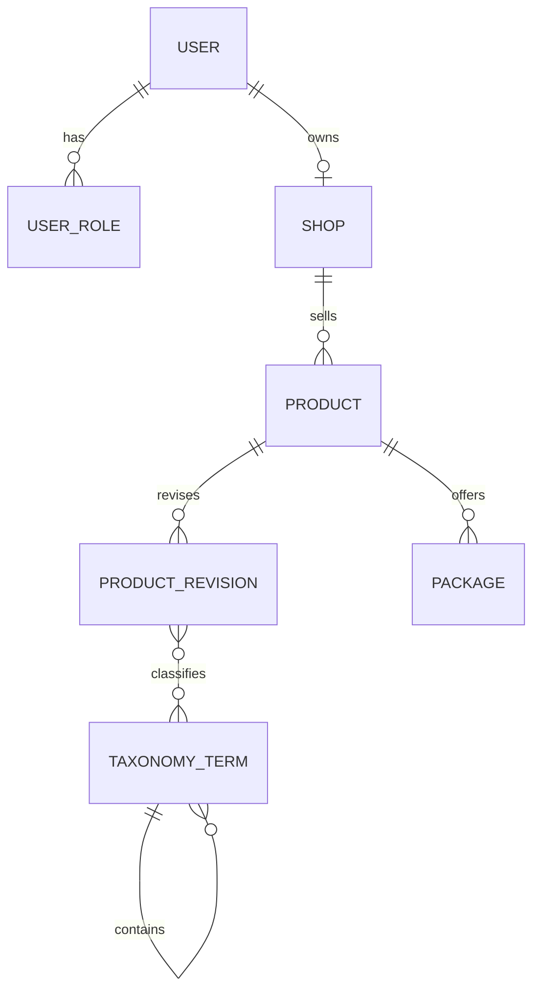
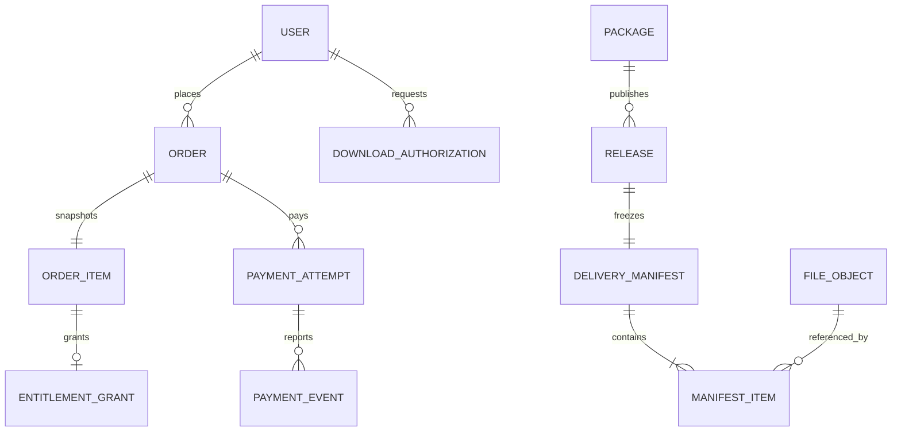

# Meteor：数据库设计 V0.1

日期：2026-09-28
状态：V2 已实现的数据库基线，以及 C1 后续迁移边界。本文描述关系与不变量，不代表计划表均已实现。

## 1. 当前已实现结构

- `users` 与 `user_roles` 分离，允许创作者同时作为普通买家。
- 当前规则为一个用户最多拥有一个店铺，由 `shops.owner_user_id` 唯一约束保证。
- `products` 保存稳定交易身份和在售状态；标题、简介与审核状态保存在 `product_revisions`。
- `products.current_published_revision_id` 指向当前公开内容。草稿和审核中的 Revision 不会覆盖线上内容。
- `taxonomy_terms` 使用稳定数字主键，`slug` 是唯一业务标识；`parent_id` 支持一级分类和小类。
- 分类关联到 Product Revision，使待审核的分类调整不会提前影响线上目录。
- `packages` 是稳定售卖档位；金额使用最小货币单位 `price_cents`，当前只允许 CNY。

## 2. C1 目标关系

后续迁移按业务阶段逐步增加，不提前创建没有实现代码支撑的空表。

建议迁移顺序：

1. 身份认证需要的约束与开发账号数据；
2. 商品草稿写入、Revision 提交与店铺隔离；
3. `orders`、`order_items` 与创建请求幂等键；
4. `payment_attempts`、`payment_events` 与来源权益；
5. Release、不可变交付清单、文件对象与下载授权记录。

## 3. 必须保持的不变量

1. 商品是稳定交易身份；修改展示内容必须创建或修改未发布 Revision。
2. 同一商品只有审核通过的 Revision 才能成为 `current_published_revision_id`。
3. 商品下架停止新购，但不删除历史订单、权益或发布版本。
4. 订单项保存商品名、套餐名、金额和币种快照；商品改价不能改变历史订单。
5. 客户端金额不可信，订单金额只能由服务端按套餐计算。
6. 每个支付提供方事件键唯一；重复事件不能重复改变订单或创建权益。
7. 每条权益必须指向具体订单项来源，退款只撤销对应来源。
8. Release、Manifest 和正式文件发布后不可原地覆盖；变更必须创建新 Release。
9. 分类 slug 可以演进，外键只引用稳定的 `taxonomy_terms.id`。
10. 前端角色、路由和本地存储都不能作为服务端授权依据。

## 4. 迁移规则

- Flyway 迁移位于 `backend/src/main/resources/db/migration`。
- 已应用的版本迁移不得修改；所有结构变化新增更高版本脚本。
- 本地旧数据库由版本 1 baseline 接管，V2 将原商品数据迁移到 Revision 与 Taxonomy 结构。
- 正式环境禁用自动 baseline，只允许对已确认的空库或具有正确历史表的数据库执行迁移。
- 删除列或拆表采用“新增结构 → 迁移数据 → 切换代码 → 验证 → 删除旧结构”的顺序。
- 每次包含删除或不可逆转换的迁移，执行前保留数据库备份并记录回滚方法。

## 5. 当前尚未实现

真实登录、商品写接口、订单、支付、权益、Release、文件与下载授权仍未实现。V2 只是为这些能力建立稳定的数据基础，不能在简历中写成交易闭环已经完成。
