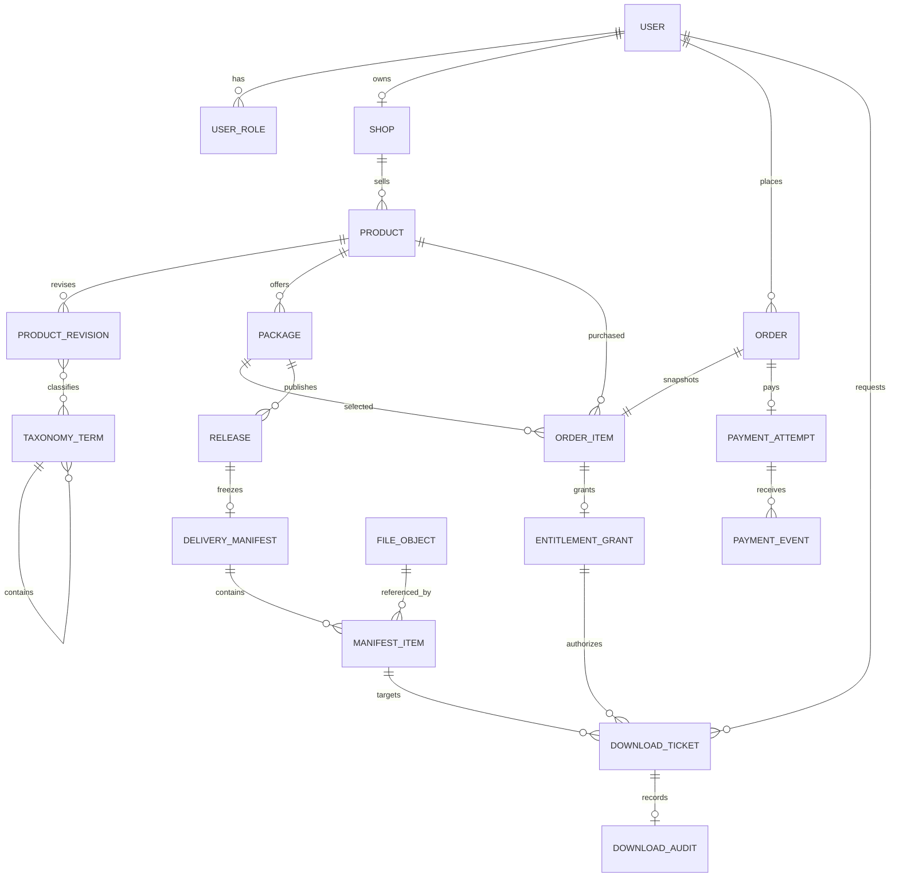
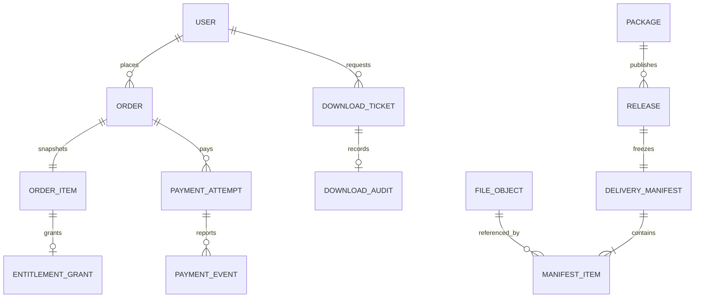

# Meteor：数据库设计 V1.0

## 2026-10-15：素材商品验收

V13 只向已有表新增四组图片商品数据与分类关系，没有新增实体或列。各表 9101～9104 为本次预置保留 ID；遇到冲突会报错，不用 upsert 覆盖已有记录。已执行迁移保持不变。详见[素材接入说明](31-已有展示素材接入真实商品.md)。

日期：2026-09-28
状态：V13 已实现的数据库基线（V13 仅新增预置数据），以及 C1 后续迁移边界。本文描述关系与不变量，不代表计划表均已实现。

## 1. 当前已实现结构

- `users` 与 `user_roles` 分离，允许创作者同时作为普通买家。
- 当前规则为一个用户最多拥有一个店铺，由 `shops.owner_user_id` 唯一约束保证。
- `products` 保存稳定交易身份和在售状态；标题、简介与审核状态保存在 `product_revisions`。
- `products.current_published_revision_id` 指向当前公开内容。草稿和审核中的 Revision 不会覆盖线上内容。
- `taxonomy_terms` 使用稳定数字主键，`slug` 是唯一业务标识；`parent_id` 支持一级分类和小类。
- 分类关联到 Product Revision，使待审核的分类调整不会提前影响线上目录。
- `packages` 是稳定售卖档位；金额使用最小货币单位 `price_cents`，当前只允许 CNY。
- V3 为本地演示账号写入 BCrypt 密码哈希；后端已能从 `users`、`user_roles` 加载账号并建立 Spring Security Session。演示账号认证默认关闭，只有本地显式设置 `METEOR_DEMO_ACCOUNTS_ENABLED=true` 才允许登录。
- V4 创建 `orders` 与 `order_items`。当前订单只支持一个套餐项，保存商品／套餐名称、单价和币种快照；`(user_id, idempotency_key)` 唯一约束防止同一用户重复建单。
- V5 创建 `payment_attempts` 与 `payment_events`。当前只提供 `LOCAL_TEST` 测试支付适配器：同订单一笔支付尝试，事件键和交易键分别唯一；金额／币种必须匹配订单，成功事件把订单从待支付转为 `PAID`。
- 支付处理事务通过 `SELECT ... FOR UPDATE` 锁定目标订单，使同一订单的并发事件串行判断状态；数据库唯一约束继续作为事件键和交易键的最后防线。
- `LOCAL_TEST` HTTP 入口默认关闭，只有本地显式设置 `METEOR_TEST_PAYMENT_ENABLED=true` 才注册；该开关不是实际支付安全方案。
- V6 为订单项补充 `shop_name` 与 `access_policy` 快照并创建 `entitlement_grants`。每条 Grant 必须指向一个订单项；`UNIQUE(order_item_id)` 保证同一购买来源最多发放一次，`ACTIVE`／`REVOKED` 与 `revoked_at` 由检查约束保持一致。
- 支付事务在订单变为 `PAID` 后用条件插入幂等创建 Grant；只有订单属于当前用户且状态为 `PAID` 才能产生权益。V7 另行回填迁移前的历史已支付订单，已执行的 V6 没有被修改。
- V8 把固定演示账号默认锁定并替换已知密码；应用启动时只有显式开启本地演示开关才恢复演示凭据，否则再次强制锁定。
- V9 创建 Package 级 `releases`。套餐内发布序号与展示标签分别唯一；PUBLISHED／DISABLED 与禁用时间保持一致。
- V10 创建 `delivery_manifests`、`manifest_items` 与 `file_objects`。一个 Release 最多一份冻结清单；位置和文件在同一清单内分别唯一；FileObject 保存内部定位、媒体类型、真实字节数和 SHA-256，内部 `storage_key` 不进入 API。
- V11 不修改已执行的 V4，而是先移除旧检查约束，再把历史订单 `PENDING → PENDING_PAYMENT`、`CANCELLED → CLOSED`，最后重建默认值和四状态检查约束。Java 使用 `OrderStatus` enum，避免订单状态继续以任意字符串传播。
- V12 创建 `download_tickets` 与 `download_audits`。票据保存 token 的 SHA-256、用户、Grant、Release、ManifestItem、FileObject、状态和五分钟到期时间；原 token 只返回浏览器。审计一对一记录服务端已经准备文件响应，不声称浏览器已经保存文件。

## 2. C1 目标关系

后续迁移按业务阶段逐步增加，不提前创建没有实现代码支撑的空表。

建议迁移顺序：

1. 身份认证需要的约束与开发账号数据；
2. 商品草稿写入、Revision 提交与店铺隔离；
3. `orders`、`order_items` 与创建请求幂等键（V4 已实现最小切片）；
4. `payment_attempts`、`payment_events` 与来源权益（V5 支付、V6／V7 权益与历史回填均已实现）；
5. Release、不可变交付清单、文件对象（V9／V10）与下载票据／审计（V12）。

## 3. 必须保持的不变量

1. 商品是稳定交易身份；修改展示内容必须创建或修改未发布 Revision。
2. 同一商品只有审核通过的 Revision 才能成为 `current_published_revision_id`。
3. 商品下架停止新购，但不删除历史订单、权益或发布版本。
4. 订单项保存商品名、套餐名、金额和币种快照；商品改价不能改变历史订单。
5. 客户端金额不可信，订单金额只能由服务端按套餐计算。
6. 每个支付提供方事件键唯一；重复事件不能重复改变订单或创建权益。
7. 每条权益必须指向具体订单项来源，退款只撤销对应来源。
8. Release、Manifest 和正式文件发布后不可原地覆盖；变更必须创建新 Release。
9. 分类 slug 可以演进，外键只引用稳定的 `taxonomy_terms.id`。
10. 前端角色、路由和本地存储都不能作为服务端授权依据。
11. 下载 token 原文不得落库；同一票据最多消费一次，消费时必须重新检查当前权益和发布状态。
12. 下载审计的 `FILE_RESPONSE_PREPARED` 只证明服务端准备了响应，不能当作客户端完整保存回执。

## 4. 迁移规则

- Flyway 迁移位于 `backend/src/main/resources/db/migration`。
- 已应用的版本迁移不得修改；所有结构变化新增更高版本脚本。
- 本地旧数据库由版本 1 baseline 接管，V2 将原商品数据迁移到 Revision 与 Taxonomy 结构。
- 正式环境禁用自动 baseline，只允许对已确认的空库或具有正确历史表的数据库执行迁移。
- 删除列或拆表采用“新增结构 → 迁移数据 → 切换代码 → 验证 → 删除旧结构”的顺序。
- 每次包含删除或不可逆转换的迁移，执行前保留数据库备份并记录回滚方法。

## 5. 当前尚未实现

后端数据库账号登录、退出、当前用户查询与 CSRF 防护已经实现；注册、密码修改／重置尚未实现。订单核价、快照与幂等，本地测试支付、来源权益、内容库、Release、冻结文件清单和五分钟一次性下载均已实现；Classpath 文件使用固定内存的流式完整性校验与 Spring `Resource` 响应。退款、生产对象存储、对象版本校验、Range／断点续传、限流和完整失败审计仍未实现；简历可以写“本地测试支付到一次性受控下载的闭环”，不能写成真实支付或生产文件平台已经上线。

## 2026-10-14 商家首次发布的表复用

本轮仍为 V12，无新迁移。创建草稿使用 products／product_revisions；发布使用既有 packages、releases、delivery_manifests、manifest_items，并复用 file_objects。file_objects 没有 owner 字段，资格必须沿既有交付清单连接到当前用户的 ACTIVE Shop，不能只按文件 ID 校验。发布后的商品指针指向自己的正式修订；单套餐的首个正式版本为 1.0.0。写入顺序、生成主键和失败回滚见 [发布专题](28-创作者商品草稿与发布任务-V1.0.md)。
