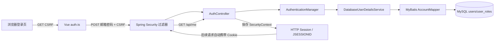
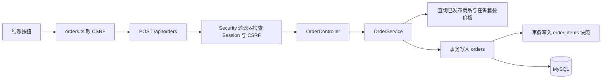
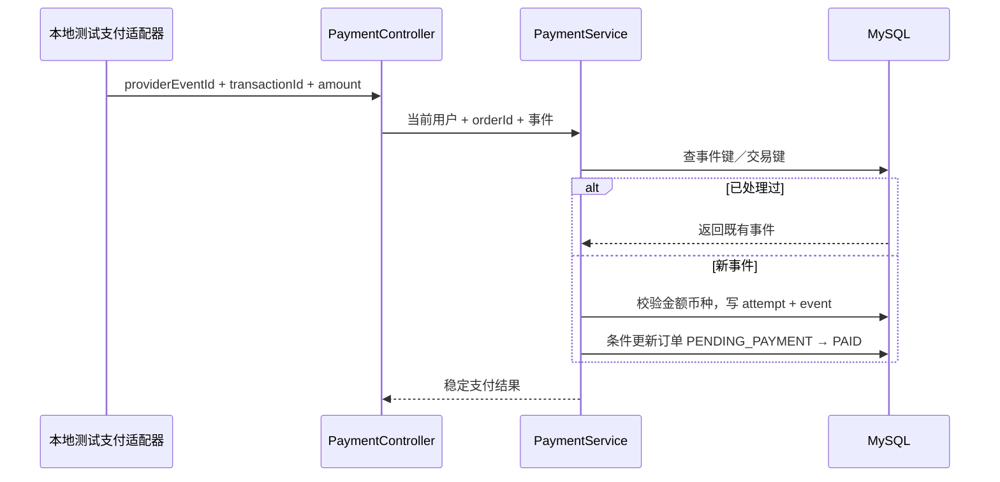

# Meteor：零基础学习与面试实战手册 V1.0

日期：2026-10-03
目标：让你能够解释、运行、修改并面试表达自己参与完成的 Meteor 项目。

这不是“把所有 Java 知识读完再开始”的课程，而是围绕项目里已经存在的一条真实链路学习：



## 1. 先知道项目现在到底完成了什么

当前已经可以真实演示：

- Spring Boot 读取公开商品列表和详情。
- MySQL 通过 Flyway 管理 V1～V11 迁移；V4 创建订单，V5 创建测试支付，V6 创建权益，V7 回填历史已支付订单，V8 默认锁定固定演示凭据，V9 创建 Package 发布版本，V10 创建冻结交付清单与文件对象元数据，V11 统一订单状态术语。
- `buyer@meteor.local` 和 `creator@meteor.local` 使用 BCrypt 密码登录。
- Spring Security 建立 Session，浏览器后续请求通过 `JSESSIONID` 恢复身份。
- 前端登录页调用 CSRF、登录和 `/api/me` 接口。
- 登录后可以调用 `POST /api/orders` 创建订单；后端负责套餐核价、订单快照和幂等键。
- 显式开启本地测试支付后，可以调用 `POST /api/orders/{orderId}/test-payment` 模拟成功事件；后端负责金额／币种校验、事件幂等和 `PENDING_PAYMENT → PAID` 状态转移。
- 支付成功会在同一事务中幂等创建来源指向订单项的 ACTIVE Grant；内容库、订单列表和订单详情读取真实后端数据。
- 41 个后端测试通过，覆盖登录、订单、测试支付、权益、内容库，以及有效 Grant 下的 Release／Manifest 访问隔离。

当前还没有完成：

- 测试支付只实现了本地适配器；真实支付签名、支付超时和退款仍未完成。
- 生产私有对象存储、大文件流、断点续传、失败下载审计和限流；当前只有 Classpath 小文件的一次性受控下载。
- 退款后自动撤销来源权益。
- 创作者发布的后端写接口。

所以你现在可以把项目说成“完成商品目录、数据库会话认证、订单创建、本地测试支付、购买权益、版本清单到 Classpath 小文件一次性下载的闭环”，不能说成“完成真实支付与生产对象存储”。权益、版本、清单和下载的逐层学习分别见 [购买权益闭环](14-购买权益闭环与面试学习手册-V1.0.md)、[Release](15-发布版本Release学习手册-V1.0.md)、[Manifest](16-交付清单与文件对象学习手册-V1.0.md) 和 [第六课](24-第六课-一次性下载票据与受控文件响应-V1.0.md)。

## 2. 第一次运行

后端需要本机 MySQL 8.0 服务运行，前端不需要先启动后端也能浏览公开页面。

### 后端

```powershell
cd backend
.\mvnw.cmd clean test
$env:METEOR_DEMO_ACCOUNTS_ENABLED='true'
$env:METEOR_TEST_PAYMENT_ENABLED='true'
.\mvnw.cmd spring-boot:run
```

看到 `Started MeteorApplication` 后，后端监听 `http://localhost:8080`。
演示账号认证与 `test-payment` 都是本地学习入口，默认关闭；只有练习对应链路时才设置上面的环境变量，部署时不要开启。

### 前端

另开一个终端：

```powershell
cd frontend
npm ci
npm run dev
```

浏览器访问 `http://localhost:5173/`。Vite 会把 `/api/*` 转发到 8080。

### 本地账号

```text
买家：buyer@meteor.local / password
创作者：creator@meteor.local / password
```

这是本地学习账号，不能用于部署。

### 用 PowerShell 验证一次下单

登录后，先重新请求一次 CSRF token，再把 Cookie 和 token 一起提交订单。请求体没有金额字段，这是刻意设计：

```powershell
@{
  productId = 1001
  packageId = 2001
  idempotencyKey = 'my-first-order-001'
} | ConvertTo-Json
```

第一次请求应返回 `201` 和 `status: "PENDING_PAYMENT"`。用同一个用户、同一个幂等键再次提交，应返回相同订单 ID；改成 `packageId: 2002` 再提交，应返回 `409 IDEMPOTENCY_CONFLICT`。

## 3. 一次登录请求到底发生了什么

### 第一步：先拿 CSRF token

前端调用 `GET /api/auth/csrf`。后端返回三个字段：

| 字段 | 用途 |
| --- | --- |
| `headerName` | 通常是 `X-CSRF-TOKEN`，告诉前端请求头叫什么 |
| `parameterName` | 表单场景使用的参数名 |
| `token` | 服务器期望收到的随机值 |

CSRF 的直觉解释：浏览器会自动携带 Cookie，恶意网站可能诱导浏览器发送请求；CSRF token 要求真正的前端额外证明自己知道这次会话的随机值。

### 第二步：提交登录

`src/api/auth.ts` 发送：

```json
{
  "email": "buyer@meteor.local",
  "password": "password"
}
```

并把 token 放入请求头。Spring Security 先检查 CSRF，再把登录请求交给 `AuthenticationManager`。

### 第三步：查数据库但不保存明文密码

`DatabaseUserDetailsService` 调用 `AccountMapper`：

```sql
SELECT id, email, password_hash, display_name, status
FROM users
WHERE email = ?;
```

数据库里保存的是 BCrypt 哈希。登录时不是“解密哈希”，而是用同样的算法检查用户输入的密码是否匹配哈希。

### 第四步：把身份放进 Session

登录成功后，后端把认证结果保存到 `SecurityContext`，再持久化到 HTTP Session。响应通过 Cookie 给浏览器一个 `JSESSIONID`。

注意：Cookie 里不是“用户角色文本”，而是 Session 的标识。下一次请求带上 Cookie，服务端再从 Session 恢复身份。

### 第五步：`/api/me` 返回当前用户

前端调用 `GET /api/me`，后端从当前请求的 Authentication 取得用户，而不是相信 URL、localStorage 或前端传来的 userId。

这就是服务端授权和前端显示身份的区别：前端可以影响页面显示，不能决定服务端是否允许访问。

### 第六步：创建订单时谁决定金额



请求里只有 `productId`、`packageId` 和 `idempotencyKey`，没有 `amount`。原因很简单：浏览器里的数字可以被修改。服务端重新查 `packages.price_cents`，再把商品标题、套餐名称、单价写入订单明细；这就是“服务端核价”和“订单快照”。

如果请求因为网络超时被重试，服务端先用 `(当前用户, idempotencyKey)` 找旧订单。相同商品和套餐直接返回旧订单，不再插入；同一个键却换了套餐，返回 409，而不是猜用户想买哪一个。

### 第七步：为什么支付事件要单独落库



`payment_attempts` 表示“这笔订单尝试过哪次支付”；`payment_events` 表示“提供方通知过什么事实”。两者都不是前端的“支付成功按钮”。事件先查唯一键，再在事务里校验金额并更新订单，所以重复通知不会重复改变业务状态。

## 4. 按文件阅读，不要一次读完整项目

推荐顺序：

1. [frontend/src/api/auth.ts](../frontend/src/api/auth.ts)：先看浏览器发送了什么。
2. [frontend/src/pages/BuyerPages.vue](../frontend/src/pages/BuyerPages.vue)：看登录表单如何调用 API。
3. [backend/src/main/java/dev/meteor/auth/controller/AuthController.java](../backend/src/main/java/dev/meteor/auth/controller/AuthController.java)：看 HTTP 请求如何进入 Java。
4. [backend/src/main/java/dev/meteor/auth/security/SecurityConfig.java](../backend/src/main/java/dev/meteor/auth/security/SecurityConfig.java)：看哪些接口公开、哪些接口需要登录。
5. [backend/src/main/java/dev/meteor/auth/security/DatabaseUserDetailsService.java](../backend/src/main/java/dev/meteor/auth/security/DatabaseUserDetailsService.java)：看数据库账号如何变成 Spring Security 用户。
6. [backend/src/main/resources/mapper/AccountMapper.xml](../backend/src/main/resources/mapper/AccountMapper.xml)：看 Java Mapper 最终执行的 SQL。
7. [backend/src/main/resources/db/migration/V3__seed_local_login_accounts.sql](../backend/src/main/resources/db/migration/V3__seed_local_login_accounts.sql)：看演示账号如何进入数据库。
8. [backend/src/test/java/dev/meteor/auth/controller/AuthControllerWebTest.java](../backend/src/test/java/dev/meteor/auth/controller/AuthControllerWebTest.java)：看行为应该如何被验证。
9. [backend/src/main/java/dev/meteor/order/service/OrderService.java](../backend/src/main/java/dev/meteor/order/service/OrderService.java)：看服务端核价、幂等复用和订单快照。
10. [backend/src/main/resources/db/migration/V4__create_orders.sql](../backend/src/main/resources/db/migration/V4__create_orders.sql)：看数据库如何强制订单不变量。
11. [backend/src/test/java/dev/meteor/order/service/OrderServiceTest.java](../backend/src/test/java/dev/meteor/order/service/OrderServiceTest.java)：看订单业务规则如何被单元测试表达。
12. [backend/src/main/java/dev/meteor/payment/service/PaymentService.java](../backend/src/main/java/dev/meteor/payment/service/PaymentService.java)：看支付事件如何校验金额、交易和订单状态。
13. [backend/src/main/resources/db/migration/V5__create_test_payments.sql](../backend/src/main/resources/db/migration/V5__create_test_payments.sql)：看事件键和交易键如何由数据库保证唯一。
14. [backend/src/test/java/dev/meteor/payment/service/PaymentServiceTest.java](../backend/src/test/java/dev/meteor/payment/service/PaymentServiceTest.java)：看重复事件和错金额如何变成测试。
15. [frontend/src/api/payments.ts](../frontend/src/api/payments.ts)：看结果页如何调用本地测试支付，不把测试按钮伪装成真实收款。

每读一个文件，回答三个问题：

- 它接收什么输入？
- 它把结果交给谁？
- 如果失败，谁负责返回错误？

## 5. 你必须亲自完成的五个小实验

### 实验 A：观察公开与受保护接口

在后端启动后运行：

```powershell
Invoke-WebRequest http://localhost:8080/api/products
Invoke-WebRequest http://localhost:8080/api/me
```

第一个应成功，第二个应返回 401。写下原因：商品目录是公开资源，当前用户是受保护资源。

### 实验 B：观察 Session

用浏览器登录后打开开发者工具 Network：

1. 找到 `POST /api/auth/login`。
2. 看响应是否设置 `JSESSIONID`。
3. 找到 `GET /api/me`。
4. 看请求是否自动携带 Cookie。

不要只看页面“登录成功”，要在 Network 面板里找到这两个请求。

### 实验 C：观察 CSRF

删掉登录请求中的 `X-CSRF-TOKEN`，再提交一次。预期结果是 403，而不是“密码错误”。这说明安全检查有层次：先过 CSRF，再验证账号密码。

### 实验 D：做一个小变式

把 `AuthControllerWebTest` 中的邮箱改成大写并加首尾空格，确认测试仍然通过；再把密码改成 ` password`，确认登录失败。这样你是在理解输入规范化，而不是只复制代码。

### 实验 E：观察测试支付的幂等性

先创建一个订单，再发送一次测试支付事件。把完全相同的 `providerEventId` 和 `providerTransactionId` 再发送一次，预期返回相同的事件 ID，数据库不会多一条事件。

然后保持订单金额为 1900，把请求中的 `amountCents` 改成 3900；预期返回 409 `PAYMENT_CONFLICT`，订单不会变成新的金额。记住：支付提供方说“成功”也不能绕过本地订单金额校验。

## 6. 面试表达模板

不要背“我用了 Spring Security”。要按问题回答：

**问：为什么没有把登录状态放 localStorage？**

答题方向：localStorage 只是前端可读数据，不能作为服务端授权依据；当前实现使用 HTTP Session 保存服务端 SecurityContext，后续请求由服务端恢复 Authentication。前端的本地角色只用于尚未接入完整后端的演示页面。

**问：为什么需要 CSRF？**

答题方向：Session Cookie 会被浏览器自动携带，跨站请求可能借用这个 Cookie；CSRF token 要求请求同时提供会话关联的随机值。当前登录和退出都是修改状态的 POST，因此保留 CSRF 检查。

**问：数据库为什么保存 password_hash，而不是密码？**

答题方向：密码不应可逆保存；BCrypt 带随机盐，数据库泄露时不能直接读出原密码。登录是对输入密码进行哈希匹配，而不是解密。

**问：前端路由守卫能不能保证权限？**

答题方向：不能。路由守卫只改善用户体验；真正的权限必须在服务端根据 Session、角色和资源归属判断。后续订单和下载接口必须重复做服务端检查。

**问：为什么创建订单时不相信前端传来的金额？**

答题方向：浏览器输入可以被用户修改，前端金额只能用于展示。当前接口只接受商品、套餐和幂等键，服务端重新读取在售套餐价格，并把商品标题、套餐名称、单价写入订单明细快照；这样金额由可信边界产生，历史订单也不会随商品改价漂移。

**问：幂等键解决什么问题？**

答题方向：网络超时或用户重复点击可能让同一个购买意图到达后端多次。当前实现按用户和幂等键查询已有订单，并在数据库建立唯一约束；相同请求返回同一订单，不同商品／套餐复用同一键则返回 409，避免静默产生错误订单。

**问：为什么还要保存支付事件，不能收到回调就直接把订单改成 PAID？**

答题方向：外部支付通知可能重复、乱序或在网络重试后再次到达。当前实现先用提供方事件键和交易键做唯一约束，再在本地事务中校验订单金额／币种，写入 `payment_attempts`、`payment_events`，最后条件更新订单状态。这样能回答“这次通知是否已经处理”和“同一交易是否已经绑定其他订单”。

**问：为什么本地测试支付不能等同真实支付？**

答题方向：本地适配器只验证业务系统的事件处理、金额校验和幂等，不包含真实支付商的签名、异步网络、退款和对账。简历中应准确写成“测试支付适配器”，不能说接入了真实支付。

## 7. 未来交易闭环的学习顺序

每一阶段都必须留下“代码 + 测试 + 自己的复述”：

| 阶段 | 要实现 | 你要能解释 |
| --- | --- | --- |
| M2 | Session 登录 | Cookie、Session、CSRF、BCrypt、角色 |
| M3 | 订单创建 | 服务端定价、订单快照、幂等键、事务边界 |
| M4 | 测试支付 | 事件唯一键、重复回调、订单状态流转 |
| M5 | 权益与内容库 | 为什么不能只保存 `has_access=true` |
| M6 | 受控下载 | 资源归属、短时令牌、过期和撤权 |
| M7 | 故障测试 | 事务回滚、恢复、重复和乱序事件 |

项目的简历价值来自 M3～M7 的可验证业务规则，不来自页面数量。

## 8. AI 协作规则：防止项目不属于你

以后每完成一个功能，必须做以下动作：

1. 让 AI 先用 5 句话说清改动目标和不做什么。
2. 你先预测一个正常结果和一个失败结果。
3. 跑测试或手工请求，记录实际结果。
4. 让 AI 只解释你看不懂的 1～3 个文件，不要一次讲全仓库。
5. 你自己改一个小变量、错误码或断言，再重新运行。
6. 用 2 分钟口述“请求从哪里进来、经过什么、在哪里失败”。

如果你不能解释某个功能，就暂时不要把它写进简历；先把它降级为“项目中正在学习的代码”。

## 9. 已完成阶段的验证定义

本轮完成以下内容就算有效：

- 前端登录页调用真实后端 Session。
- 前端构建通过。
- 后端 41 项测试通过。
- 本机 MySQL 实际登录、恢复 Session、退出验证通过。
- 你能沿着本手册解释一条登录请求。
- 本机 MySQL 实际创建订单、重复幂等请求和冲突请求均已验证。
- 本机 MySQL 实际应用 V10；测试支付首次成功、重复事件返回同一 Grant、跨用户订单与 Release／Manifest 访问返回 404 均已验证。

Release、不可变文件清单和一次性下载最小切片已经完成：签发与消费都会重新核对 ACTIVE Grant，文件响应前校验字节数和 SHA-256。当前仍不具备生产对象存储、大文件流、Range 或真实收款能力。
