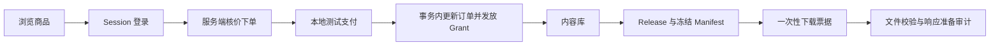

# Meteor 零基础项目学习路线 V1.0

> 适用对象：需要尽快把 Meteor 的真实实现学懂，并能在简历和面试中准确说明的人。
>
> 本文只安排学习顺序和过关标准。业务细节在第 1～7 课，语法在语法手册，简历表达在证据清单；这里不重复讲一遍。

## 0. 到校当天：90 分钟启动

目标：亲手运行项目、走通一次页面流程，并能找到一条请求的六层路径。当天不要顺序阅读所有文档。

### 0～10 分钟：检查环境

在仓库根目录运行：

```powershell
.\scripts\check-learning-environment.ps1
.\scripts\check-learning-environment.ps1 -Verify
```

脚本检查 Java 21、Node.js、npm、MySQL、Maven Wrapper、前端依赖和本地端口。当前机器若没有可用 Docker，2 项 Testcontainers 测试会跳过；这不影响第一天学习，但不能把它说成真实容器测试已经跑通。

### 10～30 分钟：启动并操作

确认 MySQL 已初始化，然后打开两个终端：

```powershell
# 终端一
cd backend
$env:METEOR_DEMO_ACCOUNTS_ENABLED='true'
$env:METEOR_TEST_PAYMENT_ENABLED='true'
.\mvnw.cmd spring-boot:run
```

```powershell
# 终端二
cd frontend
npm install
npm run dev
```

访问 `http://localhost:5173/`，使用 `buyer@meteor.local / password`，完成一次：

```text
商品详情 → 下单 → 本地测试支付 → 内容库 → 展开版本和清单 → 下载
```

两个开关只用于本地学习。部署环境不能开启固定演示账号和测试支付。

### 30～60 分钟：追公开商品详情

按顺序打开：

```text
frontend/src/api/products.ts
  → ProductController.java
  → ProductQueryService.java
  → ProductMapper.java
  → mapper/ProductMapper.xml
  → products / product_revisions / shops / packages
```

每一层只回答：收到什么、返回什么、失败由谁处理。语法不懂时在[项目代码语法与面试问答](12-项目代码语法与面试问答-V1.0.md)搜索关键词，不展开读完整本。

### 60～80 分钟：关文档画图

自己画出两条链：

```text
页面 → API Client → Controller → Service → Mapper → MySQL
Product → Package → Order Item → Grant → Release → Manifest → File Object
```

画不出的箭头标问号，再回代码找证据。

### 80～90 分钟：记录停点

只记录下面五行：

```text
实际打开的页面：
追到的接口：
能解释的一条 SQL：
仍说不清的两个词：
下次从哪个文件继续：
```

过关标准：不看文档画出第一条六层路径，并能在仓库中重新找到商品详情链路。

## 1. 当前要掌握的项目主线（10 分钟）

Meteor 已实现并验证的本地主线是：



已经实现并有证据：公开商品、数据库账号登录、订单、默认关闭的本地测试支付、权益、内容库、版本清单、Classpath 小文件下载、统一错误响应和本地质量门禁。

尚未实现：真实支付、退款、创作者后端写接口、生产对象存储、Range／断点续传、传输失败审计和托管 CI。Classpath 文件已经使用固定内存校验与 Spring `Resource` 响应；Testcontainers 代码已接入，但本机 Docker 不可用时仍会跳过 2 项。

第一次只记住四个设计点：

1. 金额由服务端查询，浏览器不能决定成交价。
2. 幂等键和数据库唯一约束处理重复请求。
3. 支付成功与 Grant 发放在同一事务中完成。
4. Release、Manifest 和文件访问都从当前 Session 用户逐层重新授权。

## 2. 每节课固定怎么学（10 分钟）

每次只走一个闭环：

1. 操作页面，记录输入和结果。
2. 在浏览器 Network 找到 URL、方法、状态码和 JSON。
3. 沿 API Client → Controller → Service → Mapper → 表定位代码。
4. 只补这条链出现的 Java、SQL、TypeScript 或 Vue 语法。
5. 找一个失败路径，说明由哪一层防御。
6. 找对应测试，说明它能证明什么、不能证明什么。
7. 关掉教程，画图并口述 1 分钟。

“读完”不算通过。关掉文档后仍能操作、定位、解释和做小修改，才算掌握。

## 3. 七天主线

每天建议 2～3 小时。时间不足时保留页面操作、代码定位、画图和口述，先不读扩展材料。

| 天 | 课程 | 当天产出 | 过关标准 |
| --- | --- | --- | --- |
| Day 1 | [第二课：商品查询与后端分层](20-第二课-商品查询与后端分层-V1.0.md) | 六层请求图 | 能从页面重新定位到 SQL |
| Day 2 | [第一课：登录全栈请求](19-第一课-从登录页面看懂一次全栈请求-V1.0.md) | 登录时序图 | 能解释 Session、CSRF、401 和 403 |
| Day 3 | [第三课：订单创建与幂等](21-第三课-订单创建与幂等-V1.0.md) | 下单链路图 | 能解释核价、快照、重试和冲突 |
| Day 4 | [第四课：测试支付与事务](22-第四课-测试支付与事务内权益发放-V1.0.md) | 支付事务图 | 能解释行锁、事件去重和同事务发放 |
| Day 5 | [第五课：内容库与授权](23-第五课-内容库与逐层资源授权-V1.0.md) | 授权判断图 | 能区分 Grant、Release、Manifest、FileObject |
| Day 6 | [第六课：一次性下载](24-第六课-一次性下载票据与受控文件响应-V1.0.md) | 下载时序图 | 能解释 token 哈希、二次授权和摘要校验 |
| Day 7 | [第七课：真实 MySQL 集成测试](25-第七课-Testcontainers真实MySQL集成测试-V1.0.md) | 测试分层表 | 能区分 Stub、MockMvc、集成测试和浏览器证据 |

课程编号按编写顺序保留；学习时先走公开商品，再学登录，理解会更顺。

每一课已经按 10～20 分钟小节拆分。一天没有学完时，记录当前小节和下一次继续的文件，不需要赶进度。

## 4. 14 天安排

| 日期 | 工作 | 可检查结果 |
| --- | --- | --- |
| Day 1～7 | 每天完成上表一课 | 页面操作、链路图、1 分钟口述 |
| Day 8～10 | 随机抽三条链，不看教程定位 | 2 分钟内找到 Controller、Service、Mapper、表和测试 |
| Day 11～12 | 做三轮项目模拟面试 | 答案能回到代码和测试，明确未实现边界 |
| Day 13 | 独立完成一个小修改并运行门禁 | 能解释 Git diff 中每一行 |
| Day 14 | 对照简历证据清单定稿 | 只保留已通过定位、口述和证据检查的能力 |

## 5. 查阅入口，不重复顺序阅读

| 遇到的问题 | 打开哪里 |
| --- | --- |
| Java、Spring、SQL、Vue 或 TypeScript 语法 | [项目代码语法与面试问答](12-项目代码语法与面试问答-V1.0.md) |
| Product、Package、Grant 等术语 | [领域词汇表](../GLOSSARY.md) |
| 表、字段、外键和迁移 | [数据库设计](10-数据库设计-V1.0.md) |
| 当前完成度和技术债 | [文档导航](README.md) |
| 每次实现和验证记录 | [学习执行日志](08-学习执行日志.md) |
| 无障碍证据与未覆盖设备 | [无障碍审查报告](18-无障碍审查与修复报告-2026-10-03.md) |
| 简历表述、代码证据和禁止夸大边界 | [简历与面试证据清单](27-简历与面试证据清单-V1.0.md) |
| 当前业务和技术规则 | [总体设计](01-项目需求与总体设计-V0.4.0.md)、[核心业务设计](03-核心业务设计-V0.4.0.md) |
| 被替代文档和历史结论 | [历史归档](archive/README.md) |

主目录中的教程各自只承担一种用途：`17` 安排顺序，`19～25` 教具体链路，`12` 解释语法，`27` 管理简历证据。不要同时打开四类文档。

## 6. 调试时固定顺序（10 分钟）

1. 浏览器 Network：请求是否发出，URL、方法和状态码是什么。
2. 浏览器 Console：是否有运行时错误或未处理 Promise。
3. Controller：请求是否到达，当前用户是谁。
4. Service：哪条业务规则拒绝了请求。
5. Mapper／SQL：是否校验当前用户和资源归属。
6. 数据库：状态、唯一键、外键和迁移版本是否正确。
7. 自动化测试：先找到或补充能复现问题的测试。
8. 页面：加载、空、失败和成功状态是否互斥并可重试。
9. 无障碍：键盘、焦点、状态播报和窄屏是否仍成立。

## 7. 写进简历前的最低门槛

以下 12 项至少完成 10 项，并通过[简历与面试证据清单](27-简历与面试证据清单-V1.0.md)逐条核对：

- [ ] 3 分钟不看稿讲完整业务链。
- [ ] 画出 Vue → Controller → Service → Mapper → MySQL。
- [ ] 解释服务端核价和订单快照。
- [ ] 区分幂等键、唯一约束和按钮防重复点击。
- [ ] 解释支付事务、行锁和事件去重。
- [ ] 解释 Grant 为什么需要来源和状态。
- [ ] 解释跨账号资源为什么统一返回 404。
- [ ] 区分 Package、Release、Manifest 和 FileObject。
- [ ] 指出至少三个自动化测试及其证据边界。
- [ ] 说明真实支付、退款和生产文件服务尚未实现。
- [ ] 2 分钟内在源码中找到上述答案。
- [ ] 独立完成过一个小修改并跑通 `scripts/verify.ps1`。

简历最终措辞从证据清单选，不在本文再维护另一份模板，避免代码变化后两处内容不一致。
