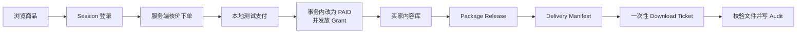

# Meteor 零基础项目学习路线 V1.0

> 适用对象：几乎没有 Java、Spring、SQL、Vue 或 TypeScript 基础，但需要尽快把本项目真正讲懂并用于求职的人。
>
> 这是一份“主路线”，不是另一份百科全书。第一次学习只顺着本文走；遇到语法再跳到对应专题手册，不从几十份文档第一页开始读。

## 1. 先说结论：你现在应该学什么

Meteor 当前最值得写进简历的是下面这条已经能运行和验证的业务链路：



图中每个方框都能落到真实页面、接口、Java 类和数据库表。第一遍只记顺序；学习对应课程时再展开细节。

你不需要先把 Java 语法书学完。正确顺序是：先知道用户做了什么，再沿真实代码走完请求，最后补这段代码里出现的语法。

当前学习优先级：

1. 能用自己的话讲完整链路，不把“本地测试支付”说成真实支付。
2. 能打开关键文件，说明 Controller、Service、Mapper、数据库分别负责什么。
3. 能解释本项目最有价值的四个设计：服务端核价、幂等、事务内发放权益、逐层资源授权。
4. 能说出测试证据和未完成边界。
5. 用第六课学完受控下载，再用第七课理解真实 MySQL 集成测试；暂停增加静态页面。

## 2. 学习规则：每次只走一个闭环

每个专题固定按七步学习：

1. **先操作页面**：知道用户看到了什么、点了什么。
2. **看请求**：找到前端 API 文件和 HTTP 方法。
3. **走后端**：Controller → Service → Mapper。
4. **看数据**：找到对应 Flyway 表、唯一约束和状态字段。
5. **补语法**：只学习刚才真实代码中出现的 Java、SQL、TypeScript、Vue 语法。
6. **看失败路径与测试**：理解为什么不是“正常情况能跑”就算完成。
7. **练口述**：用 1 分钟回答“为什么这样设计”，并明确没有实现什么。

不要把“读过文件”当作“学会”。真正过关的标准是：关掉文档后仍能画出链路、指出关键约束，并在源码中重新找到证据。

## 3. 开始前只记住 12 个词

| 词 | 在 Meteor 中的意思 | 先不要误解成 |
| --- | --- | --- |
| Product | 对外展示的一件数字作品 | 具体可购买规格 |
| Package | Product 下可购买的 Basic／Pro 套餐 | 软件安装包 |
| Order | 一次购买事实 | 支付本身 |
| Order Item | 订单中的购买项和成交快照 | 当前商品数据的引用 |
| Payment Event | 支付提供方到达的一条事实事件 | 前端按钮状态 |
| Idempotency Key | 让同一业务请求重复到达时复用结果的键 | 随机生成后就万事大吉 |
| Entitlement Grant | 用户为什么能访问某套餐的可审计依据 | `user.hasAccess=true` |
| Release | 某 Package 的一个发布版本 | Product 的营销版本号 |
| Delivery Manifest | 某 Release 冻结后的交付清单 | 临时文件列表 |
| Manifest Item | 清单中的业务条目、顺序和角色 | 物理文件本体 |
| File Object | 物理文件身份、大小、摘要和存储定位 | 可直接暴露给前端的下载地址 |
| Session | 服务端识别当前登录用户的会话 | 前端自己声明的 userId |

完整定义见 [领域词汇表](../GLOSSARY.md)。第一次不要求背英文，要求能把相邻概念分开。

## 4. 第一次学习：40 分钟拿到全局图

### 4.1 运行项目（10 分钟）

准备 Java 21、Node.js/npm 和 MySQL 8.0。仓库包含 Maven Wrapper，不要求全局安装 Maven。数据库初始化见 [根 README](../README.md)。本机后端可执行：

```powershell
cd backend
$env:METEOR_DEMO_ACCOUNTS_ENABLED='true'
$env:METEOR_TEST_PAYMENT_ENABLED='true'
.\mvnw.cmd spring-boot:run
```

另开终端：

```powershell
cd frontend
npm install
npm run dev
```

访问 `http://localhost:5173/`。本地账号：

- 买家：`buyer@meteor.local` / `password`
- 创作者：`creator@meteor.local` / `password`

两个后端开关只用于本地学习。关闭开关后演示账号应重新锁定，测试支付接口也不应存在。

### 4.2 只操作，不读代码（10 分钟）

按顺序完成：

1. 首页进入“发现”，打开商品详情。
2. 使用买家账号登录。
3. 选择一个套餐并创建订单。
4. 完成本地测试支付。
5. 进入内容库，展开版本和交付清单。
6. 打开订单详情，看状态和权益。

操作时只记三件事：输入是什么、页面发生了什么变化、失败时页面显示什么。不要同时背语法。

### 4.3 画一张图（10 分钟）

自己在纸上画：

```text
Vue 页面 → api/*.ts → Controller → Service → Mapper → MySQL
                                  ↘ 统一异常响应
```

再画数据关系：

```text
Product → Package → Order Item → Entitlement Grant
               Package → Release → Delivery Manifest → Manifest Item → File Object
```

画不出来时再查本文，不要照着抄完整图。

### 4.4 第一次口述（10 分钟）

可以直接按这个骨架说，但必须改成自己的话：

> Meteor 是一个数字作品交易与交付学习项目。买家登录后只提交商品和套餐标识，后端重新查询当前价格并保存成交快照；重复下单使用用户级幂等键处理。当前支付是默认关闭的本地测试适配器，支付成功会在同一事务中更新订单并幂等创建购买权益。内容库从当前 Session 用户和有效权益出发读取版本与冻结清单；下载使用五分钟一次性票据，消费时重新授权并核对文件摘要。真实支付、退款和生产对象存储还没有实现。

如果你能解释每个粗体概念为什么存在，就进入下一节；如果只是背下来，就先回到页面和图。

## 5. 七天速成路线

每天建议 2～3 小时。时间更少时保留“操作、链路、口述”，压缩扩展阅读。

| 天 | 主线 | 必须产出 | 过关标准 |
| --- | --- | --- | --- |
| Day 1 | 全局图 + 商品读取 | 一张组件图、一张数据图 | 3 分钟讲清项目范围 |
| Day 2 | Session 登录与 CSRF | 登录请求时序图 | 能解释为什么不能信任前端 userId |
| Day 3 | 下单、核价、快照、幂等 | 下单链路图 | 能解释重试与冲突的区别 |
| Day 4 | 测试支付、事务、行锁 | 支付事务图 | 能解释为什么 Grant 必须同事务发放 |
| Day 5 | 权益、内容库、跨账号隔离 | 授权判断图 | 能解释 404 隐藏资源存在性的理由 |
| Day 6 | Release、Manifest、文件元数据 | 交付模型图 | 能区分 Release／Manifest／FileObject |
| Day 7 | 一次性下载、无障碍、完整面试演练 | 下载时序图 + 5 分钟陈述 + 10 个追问 | 能据实说成果、证据和边界 |

## 6. Lesson 1：公开商品查询

**状态：已实现并验证。**

### 页面动作

打开 `/discover`，搜索作品并进入 `/products/1001`。

### 真实代码路径

```text
frontend/src/api/products.ts
  → backend/.../product/controller/ProductController.java
  → backend/.../product/service/ProductQueryService.java
  → backend/.../product/mapper/ProductMapper.java
  → backend/src/main/resources/mapper/ProductMapper.xml
  → products / packages / shops
```

### 在这段代码里学习的语法

- TypeScript `type`／`interface`：约束 API 返回结构，编译期发现字段拼错。
- `async`／`await`：等待 HTTP 结果；它不是另开线程的魔法。
- Java `record`：表达只承载返回数据的 DTO。
- 构造器注入：Service 明确依赖 Mapper，便于测试替换。
- MyBatis `#{}` 参数：把值作为预编译参数绑定，不用字符串拼 SQL。
- SQL `JOIN`：把商品、店铺和套餐按关系组合成页面需要的数据。

语法细节查 [项目代码语法与面试问答](12-项目代码语法与面试问答-V1.0.md)，只查正在看的关键词。

### 必须理解的失败路径

- 商品 ID 非法返回 400，不进入无意义查询。
- 商品不存在返回 404，不返回 `null` 再让前端猜。
- 列表和详情只暴露公开字段，不泄露内部存储信息。

### 面试可以怎么说

“我按业务模块组织 Controller、Service、Mapper；Service 负责输入和不存在语义，Mapper 只负责数据库查询，统一异常处理把领域异常转换为稳定 API 错误。”

不要说“做了完整搜索引擎”；当前是数据库目录查询，不是 Elasticsearch。

## 7. Lesson 2：Session 登录与 CSRF

**状态：数据库账号登录、BCrypt、Session、CSRF 已实现；注册和找回密码未实现。**

### 页面动作

访问 `/login`，使用买家账号登录，再刷新 `/library`，确认会话能恢复。

### 真实代码路径

```text
frontend/src/api/auth.ts
  → AuthController.java
  → DatabaseUserDetailsService.java
  → AccountMapper.java / AccountMapper.xml
  → users / user_roles
  → SecurityConfig.java
```

### 在这段代码里学习的语法与框架概念

- Vue `ref`：保存输入、加载和错误状态；模板通过 `.value` 对应的响应式值更新。
- `try / catch / finally`：成功、失败和“无论如何结束 loading”三条路径。
- Spring 注解：`@RestController` 暴露 HTTP 接口，`@PostMapping` 映射请求。
- BCrypt：数据库存哈希，不存明文密码；同一密码每次哈希可以不同。
- HTTP Session：浏览器持有会话 Cookie，后端从 SecurityContext 得到当前用户。
- CSRF：Cookie 会被浏览器自动携带，因此写请求还要带服务端签发的 token。

### 必须理解的安全边界

- 不能从请求体接受 `userId` 后直接当登录用户。
- 登录成功要更换 Session ID，降低会话固定攻击风险。
- 登录／退出后要轮换 CSRF token。
- 固定演示账号默认锁定，只有本地开关开启才恢复。

### 一分钟回答

“项目使用服务端 Session 识别用户，前端参数不能作为身份依据。登录时从数据库读取 BCrypt 哈希验证密码，成功后把认证上下文写入 Session；写请求还校验 CSRF。演示账号通过默认关闭的配置开关启用，避免部署时暴露固定密码。”

## 8. Lesson 3：服务端核价、订单快照与幂等

**状态：已实现并验证，包括并发唯一键冲突恢复。**

### 页面动作

在商品详情选择套餐并创建订单。快速重复提交相同请求，观察返回同一订单；使用同一个幂等键改买另一套餐，应得到冲突。

### 真实代码路径

```text
frontend/src/api/orders.ts
  → OrderController.java
  → OrderService.java
  → OrderMapper.java
  → V4__create_orders.sql
  → orders / order_items
```

### 核心设计

前端只提交商品、套餐和幂等键，不能提交最终价格。后端重新查询在售套餐，写入标题、套餐名、单价、币种等成交快照。

数据库唯一约束 `(user_id, idempotency_key)` 是最终并发防线。应用先查能改善常见重试体验，但不能替代唯一约束；两个请求仍可能同时“查不到”再插入。

### 在这段代码里学习的语法

- Java `UUID`：生成订单和幂等相关标识；“随机”不等于业务幂等本身。
- `BigDecimal`：金额不能用 `double`，比较金额时理解 `compareTo` 与 `equals` 的差别。
- `@Transactional`：方法内的多条数据库操作作为一个事务提交或回滚。
- `enum OrderStatus`：限制状态语言，不让任意字符串扩散。
- SQL `UNIQUE`：数据库层保证并发下不会出现两个相同幂等请求的订单。
- `SELECT ... FOR UPDATE`：需要读取最新胜出记录或串行化修改时加行锁。

### 面试追问

**问：前端禁用按钮不就不会重复下单了吗？**

答：网络超时重试、多标签页、脚本调用和两个服务实例都可能重复；前端禁用只是体验优化，数据库唯一约束才是最终一致性防线。

**问：相同幂等键为什么有时返回旧订单，有时返回 409？**

答：业务参数相同表示同一次意图重试，应复用结果；参数不同表示错误复用同一键，静默返回旧结果会掩盖问题，所以返回冲突。

## 9. Lesson 4：测试支付、事务和行锁

**状态：本地测试支付已实现且默认关闭；真实支付未实现。**

### 页面动作

对待支付订单点击“完成本地测试购买”，刷新订单详情，确认状态为 `PAID`。

### 真实代码路径

```text
frontend/src/api/payments.ts
  → PaymentController.java
  → PaymentService.java
  → PaymentMapper.java
  → V5__create_test_payments.sql
  → payment_attempts / payment_events / orders
```

支付成功还会进入 EntitlementMapper 并创建 Grant，所以不能只读 Payment 模块。

### 核心设计

- 处理事件前锁定订单，避免两个不同事件并发修改同一订单。
- 校验订单归属、状态、金额、币种、事件键和交易键。
- 支付事实、订单状态和权益发放在同一事务中完成。
- 相同事件重放返回既有结果，不重复记账或重复授权。

### 在这段代码里学习的语法

- Spring 条件注册：只有 `METEOR_TEST_PAYMENT_ENABLED=true` 时测试 Controller 才存在。
- 事务异常回滚：抛出运行时异常时整段事务回滚，避免“订单已付但无权益”。
- 数据库行锁与唯一键：一个控制同订单并发修改，一个防止事件重复插入。
- Java 分支提前返回：让“已处理重放”和“首次处理”边界清楚。

### 不能夸大的地方

当前没有支付商签名验证、异步 Webhook Inbox、退款、对账、超时关闭和恢复任务。简历应写“实现可关闭的本地支付适配器并验证幂等交易状态机”，不能写“接入微信／支付宝支付”。

## 10. Lesson 5：Entitlement Grant 与内容库

**状态：已实现并验证。**

### 页面动作

支付后进入 `/library`；换成另一个账号尝试读取原订单或 Grant，应得到 404。

### 真实代码路径

```text
PaymentService.java
  → EntitlementMapper.java
  → entitlement_grants

frontend/src/api/library.ts
  → LibraryController.java
  → LibraryService.java
  → EntitlementMapper.java / XML
```

### 为什么不使用 `users.has_access`

用户可能购买多个套餐，也可能有多笔订单，其中一笔后来退款。一个布尔值无法回答“能访问哪个套餐、为什么获得、何时撤销、由哪笔订单产生”。Grant 保存来源和状态，才能审计和精确撤权。

### 在这段代码里学习的语法

- Java `Optional` 或空值分支：把“查不到资源”转换成领域异常。
- Mapper Projection：承接查询结果，不把数据库行直接泄露成 API。
- SQL 多条件授权：`user_id`、Grant 状态、Package 关系共同限定结果。
- HTTP 404：跨账号访问时不区分“存在但无权”和“不存在”，减少资源枚举信息。

### 需要知道的产品决策

内容库只展示 `ACTIVE` Grant；撤销购买历史仍在订单详情表达。理由和代价见 [ADR-0001](adr/0001-content-library-shows-active-access-only.md)。

## 11. Lesson 6：Release、Manifest 与文件对象

**状态：版本和文件元数据读取已实现；一次性受控下载已在 V12 接通。**

### 页面动作

在内容库展开一个权益卡，再展开 Release 和交付清单。先理解文件元数据，再点击已接通真实接口的“下载文件”；下载细节放到第 13 节和第六课。

### 真实代码路径

```text
frontend/src/components/library/LibraryItemCard.vue
  → ReleaseExplorer.vue
  → DeliveryManifestPanel.vue
  → frontend/src/api/library.ts

ReleaseController.java / DeliveryManifestController.java
  → ReleaseService.java / DeliveryManifestService.java
  → ReleaseMapper.java / DeliveryManifestMapper.java
  → releases / delivery_manifests / manifest_items / file_objects
```

### 核心授权顺序

1. 从 Session 得到当前用户。
2. 用当前用户读取 ACTIVE Grant。
3. 从 Grant 得到可信 `packageId`，不信前端自报套餐。
4. 确认 Release 属于同一 Package 且可用。
5. 再读取该 Release 的冻结 Manifest。

这种逐层收窄叫对象级授权。只在 Controller 写“已登录”远远不够。

### 在这段代码里学习的语法

- Vue `props`／`emits`：父组件传数据，子组件只发出明确事件。
- `v-if` 与 `v-show`：前者控制组件挂载，后者保留已加载数据只切换显示。
- Composition API composable：`useKeyedLoader` 复用加载、失败、重试和取消逻辑。
- `AbortController`：组件切换或卸载时取消旧请求。
- 递增请求序号：即使旧请求无法及时取消，也拒绝迟到结果覆盖新状态。
- SHA-256 与字节数：验证文件身份和完整性元数据，不等于加密文件。

专题详解：

- [购买权益闭环](14-购买权益闭环与面试学习手册-V1.0.md)
- [Package Release](15-发布版本Release学习手册-V1.0.md)
- [交付清单与文件对象](16-交付清单与文件对象学习手册-V1.0.md)

## 12. Lesson 7：Vue 异步状态与无障碍

**状态：核心页面已完成一次 WCAG A/AA 自动审查和关键人工复核；这不等于第三方认证。**

### 为什么这是项目能力，而不只是“美化”

真实产品必须让键盘用户、读屏用户、低视力用户和减少动画用户完成同一条业务链。加载、错误、重试和空状态也是业务功能，不是装饰。

### 真实代码入口

```text
frontend/src/App.vue                      SPA 路由后把焦点送到新 main
frontend/src/components/InnerHeader.vue  菜单 Escape 与焦点恢复
frontend/src/components/SearchDialog.vue 对话框语义与焦点管理
frontend/src/pages/BuyerPages.vue        标题层级、状态播报和业务表单
frontend/src/styles.css                  全局焦点、触摸目标、减弱动画
frontend/src/page-styles.css             业务页焦点与控件尺寸
frontend/src/utils/devA11y.ts             开发环境 axe 审查入口
```

### 在这段代码里学习的语法

- `watch` + `nextTick`：等新路由 DOM 更新后再聚焦主内容。
- 模板引用 `ref<HTMLButtonElement | null>`：拿到真实菜单按钮并恢复焦点。
- `aria-expanded`／`aria-pressed`／`aria-live`：分别表达展开、开关状态和动态消息。
- `:focus-visible`：只在键盘等需要焦点提示的场景显示清晰轮廓。
- `@media (prefers-reduced-motion: reduce)`：尊重系统减少动态效果偏好。
- CSS 层叠：较早的 `animation: none` 仍可能被后面的动画声明覆盖，因此必须用真实浏览器复测计算样式。

完整证据和复测方法见 [无障碍审查与修复报告](18-无障碍审查与修复报告-2026-10-03.md)。

## 13. Lesson 8：一次性受控下载

**状态：本地 Classpath 小文件最小切片已实现并验证。**

不要把 `storage_key` 拼成 URL 返回。按下面顺序学习当前实现：

1. 下载授权 POST 只接受 Grant、Release 和 ManifestItem 业务标识。
2. 后端执行“当前用户 → ACTIVE Grant → PUBLISHED Release → ManifestItem”授权。
3. 生成 32 字节随机 token，数据库只保存 SHA-256 和五分钟有效期。
4. 文件 GET 用 token 哈希锁定票据，并再次执行同一授权查询。
5. 读取 Classpath 小文件，核对字节数和 SHA-256，再消费票据。
6. 写 `FILE_RESPONSE_PREPARED` 审计；它不代表浏览器已经保存完成。
7. 测试过期、重复使用、撤权、摘要错误、匿名、CSRF 和响应头。

逐行教程见[第六课](24-第六课-一次性下载票据与受控文件响应-V1.0.md)。生产对象存储、Range、失败审计、限流和大文件流仍是后续范围。

## 14. Lesson 9：Testcontainers 真实 MySQL 集成测试

**状态：测试代码已接入并编译；本机 Docker Desktop 启动崩溃，2 项测试尚未实际执行。**

学完业务链后，用这一课区分“Service 分支正确”和“整套数据库协作正确”：

1. Stub 单元测试快速覆盖业务分支，但不执行真实 SQL。
2. `@SpringBootTest` 启动完整 Spring 上下文。
3. Testcontainers 创建临时 MySQL，`@ServiceConnection` 注入连接信息。
4. Flyway 在空库执行 V1～V12，真实 Mapper 完成下单、支付与 Grant 发放。
5. 同键重放后检查真实表只有一条记录。
6. 临时 Trigger 在 Grant 插入处制造失败，验证订单和支付写入整体回滚。
7. Maven 报告必须是 2 项执行、0 跳过，才算容器测试通过。

逐行教程见[第七课](25-第七课-Testcontainers真实MySQL集成测试-V1.0.md)。当前已经确认 54 项非容器测试通过，其中包括 OrderMapper XML 映射契约测试；2 项容器测试已编译，运行证据仍待 Docker 环境修复。

## 15. 项目语法速查地图

| 想学的语法／概念 | 先看本项目哪里 | 你要回答的问题 |
| --- | --- | --- |
| Java 方法、参数、返回值 | 任意 Controller → Service | 请求参数怎样变成业务调用？ |
| `record` | `*/dto/*Response.java` | 为什么把 API DTO 和数据库实体分开？ |
| `enum` | `OrderStatus.java` | 为什么状态不用任意字符串？ |
| 异常 | `GlobalExceptionHandler.java` | 业务异常怎样变成 HTTP 状态？ |
| 事务 | `PaymentService.java` | 哪些写操作必须一起成功？ |
| 集合与映射 | Service 组装返回对象处 | 一对多结果怎样变成 API 层级？ |
| SQL JOIN | Mapper XML | 每个 JOIN 对应哪条业务关系？ |
| 唯一约束 | V4、V5、V6、V9、V10 迁移 | 它防的是哪种重复或串包？ |
| 行锁 | 订单／支付 Mapper | 为什么普通查询挡不住并发修改？ |
| TypeScript 联合类型 | 前端 API 类型 | 编译器怎样限制订单状态？ |
| Vue `ref`／`computed` | 页面 `<script setup>` | 哪些值会变化，哪些是派生值？ |
| `v-if`／`v-for`／`:key` | 内容库组件 | 空、错、加载、成功怎样互斥？ |
| `async`／`await` | `frontend/src/api` 和页面加载函数 | 错误在哪里被转成人能理解的状态？ |
| AbortController | `useKeyedLoader.ts` | 旧请求为什么不能覆盖新选择？ |
| ARIA 与焦点 | App、Header、Dialog | 视觉变化怎样同步给辅助技术？ |

更详细的代码级解释见 [项目代码语法与面试问答](12-项目代码语法与面试问答-V1.0.md)。这张表决定“先看哪里”，专题手册负责“看不懂时展开”。

## 16. 调试时固定走这条顺序

遇到页面不对时不要随机改代码：

1. 浏览器 Network：请求有没有发出，URL、方法、状态码是什么。
2. 浏览器 Console：是否有运行时错误或未捕获 Promise。
3. Controller：请求是否到达，当前用户是谁。
4. Service：哪一条业务判断拒绝了请求。
5. Mapper／SQL：查询条件是否包含当前用户和正确资源关系。
6. 数据库：状态、唯一键、外键和迁移版本是否符合预期。
7. 自动化测试：先补能复现问题的测试，再修实现。
8. 页面状态：加载、空、失败、成功是否互斥，错误能否重试。
9. 无障碍：键盘、焦点、状态播报和窄屏是否仍然成立。

如果只会刷新页面或加 `console.log`，面试官继续追问时很容易断链；这套顺序本身就是可讲的工程能力。

## 17. 面试前的最低过关清单

以下 12 项至少完成 10 项，再把项目写成核心简历项目：

- [ ] 3 分钟不看稿讲完整业务链。
- [ ] 画出 Vue → Controller → Service → Mapper → MySQL。
- [ ] 解释为什么价格必须由后端重查。
- [ ] 解释幂等键、数据库唯一约束和前端禁用按钮的不同作用。
- [ ] 解释订单快照为什么不能只关联当前商品价格。
- [ ] 解释支付为什么需要行锁和事务。
- [ ] 解释 Grant 为什么比 `has_access` 更可靠。
- [ ] 解释跨账号访问为什么返回 404。
- [ ] 区分 Package、Release、Manifest 和 FileObject。
- [ ] 指出至少三个真实测试或浏览器验收证据。
- [ ] 诚实说出真实支付、退款和生产文件服务尚未实现。
- [ ] 能在源码中 2 分钟找到上述每个答案的证据。

## 18. 简历表达模板

可以据实整理为：

> 使用 Spring Boot、Spring Security、MyBatis、Flyway、MySQL 与 Vue 3 实现数字作品本地交易闭环；通过服务端核价、订单快照、幂等键与唯一约束处理重复／并发下单；在支付事务中幂等发放 Entitlement Grant，并从当前 Session 用户逐层校验 Release、Manifest 与文件访问范围；以五分钟一次性票据、token 哈希、消费时二次授权和 SHA-256 校验实现受控下载最小切片；使用 JUnit／MockMvc、真实 MySQL、Playwright 与 axe 验证关键路径。

面试时必须紧接一句边界：

> 当前支付是默认关闭的本地测试适配器，下载只面向 Classpath 小文件；生产支付签名、退款、对象存储和大文件流仍在后续范围。

不要写无法在仓库中定位证据的性能数字、用户量、线上可用性或“高并发”。

## 19. 怎样让 Agent 继续教你并控制代码扩张

仓库根目录 [AGENTS.md](../AGENTS.md) 已要求后续 Agent：每完成一个切片都同步学习日志、真实代码路径、语法、失败路径、测试证据和面试边界。

你可以直接使用这些提示：

```text
带我学 Lesson 3。先让我操作一次下单，再沿真实代码从 Vue 走到 MySQL；
每到一个文件只解释本段出现的语法，最后用面试追问检查我是否真的理解。
```

```text
带我学第六课。先在页面下载一次文件，再沿授权 POST 和文件 GET 走到两张表；
解释 token 哈希、行锁、二次授权、SHA-256 和审计边界，并对应每项测试。
```

```text
带我学第七课。先区分 Stub、MockMvc 和集成测试，再逐行解释容器测试；
重点讲 Flyway 空库迁移、ServiceConnection、真实幂等证据和事务回滚 Trigger。
```

```text
我不懂 PaymentService。不要泛讲 Spring，按首次事件、相同事件重放、
不同事件并发、事务失败四条路径逐行解释，并对应到测试。
```

Agent 可以加速定位、实现和解释，但你最终要能自己复述、画图、找证据。做到这三件事，项目才真正成为你的。

## 20. 文档怎么用，才不会被淹没

第一次只读：

1. 本文。
2. [项目现状首页](README.md)。
3. [第一课：登录全栈请求](19-第一课-从登录页面看懂一次全栈请求-V1.0.md)。
4. [第二课：商品查询与后端分层](20-第二课-商品查询与后端分层-V1.0.md)。
5. [第三课：订单创建与幂等](21-第三课-订单创建与幂等-V1.0.md)。
6. [第四课：测试支付与事务内权益发放](22-第四课-测试支付与事务内权益发放-V1.0.md)。
7. [第五课：内容库与逐层资源授权](23-第五课-内容库与逐层资源授权-V1.0.md)。
8. [第六课：一次性下载票据与受控文件响应](24-第六课-一次性下载票据与受控文件响应-V1.0.md)。
9. [第七课：Testcontainers 真实 MySQL 集成测试](25-第七课-Testcontainers真实MySQL集成测试-V1.0.md)。
10. 当前正在学的一个专题手册。

按需查阅：

- 语法不懂：[项目代码语法与面试问答](12-项目代码语法与面试问答-V1.0.md)。
- 登录、下单、支付主链：[零基础学习与面试实战手册](11-零基础学习与面试实战手册-V1.0.md)。
- 权益：[购买权益闭环](14-购买权益闭环与面试学习手册-V1.0.md)。
- Release：[Release 手册](15-发布版本Release学习手册-V1.0.md)。
- Manifest：[交付清单手册](16-交付清单与文件对象学习手册-V1.0.md)。
- 无障碍：[审查与修复报告](18-无障碍审查与修复报告-2026-10-03.md)。
- 当前进度和每次验收：[学习执行日志](08-学习执行日志.md)。

01、03、10 等设计文档用于查业务规则和表结构，不要求零基础阶段从头背完。05～07 属于早期规划资料，不代表当前完成度。
