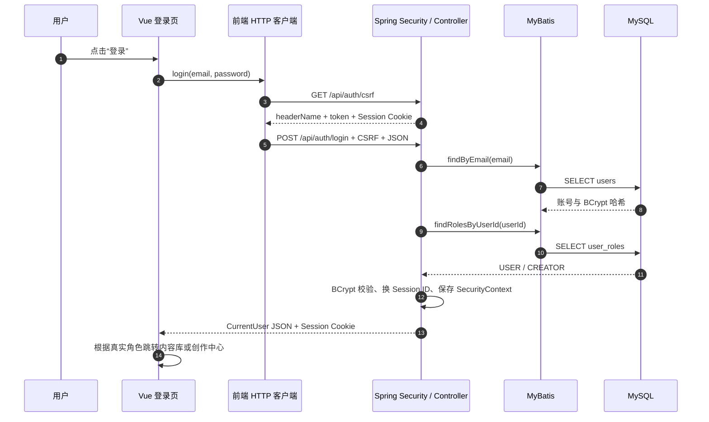

# 第一课：从登录页面看懂一次全栈请求 V1.0

> 对应当前代码：2026-10-04，Flyway V12，前端 Vue 3，后端 Spring Boot 4.1。
>
> 预计学习时间：90～120 分钟。可以分成 7 段，每段 10～20 分钟。每段结尾都写明可以停在哪里。

## 0. 这节课结束后要掌握什么

完成本课后，你应该能做到：

1. 从登录表单找到负责提交的 Vue 函数。
2. 从 Vue 函数找到前端 API 和通用 HTTP 客户端。
3. 解释登录为什么先获取 CSRF token。
4. 从 `/api/auth/login` 找到 Java Controller。
5. 解释 Spring Security 怎样读取数据库账号并检查 BCrypt 密码。
6. 解释 Session Cookie、SecurityContext 和 `/api/me` 的关系。
7. 找到 `users`、`user_roles` 表和对应 MyBatis SQL。
8. 说清楚 200、401、403 各表示什么。
9. 在面试中用两分钟讲清本项目登录链路。

这节课只讲当前已经实现的登录。注册、找回密码、邮箱验证、管理员登录页面暂未实现。

## 1. 先看完整链路（10 分钟）

用户在 `/login` 输入邮箱和密码，浏览器最终完成两次主要请求：



先记四个对象：

| 对象 | 在本项目中的用途 |
| --- | --- |
| CSRF token | 证明写请求来自已经拿到当前会话页面的客户端 |
| Session Cookie | 浏览器后续请求携带的会话标识 |
| SecurityContext | 服务端 Session 中保存的认证结果 |
| CurrentUser | 登录成功后返回给前端的安全用户信息，不含密码哈希 |

本节可以停在这里。下次从“2. 登录表单”继续。

## 2. 登录表单怎样触发代码（15 分钟）

文件：`frontend/src/pages/BuyerPages.vue`。

### 2.1 表单结构

当前模板的关键部分位于约 1222～1294 行：

```vue
<form @submit.prevent="signInWithDemoRole">
  <label for="login-email">邮箱</label>
  <input
    id="login-email"
    type="email"
    required
    v-model="loginEmail"
    autocomplete="email"
  />

  <label for="login-password">密码</label>
  <input
    id="login-password"
    type="password"
    required
    v-model="loginPassword"
    autocomplete="current-password"
  />

  <button class="button button-primary" type="submit" :disabled="loginLoading">
    {{ loginLoading ? '正在登录…' : '登录' }}
  </button>
</form>
```

逐项解释：

| 写法 | 当前代码中的作用 |
| --- | --- |
| `<form>` | 把邮箱、密码和提交动作组成一个原生表单 |
| `@submit` | Vue 监听表单提交事件 |
| `.prevent` | 调用浏览器事件的 `preventDefault()`，避免整页传统提交和刷新 |
| `signInWithDemoRole` | 提交时执行的 TypeScript 函数 |
| `for="login-email"` | label 与相同 `id` 的输入框建立程序化关联 |
| `type="email"` | 浏览器使用邮箱输入语义并提供基础格式检查 |
| `required` | 空值时浏览器阻止提交 |
| `v-model="loginEmail"` | 输入框内容与 Vue 响应式变量双向同步 |
| `autocomplete` | 允许密码管理器正确识别邮箱和当前密码 |
| `:disabled="loginLoading"` | 请求进行中禁用按钮，减少连续点击 |
| `{{ ... }}` | Vue 模板插值，根据状态显示文字 |

### 2.2 三个登录状态变量

脚本约 64～73 行：

```ts
const loginEmail = ref(
  demoAccountsVisible
    ? loginRole.value === 'creator'
      ? 'creator@meteor.local'
      : 'buyer@meteor.local'
    : '',
)
const loginPassword = ref(demoAccountsVisible ? 'password' : '')
const loginLoading = ref(false)
const loginError = ref('')
```

`ref` 来自 Vue。它创建一个响应式容器：

```ts
const loginLoading = ref(false)
```

这个变量保存布尔值。TypeScript 脚本中读写实际值要使用：

```ts
loginLoading.value = true
loginLoading.value = false
```

Vue 模板会自动解包，因此模板写 `loginLoading`，不用写 `.value`。

变量分别负责：

- `loginEmail`：输入的邮箱。
- `loginPassword`：输入的密码。
- `loginLoading`：请求是否进行中。
- `loginError`：显示给用户的失败信息。

开发模式下填入演示账号只是本地学习便利。后端仍会验证邮箱、密码、账号状态和演示开关。

### 2.3 提交函数

脚本约 528～556 行：

```ts
async function signInWithDemoRole() {
  const requested = String(route.query.next ?? '')
  const next = requested.startsWith('/') && !requested.startsWith('//') ? requested : ''
  loginLoading.value = true
  loginError.value = ''
  signInNotice.value = ''

  if (loginRole.value === 'admin') {
    loginError.value = '管理员账号将在管理员后端接口完成后开放。当前可先使用用户或创作者账号。'
    loginLoading.value = false
    return
  }

  try {
    const user = await loginWithApi(loginEmail.value, loginPassword.value)
    const actualRole = roleFromCurrentUser(user)
    saveLocalRole(actualRole)
    const targetRole = roleForNextPath(next)
    signInNotice.value = `已连接后端会话：${user.displayName}`
    const canContinue = Boolean(next) && targetRole === actualRole
    const destination = canContinue
      ? next
      : { user: '/library', creator: '/creator/works', admin: '/admin/reviews' }[actualRole]
    void router.replace(destination)
  } catch (error) {
    loginError.value =
      error instanceof Error ? error.message : '登录失败，请检查后端是否启动和账号密码。'
  } finally {
    loginLoading.value = false
  }
}
```

执行顺序：

1. 读取 URL 中的 `next`，例如 `/login?next=/library`。
2. 只接受以单个 `/` 开始的站内路径，阻止 `//example.com` 一类外部跳转。
3. 设置 loading，清空旧错误。
4. 管理员接口未完成时直接返回明确错误。
5. 调用 `loginWithApi`。
6. 使用后端返回的真实角色决定跳转位置。
7. 请求失败进入 `catch`。
8. `finally` 在成功和失败时都会运行，负责关闭 loading。

这里出现的基础语法：

| 语法 | 含义 |
| --- | --- |
| `async function` | 函数内部可以使用 `await`，函数返回 Promise |
| `await` | 等待 Promise 完成；失败时会抛出异常进入 `catch` |
| `??` | 左侧为 `null` 或 `undefined` 时使用右侧值 |
| 三元表达式 `条件 ? A : B` | 根据条件选择一个结果 |
| `Boolean(next)` | 把字符串转换成布尔值；空字符串为 `false` |
| `instanceof Error` | 判断捕获值是否为标准 Error 对象 |
| 模板字符串 `` `${...}` `` | 把变量插入字符串 |
| `void router.replace(...)` | 明确忽略路由 Promise 的返回值 |

本节可以停在这里。恢复时先重新读一遍“执行顺序”八项，然后进入前端 API。

## 3. `loginWithApi` 做了什么（10 分钟）

文件：`frontend/src/api/auth.ts`。

```ts
export async function login(email: string, password: string) {
  const user = await apiPost<CurrentUser>('/api/auth/login', { email, password })
  clearCsrfToken()
  return user
}
```

逐项解释：

### `export`

允许其他文件导入这个函数：

```ts
import { login as loginWithApi } from '../api/auth'
```

导入时改名为 `loginWithApi`，避免页面内看到 `login()` 时不清楚它属于哪一层。

### 参数类型

```ts
email: string
password: string
```

TypeScript 在编译时要求调用者传入字符串。它不会在运行时替后端验证输入，后端仍需要 Jakarta Validation。

### 泛型 `<CurrentUser>`

```ts
apiPost<CurrentUser>(...)
```

它告诉 TypeScript：“成功响应按 `CurrentUser` 使用”。定义位于 `frontend/src/types/auth.ts`：

```ts
export type CurrentUser = {
  id: number
  email: string
  displayName: string
  roles: AuthRole[]
}
```

这个类型没有 `password` 或 `passwordHash`。前端不需要、也不应收到密码哈希。

### 请求体对象

```ts
{ email, password }
```

这是对象属性简写，等价于：

```ts
{ email: email, password: password }
```

最终 JSON 类似：

```json
{
  "email": "buyer@meteor.local",
  "password": "password"
}
```

### 为什么登录后清空 CSRF 缓存

后端登录成功时会更换 Session ID，并通过 `CsrfAuthenticationStrategy` 更新 CSRF token。前端先前缓存的 token 属于登录前状态，因此执行：

```ts
clearCsrfToken()
```

下一次写请求会重新获取 token。

## 4. 通用 HTTP 客户端怎样发送登录请求（20 分钟）

文件：`frontend/src/api/http.ts`。

### 4.1 第一步：获取 CSRF token

```ts
let csrfToken: CsrfTokenResponse | null = null

export async function getCsrfToken(forceRefresh = false) {
  if (csrfToken && !forceRefresh) return csrfToken
  const response = await fetch('/api/auth/csrf', { credentials: 'include' })
  await ensureOk(response)
  csrfToken = (await response.json()) as CsrfTokenResponse
  return csrfToken
}
```

关键点：

- `CsrfTokenResponse | null` 是联合类型，表示“已有 token”或“当前没有”。
- 模块顶层变量在当前页面运行期间缓存 token，减少重复请求。
- `forceRefresh` 默认值是 `false`。
- `credentials: 'include'` 要求浏览器携带并接收 Cookie。
- `response.json()` 把响应 JSON 解析成 JavaScript 对象。

后端返回结构：

```json
{
  "headerName": "X-CSRF-TOKEN",
  "parameterName": "_csrf",
  "token": "服务端生成的随机值"
}
```

### 4.2 第二步：发送 POST

```ts
export async function apiPost<T>(
  path: string,
  body?: unknown,
  forceFreshCsrf = false,
) {
  let token = await getCsrfToken(forceFreshCsrf)
  const request = () =>
    fetch(path, {
      method: 'POST',
      credentials: 'include',
      headers: {
        ...(body === undefined ? {} : { 'Content-Type': 'application/json' }),
        [token.headerName]: token.token,
      },
      body: body === undefined ? undefined : JSON.stringify(body),
    })

  let response = await request()
  if (response.status === 403) {
    token = await getCsrfToken(true)
    response = await request()
  }
  await ensureOk(response)
  return response.status === 204 ? (undefined as T) : ((await response.json()) as T)
}
```

执行过程：

1. 读取或获取 CSRF token。
2. 创建内部 `request` 函数，避免首次和重试复制同一段 fetch 配置。
3. POST JSON，并把 token 放进后端指定的 Header。
4. 收到 403 时强制刷新 token，只重试一次。
5. 仍失败时 `ensureOk` 抛出 `ApiError`。
6. 204 响应没有 JSON；其他成功响应解析 JSON。

动态属性名：

```ts
[token.headerName]: token.token
```

如果 `headerName` 是 `X-CSRF-TOKEN`，生成的 Header 相当于：

```http
X-CSRF-TOKEN: 随机值
```

展开语法：

```ts
...(body === undefined ? {} : { 'Content-Type': 'application/json' })
```

有请求体时加入 `Content-Type`；退出请求没有 body 时省略。

### 4.3 错误怎样变成页面文字

```ts
export async function ensureOk(response: Response) {
  if (response.ok) return
  const error = await readError(response)
  throw new ApiError(response.status, error.code, error.message, error.requestId)
}
```

`response.ok` 表示 HTTP 状态位于 200～299。其他状态会被包装为：

```ts
export class ApiError extends Error {
  readonly status: number
  readonly code: string
  readonly requestId?: string

  constructor(status: number, code: string, message: string, requestId?: string) {
    super(requestId ? `${message}（请求编号：${requestId}）` : message)
    this.name = 'ApiError'
    this.status = status
    this.code = code
    this.requestId = requestId
  }
}
```

页面 `catch` 读取 `error.message`，再通过：

```vue
<p v-if="loginError" class="inline-note login-error" role="alert">
  {{ loginError }}
</p>
```

显示错误。`role="alert"` 让辅助技术感知新出现的失败信息。后端提供 `requestId` 时，页面文字会同时显示请求编号，用于定位同一次请求的服务端日志。

本节可以停在这里。恢复时先口头说出“GET CSRF → POST 登录 → 403 刷新一次 → 解析成功或抛错”。

## 5. 请求怎样进入 Java Controller（15 分钟）

文件：`backend/src/main/java/dev/meteor/auth/controller/AuthController.java`。

核心方法：

```java
@PostMapping("/api/auth/login")
public CurrentUserResponse login(
        @Valid @RequestBody LoginRequest loginRequest,
        HttpServletRequest request,
        HttpServletResponse response
) {
    Authentication authentication = authenticationManager.authenticate(
            UsernamePasswordAuthenticationToken.unauthenticated(
                    loginRequest.email(),
                    loginRequest.password()
            )
    );
    sessionAuthenticationStrategy.onAuthentication(authentication, request, response);

    SecurityContext context = securityContextHolderStrategy.createEmptyContext();
    context.setAuthentication(authentication);
    securityContextHolderStrategy.setContext(context);
    securityContextRepository.saveContext(context, request, response);

    return toResponse((MeteorUserPrincipal) authentication.getPrincipal());
}
```

逐步解释：

### `@PostMapping`

把 HTTP `POST /api/auth/login` 映射到这个 Java 方法。

### `@RequestBody`

把请求 JSON 转成 `LoginRequest`。

### `@Valid`

执行 `LoginRequest` 上的校验注解。定义如下：

```java
public record LoginRequest(
        @NotBlank @Email @Size(max = 254) String email,
        @NotBlank @Size(max = 100) String password
) {
    public LoginRequest {
        if (email != null) {
            email = email.trim().toLowerCase(Locale.ROOT);
        }
    }
}
```

校验规则：

- 邮箱和密码不能为空白。
- 邮箱必须符合邮箱格式。
- 邮箱最长 254 字符。
- 密码最长 100 字符。

紧凑构造器会去掉邮箱两侧空格并转换为小写：

```text
" BUYER@METEOR.LOCAL " → "buyer@meteor.local"
```

密码不会 `trim()`。密码中的空格可能是用户真实密码的一部分。

### `authenticationManager.authenticate(...)`

创建一个“尚未认证”的用户名密码对象，交给 Spring Security：

```java
UsernamePasswordAuthenticationToken.unauthenticated(email, password)
```

配置中的 `DaoAuthenticationProvider` 会：

1. 调用 `DatabaseUserDetailsService.loadUserByUsername`。
2. 得到数据库密码哈希和账号状态。
3. 使用 `BCryptPasswordEncoder` 检查输入密码。
4. 检查账号是否启用、是否锁定。
5. 成功后返回已认证的 `Authentication`。

### Session 策略

```java
sessionAuthenticationStrategy.onAuthentication(authentication, request, response);
```

当前策略包含：

```java
new ChangeSessionIdAuthenticationStrategy()
new CsrfAuthenticationStrategy(csrfTokenRepository)
```

作用：

- 登录成功后更换 Session ID，降低会话固定攻击风险。
- 更新当前会话的 CSRF token。

### 保存 SecurityContext

```java
SecurityContext context = securityContextHolderStrategy.createEmptyContext();
context.setAuthentication(authentication);
securityContextRepository.saveContext(context, request, response);
```

这几行把认证结果保存进 HTTP Session。后续请求携带同一 Session Cookie 时，Spring Security 可以恢复当前用户。

### 返回 DTO

```java
return new CurrentUserResponse(
        principal.id(),
        principal.getUsername(),
        principal.displayName(),
        principal.roles()
);
```

响应只包含页面需要的用户信息。

## 6. Spring Security 怎样决定哪些接口可以访问（15 分钟）

文件：`backend/src/main/java/dev/meteor/auth/security/SecurityConfig.java`。

### 6.1 密码编码器

```java
@Bean
PasswordEncoder passwordEncoder() {
    return new BCryptPasswordEncoder(10);
}
```

`10` 是 BCrypt cost。密码验证会读取数据库哈希中的 salt 和 cost，再检查输入密码。数据库不保存明文 `password`。

### 6.2 认证提供者

```java
DaoAuthenticationProvider provider = new DaoAuthenticationProvider(userDetailsService);
provider.setPasswordEncoder(passwordEncoder);
return new ProviderManager(provider);
```

它把“怎样找用户”和“怎样验密码”组合起来：

- `userDetailsService`：从 MySQL 读取账号和角色。
- `passwordEncoder`：验证 BCrypt 哈希。

### 6.3 路由权限

```java
.authorizeHttpRequests(authorize -> authorize
    .requestMatchers(HttpMethod.GET,
        "/api/products", "/api/products/**", "/api/auth/csrf")
    .permitAll()
    .requestMatchers(HttpMethod.POST, "/api/auth/login")
    .permitAll()
    .requestMatchers(HttpMethod.POST, "/api/orders", "/api/orders/*/test-payment")
    .hasAnyRole("USER", "CREATOR")
    .requestMatchers(HttpMethod.GET,
        "/api/orders", "/api/orders/**", "/api/library", "/api/library/**")
    .hasAnyRole("USER", "CREATOR")
    .anyRequest()
    .authenticated())
```

含义：

| 请求 | 权限 |
| --- | --- |
| GET 商品、GET CSRF | 任何人 |
| POST 登录 | 任何人，但仍要 CSRF |
| POST 下单、测试支付 | USER 或 CREATOR |
| GET 订单、内容库 | USER 或 CREATOR |
| 其他接口 | 至少已经登录 |

`permitAll()` 只处理“是否要求登录”。CSRF 过滤器仍会保护 POST 登录，所以缺少 token 返回 403。

### 6.4 401 与 403

配置分别返回：

```json
{
  "code": "UNAUTHORIZED",
  "message": "Authentication is required",
  "requestId": "login-check-001",
  "timestamp": "2026-10-04T06:00:00Z"
}
```

```json
{
  "code": "FORBIDDEN",
  "message": "Access is denied",
  "requestId": "login-check-002",
  "timestamp": "2026-10-04T06:00:00Z"
}
```

`SecurityConfig` 使用 Jackson 把同一个 `ApiErrorResponse` record 序列化。安全过滤器产生的 401／403 与 Controller 异常产生的 400／404／409 都有相同的 `code`、`message`、`requestId`、`timestamp` 字段。

`RequestCorrelationFilter` 在安全过滤器之前运行，把编号写入 `X-Request-Id` 响应头、请求属性和日志 MDC。日志示例：

```text
INFO [requestId=login-check-002] HTTP request completed method=POST path=/api/auth/login status=403 durationMs=3
```

如果客户端编号包含空格或超过 64 个字符，后端会改用 UUID，避免任意文本进入日志。请求结束后清理 MDC，防止线程复用串号。`AuthControllerWebTest` 检查 403 的响应头和 JSON 编号一致；更完整的语法解释见[项目代码语法与面试问答 6.8](12-项目代码语法与面试问答-V1.0.md#68-请求编号mdc-与日志关联)。

在本项目中常见含义：

- 401：没有有效登录、密码错误、账号被隐藏处理。
- 403：CSRF 缺失或失效；登录用户角色不足也可能得到 403。

## 7. 账号怎样从 MySQL 读取（15 分钟）

### 7.1 UserDetailsService

文件：`backend/src/main/java/dev/meteor/auth/security/DatabaseUserDetailsService.java`。

```java
@Override
public UserDetails loadUserByUsername(String username) {
    String normalizedEmail = username == null
            ? ""
            : username.trim().toLowerCase(Locale.ROOT);

    if (!demoAccountsEnabled && DEMO_ACCOUNT_EMAILS.contains(normalizedEmail)) {
        throw new UsernameNotFoundException("Account not found");
    }

    AccountCredentialsProjection account = accountMapper.findByEmail(normalizedEmail)
            .orElseThrow(() -> new UsernameNotFoundException("Account not found"));
    List<String> roles = accountMapper.findRolesByUserId(account.id());

    return new MeteorUserPrincipal(
            account.id(),
            account.email(),
            account.passwordHash(),
            account.displayName(),
            account.status(),
            roles
    );
}
```

这里出现的 Java 语法：

| 语法 | 当前用途 |
| --- | --- |
| `@Override` | 表明正在实现 `UserDetailsService` 的接口方法 |
| `private static final` | 类级常量，引用不可重新赋值 |
| `Set.of(...)` | 创建固定演示邮箱集合，适合 `contains` 判断 |
| `Locale.ROOT` | 使用与语言无关的小写规则处理账号标识 |
| `Optional.orElseThrow(...)` | 查不到用户时立即抛认证异常 |
| Lambda `() -> ...` | 把“需要异常时如何创建异常”作为函数传入 |
| `List<String>` | 一个用户可以有多个角色 |

关闭演示开关时，代码在查询数据库前拒绝固定邮箱。这样返回行为与不存在账号相同，也减少账号枚举信息。

### 7.2 Mapper 接口

文件：`backend/src/main/java/dev/meteor/auth/mapper/AccountMapper.java`。

```java
public interface AccountMapper {
    Optional<AccountCredentialsProjection> findByEmail(@Param("email") String email);
    List<String> findRolesByUserId(@Param("userId") long userId);
}
```

Mapper 只描述需要执行的数据库操作。MyBatis 根据方法名对应 XML 中相同 `id` 的 SQL。

### 7.3 MyBatis SQL

文件：`backend/src/main/resources/mapper/AccountMapper.xml`。

```xml
<select id="findByEmail"
        resultType="dev.meteor.auth.mapper.projection.AccountCredentialsProjection">
    SELECT id,
           email,
           password_hash AS passwordHash,
           display_name AS displayName,
           status
    FROM users
    WHERE email = #{email}
    LIMIT 1
</select>
```

`#{email}` 使用预编译参数绑定。不要把邮箱拼接到 SQL 字符串中。

数据库使用下划线列名，Java projection 使用驼峰属性：

```text
password_hash → passwordHash
display_name  → displayName
```

角色查询：

```xml
<select id="findRolesByUserId" resultType="java.lang.String">
    SELECT role
    FROM user_roles
    WHERE user_id = #{userId}
    ORDER BY role
</select>
```

### 7.4 表结构

账号表来自 `V2__catalog_identity_and_revisions.sql`：

```sql
CREATE TABLE users (
    id BIGINT NOT NULL AUTO_INCREMENT,
    email VARCHAR(254) NOT NULL,
    password_hash VARCHAR(100) NULL,
    display_name VARCHAR(100) NOT NULL,
    status VARCHAR(20) NOT NULL,
    PRIMARY KEY (id),
    CONSTRAINT uq_user_email UNIQUE (email),
    CONSTRAINT chk_user_status CHECK (status IN ('INVITED', 'ACTIVE', 'LOCKED'))
);
```

角色表：

```sql
CREATE TABLE user_roles (
    user_id BIGINT NOT NULL,
    role VARCHAR(20) NOT NULL,
    PRIMARY KEY (user_id, role),
    CONSTRAINT fk_user_role_user FOREIGN KEY (user_id) REFERENCES users (id),
    CONSTRAINT chk_user_role CHECK (role IN ('USER', 'CREATOR', 'ADMIN'))
);
```

关键约束：

- 邮箱唯一。
- 用户状态只能使用三个允许值。
- `(user_id, role)` 复合主键防止同一角色重复。
- 角色必须引用真实用户。
- 角色只能使用允许值。

## 8. 为什么演示账号默认锁定（10 分钟）

迁移 `V3__seed_local_login_accounts.sql` 曾创建固定本地密码。V8 将固定账号改为：

```sql
UPDATE users
SET password_hash = '!demo-account-disabled!',
    status = 'LOCKED'
WHERE email IN ('buyer@meteor.local', 'creator@meteor.local');
```

应用启动时，`DemoAccountStateInitializer` 根据配置同步状态：

```java
if (demoAccountsEnabled) {
    // 恢复本地 BCrypt 哈希并设为 ACTIVE
    return;
}

// 默认写入无效密码并设为 LOCKED
```

配置默认值：

```java
@Value("${meteor.demo-accounts.enabled:false}")
```

环境变量只有显式设置时才启用：

```powershell
$env:METEOR_DEMO_ACCOUNTS_ENABLED='true'
```

当前验收结束后已经用默认配置启动后端，两个演示邮箱使用固定密码登录均返回 401，并关闭了服务。

## 9. Session 怎样在第二个请求中恢复用户（10 分钟）

登录成功响应会设置或更新 Session Cookie。随后前端调用：

```ts
export async function getCurrentUser() {
  const response = await fetch('/api/me', { credentials: 'include' })
  if (response.status === 401) return null
  await ensureOk(response)
  return (await response.json()) as CurrentUser
}
```

浏览器行为：

```text
GET /api/me
Cookie: JSESSIONID=某个随机会话标识
```

服务器行为：

```text
JSESSIONID
  → 找到 HTTP Session
  → 读取 SecurityContext
  → 恢复 Authentication
  → Controller 得到当前 principal
```

Cookie 中保存的是会话标识。用户 ID、角色和认证对象保存在服务端 Session。

`credentials: 'include'` 在本项目所有需要会话的请求中保持一致。漏掉它会导致请求无法使用现有 Session。

## 10. 常见失败路径（10 分钟）

| 场景 | HTTP | 前端结果 | 代码证据 |
| --- | --- | --- | --- |
| 登录没有 CSRF token | 403 | 显示访问被拒绝错误 | `AuthControllerWebTest.rejectsLoginWithoutCsrfToken` |
| 密码错误 | 401 | 显示认证失败 | `rejectsIncorrectPassword...` |
| 未登录调用 `/api/me` | 401 | `getCurrentUser()` 返回 `null` | 同上测试 |
| 邮箱大小写和两侧空格 | 200 | 规范化后正常查询 | `LoginRequest` + Web 测试 |
| 固定演示账号开关关闭 | 401 | 当作账号不存在 | `DatabaseUserDetailsService` |
| Session 恢复成功 | 200 | 返回 displayName 和 roles | `logsInAndRestoresUserFromSession` |
| 旧 CSRF token | 首次 403 | 客户端刷新 token 后重试一次 | `apiPost` |
| 后端未启动 | 浏览器网络失败 | 页面进入 `catch` 并显示错误 | `signInWithDemoRole` |
| 管理员演示入口 | 不发送请求 | 页面直接说明未开放 | `signInWithDemoRole` |

这里没有无限重试。CSRF 只刷新一次，避免服务器持续失败时形成循环请求。

## 11. 自动化测试怎样证明这条链路（15 分钟）

### 11.1 Controller Web 测试

文件：`backend/src/test/java/dev/meteor/auth/controller/AuthControllerWebTest.java`。

四项测试：

1. 匿名用户可以获取 CSRF token。
2. 登录缺少 CSRF 返回 403。
3. 正确密码登录后，同一 Session 可以读取 `/api/me`。
4. 错误密码和匿名 `/api/me` 返回 401。

Session 恢复测试中的关键代码：

```java
MvcResult loginResult = mockMvc.perform(post("/api/auth/login")
                .with(csrf())
                .contentType(MediaType.APPLICATION_JSON)
                .content("""
                        {"email":" BUYER@METEOR.LOCAL ","password":"password"}
                        """))
        .andExpect(status().isOk())
        .andReturn();

MockHttpSession session = (MockHttpSession) loginResult.getRequest().getSession(false);

mockMvc.perform(get("/api/me").session(session))
        .andExpect(status().isOk())
        .andExpect(jsonPath("$.displayName").value("Meteor Buyer"));
```

它验证了两次请求共享 Session 的行为。

### 11.2 UserDetailsService 测试

文件：`DatabaseUserDetailsServiceTest.java`。

覆盖：

- 邮箱规范化。
- 查不到账号时不继续查询角色。
- 演示开关关闭时不访问数据库并隐藏固定账号。

### 11.3 启动状态测试

文件：`DemoAccountStateInitializerTest.java`。

覆盖：

- 开关打开：写入 BCrypt 哈希和 `ACTIVE`。
- 默认关闭：写入禁用密码和 `LOCKED`。

当前完整后端回归发现 95 项，其中 93 项非容器测试通过、2 项 Testcontainers 因 Docker 不可用跳过；认证测试是其中 9 项，请求编号过滤器另有 3 项单元测试。

## 12. 一张表记住本课语法

| 代码 | 先记住的含义 |
| --- | --- |
| `ref(false)` | Vue 响应式状态 |
| `v-model` | 输入值与状态双向同步 |
| `@submit.prevent` | 拦截表单提交并调用函数 |
| `async / await` | 等待异步请求，失败进入 catch |
| `try / catch / finally` | 成功逻辑、错误逻辑、统一收尾 |
| `<CurrentUser>` | TypeScript 泛型响应类型 |
| `type A = X \| Y` | 联合类型，值可属于多个限定类型之一 |
| `@PostMapping` | HTTP POST 到 Java 方法的映射 |
| `@RequestBody` | JSON 转 Java 对象 |
| `@Valid` | 执行输入校验 |
| Java `record` | 简洁的不可变数据载体 |
| `@Bean` | 把对象交给 Spring 容器管理 |
| `Optional.orElseThrow` | 没有查询结果时抛出明确异常 |
| `List<String>` | 有顺序、允许多个角色的集合 |
| `#{email}` | MyBatis 预编译参数绑定 |
| `UNIQUE` | 数据库保证邮箱不会重复 |
| `FOREIGN KEY` | 角色必须引用存在的用户 |

需要展开语法时查 [项目代码语法与面试问答](12-项目代码语法与面试问答-V1.0.md)。查完回到当前链路，不连续阅读整本语法手册。

## 13. 调试登录时按什么顺序查（10 分钟）

### 页面没有反应

1. 检查按钮是否 disabled。
2. 检查 Console 是否有 JavaScript 错误。
3. 检查 Network 是否出现 `/api/auth/csrf`。

### CSRF 请求失败

1. 后端是否监听 8080。
2. Vite `/api` 代理是否指向 8080。
3. 响应状态和响应 JSON 是什么。

### 登录返回 403

1. 请求 Header 是否包含后端返回的 CSRF Header 名称。
2. 获取 token 和 POST 登录时是否使用同一浏览器 Session。
3. 客户端是否已经执行一次刷新重试。

### 登录返回 401

1. 演示账号开关是否明确打开。
2. 邮箱规范化结果是否正确。
3. `users.status` 是否为 `ACTIVE`。
4. BCrypt 哈希是否存在。
5. `DatabaseUserDetailsService` 是否成功加载账号。

### 登录成功却马上变成未登录

1. POST 是否带 `credentials: 'include'`。
2. 响应是否设置 Session Cookie。
3. `/api/me` 是否携带同一 Cookie。
4. Controller 是否执行 `saveContext`。

这个顺序从浏览器到服务器再到数据库，能快速确定故障在哪一层。

## 14. 面试问答

### 问：为什么选择 Session？

答：

> 当前项目是同域 Vue 与 Spring Boot 应用，使用服务端 Session 保存 SecurityContext。浏览器只携带随机 Session Cookie，后端可以集中控制会话失效和账号状态。写请求另外校验 CSRF，登录成功时更换 Session ID 并轮换 token。

### 问：为什么登录接口也需要 CSRF？

答：

> 项目使用 Cookie Session，浏览器会自动携带 Cookie。登录请求受到 CSRF 保护，可以降低攻击者强制受害者浏览器登录到攻击者账号等风险。前端先获取 token，再放进后端指定 Header。

### 问：前端已经校验邮箱，后端为什么还要 `@Valid`？

答：

> HTTP 接口可以绕过页面直接调用。后端是输入边界，必须独立校验空值、邮箱格式和长度。数据库唯一约束继续保护最终数据不变量。

### 问：密码如何保存？

答：

> 数据库存 BCrypt 哈希。Spring Security 的 `BCryptPasswordEncoder` 用输入密码验证哈希。API 响应不返回密码或哈希。

### 问：项目怎样防止演示密码被带到部署环境？

答：

> V8 迁移把固定账号设为 LOCKED 并写入无效密码。应用启动默认继续锁定，只有本地显式打开配置才恢复演示哈希。UserDetailsService 在开关关闭时还会在查询数据库前拒绝固定邮箱。

### 问：401 和 403 有什么区别？

答：

> 401 表示当前没有有效认证，例如错误密码或匿名访问。403 表示服务器知道请求上下文，但拒绝执行，例如 CSRF 校验失败或角色不足。

## 15. 两分钟项目讲解稿

理解后按自己的语言表达下面内容：

> 登录页使用 Vue `ref` 管理邮箱、密码、加载和错误状态。提交时先由统一 HTTP 客户端获取 CSRF token，再携带 Cookie、CSRF Header 和 JSON 调用 `/api/auth/login`。后端用 Jakarta Validation 校验并规范化邮箱，Spring Security 的 DaoAuthenticationProvider 调用自定义 UserDetailsService，通过 MyBatis 查询 users 和 user_roles，再用 BCrypt 验证密码。成功后更换 Session ID、轮换 CSRF token，并把 SecurityContext 保存到 HTTP Session。前端根据后端返回的真实角色跳转，后续 `/api/me` 通过 Session Cookie 恢复用户。固定演示账号默认锁定，只能通过本地开关启用。

仓库能够提供的证据：

- Controller Web 测试覆盖 CSRF、登录、Session 恢复和错误密码。
- Service 测试覆盖邮箱规范化和演示账号关闭。
- 初始化器测试覆盖默认锁定。
- 本轮默认配置真实启动验证两个演示账号登录均返回 401。

当前边界：注册、找回密码、邮箱验证、管理员接口、分布式 Session 和生产会话存储尚未实现。

## 16. 完成本课的检查标准

看完后，按顺序确认：

- [ ] 能从 `BuyerPages.vue` 找到 `signInWithDemoRole`。
- [ ] 能说明 `v-model`、`ref`、`async/await` 和 `finally` 在登录页的用途。
- [ ] 能画出 GET CSRF 和 POST 登录两个请求。
- [ ] 能说明 `credentials: 'include'` 的用途。
- [ ] 能从 `AuthController` 找到 `authenticationManager.authenticate`。
- [ ] 能解释 `LoginRequest` 为什么只规范化邮箱。
- [ ] 能从 `DatabaseUserDetailsService` 走到 `AccountMapper.xml`。
- [ ] 能指出 `users` 与 `user_roles` 的主键、唯一键和外键。
- [ ] 能解释登录成功后为什么换 Session ID 和 CSRF token。
- [ ] 能用两分钟讲完流程，并说出尚未实现的范围。

未完成的项目可以回到对应章节，不需要重新从第一页阅读。

## 17. 下一课

第二课学习商品查询和分层结构：

```text
发现页
  → frontend/src/api/products.ts
  → ProductController
  → ProductQueryService
  → ProductMapper / ProductMapper.xml
  → products / product_revisions / packages / shops
```

重点会放在 Controller、Service、Mapper 的职责，DTO／Projection、SQL JOIN、404，以及前端加载／错误／空状态。完成商品读取后再进入订单和幂等。

继续阅读：[第二课：商品查询与后端分层](20-第二课-商品查询与后端分层-V1.0.md)。
