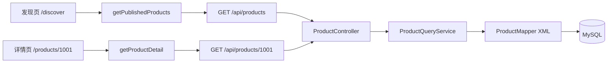
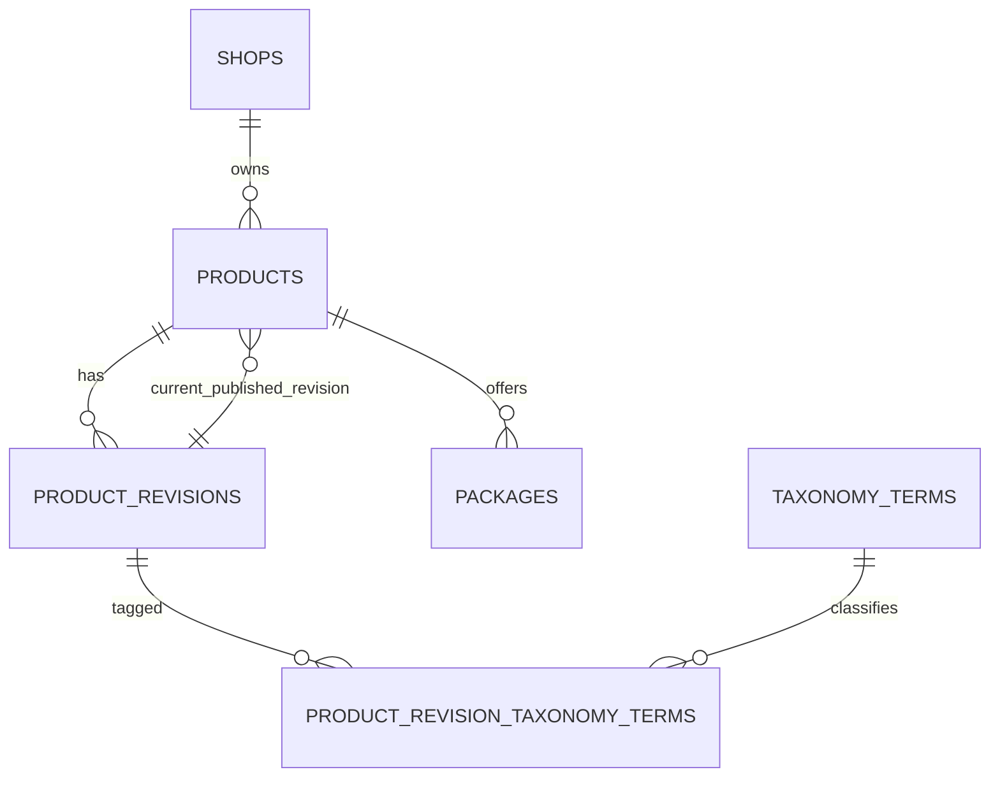

# 第二课：商品查询与后端分层 V1.0

> 对应当前代码：2026-10-04，Flyway V12。
>
> 预计学习时间：165～195 分钟。分成 11 次，每次约 15～20 分钟。

前置内容：[第一课：从登录页面看懂一次全栈请求](19-第一课-从登录页面看懂一次全栈请求-V1.0.md)。

## 0. 本课目标

完成本课后，你应该能做到：

1. 从发现页找到商品列表请求。
2. 从 `/products/1001` 找到商品详情请求。
3. 解释 Controller、Service、Mapper 各自负责什么。
4. 区分 API DTO 和数据库 Projection。
5. 看懂商品查询中的 `JOIN`、`EXISTS`、`LIKE`、排序和限制条数。
6. 解释为什么商品标题来自 `product_revisions`。
7. 解释搜索词中的 `%`、`_` 和 `!` 为什么需要转义。
8. 说明加载、成功、空结果和失败四种前端状态。
9. 根据 7 项 Service 测试和 5 项 HTTP 契约测试说明 200、400 与 404 的产生位置和证据边界。
10. 在面试中准确描述当前目录能力和演示数据边界。

本课讲公开只读查询。创建商品、编辑、发布审核写接口尚未接通。

建议分段：

| 第几次 | 阅读范围 | 预计时间 |
| --- | --- | --- |
| 1 | 第 1～2 节：请求链与路由 | 15 分钟 |
| 2 | 第 3 节：前端列表 API | 15 分钟 |
| 3 | 第 4 节：页面异步状态 | 20 分钟 |
| 4 | 第 5 节：Controller | 15 分钟 |
| 5 | 第 6 节：Service | 15 分钟 |
| 6 | 第 7.1～7.4 节：Mapper、Projection 与核心 JOIN | 20 分钟 |
| 7 | 第 7.5～8 节：分类、搜索、套餐与异常 | 20 分钟 |
| 8 | 第 9 节：Service 测试 | 20 分钟 |
| 9 | 第 9.1 节：公开 HTTP 契约测试 | 15 分钟 |
| 10 | 第 10～12 节：语法、调试与面试追问 | 20 分钟 |
| 11 | 第 13～15 节：讲解稿与检查清单 | 15 分钟 |

## 1. 两条请求链（10 分钟）

商品目录有列表和详情两条链：



返回数据不同：

```text
列表：商品 id、店铺名、标题、简介
详情：商品 id、店铺名、标题、简介、可售套餐列表
```

HTTP 示例：

```http
GET /api/products?q=求职&category=templates
Accept: application/json
```

```http
GET /api/products/1001
Accept: application/json
```

本节可以停在这里。恢复时先画出两条箭头链。

## 2. 路由怎样进入同一个 Vue 页面（10 分钟）

文件：`frontend/src/router.ts`。

公开买家页面使用兜底路由：

```ts
{
  path: '/:pathMatch(.*)*',
  component: BuyerPages,
  props: (route) => ({ path: route.path }),
}
```

这表示 `/discover`、`/products/1001`、`/login`、`/checkout` 等路径都进入 `BuyerPages.vue`，并把当前路径作为 `path` 属性传入。

`BuyerPages.vue` 声明：

```ts
const props = defineProps<{ path: string }>()
```

模板根据路径选择页面：

```vue
<template v-if="path === '/discover'">
  <!-- 发现页 -->
</template>

<template v-else-if="isProductPath">
  <!-- 商品详情 -->
</template>
```

详情路径判断：

```ts
const isProductPath = computed(() => /^\/products\/[1-9]\d*$/.test(props.path))
```

正则表达式含义：

| 片段 | 含义 |
| --- | --- |
| `^` | 从字符串开头开始 |
| `/products/` | 固定路径 |
| `[1-9]` | 第一位是 1～9，排除 0 和负数 |
| `\d*` | 后面允许零个或多个数字 |
| `$` | 到字符串结尾结束 |

`/products/1001` 匹配；`/products/0`、`/products/-1`、`/products/abc` 不匹配。

商品 ID 解析：

```ts
const requestedProductId = computed(() =>
  isProductPath.value
    ? Number(props.path.slice('/products/'.length))
    : props.path === '/checkout'
      ? Number(route.query.product ?? 1001)
      : 1001,
)
```

`slice('/products/'.length)` 去掉路径前缀，`Number(...)` 转成数字。

## 3. 前端列表请求（15 分钟）

文件：`frontend/src/api/products.ts`。

```ts
export async function getPublishedProducts(
  query = '',
  category?: string,
  signal?: AbortSignal,
): Promise<ProductListItemResponse[]> {
  const params = new URLSearchParams()
  if (query.trim()) params.set('q', query.trim())
  if (category) params.set('category', category)

  const response = await fetch(`/api/products${params.size ? `?${params}` : ''}`, {
    headers: { Accept: 'application/json' },
    signal,
  })

  if (!response.ok) {
    throw new Error(`作品列表读取失败（HTTP ${response.status}）`)
  }

  return response.json() as Promise<ProductListItemResponse[]>
}
```

### 3.1 可选参数

```ts
category?: string
signal?: AbortSignal
```

问号表示参数可以省略。调用示例：

```ts
getPublishedProducts('求职', 'templates', signal)
getPublishedProducts('', undefined, signal)
```

### 3.2 返回类型

```ts
Promise<ProductListItemResponse[]>
```

拆开理解：

- `ProductListItemResponse`：一条商品摘要。
- `[]`：多条摘要组成数组。
- `Promise<...>`：结果稍后从网络返回。

类型定义位于 `frontend/src/types/product.ts`：

```ts
export interface ProductListItemResponse {
  id: number
  shopName: string
  title: string
  summary: string
}
```

### 3.3 URLSearchParams

输入：

```text
query = " 求职 "
category = "templates"
```

生成：

```text
q=%E6%B1%82%E8%81%8C&category=templates
```

最终 URL：

```text
/api/products?q=%E6%B1%82%E8%81%8C&category=templates
```

`URLSearchParams` 负责 URL 编码，避免手工拼接空格、中文和特殊字符。

### 3.4 AbortSignal

用户连续输入时，旧搜索请求可能比新请求更晚返回。页面为每次请求创建 `AbortController`，把 `signal` 传给 fetch：

```ts
const currentRequest = new AbortController()
catalogRequest = currentRequest

catalog.value = await getPublishedProducts(
  query.value,
  category.value === 'all' ? undefined : category.value,
  currentRequest.signal,
)
```

发起新请求前：

```ts
catalogRequest?.abort()
```

旧请求被取消后，页面不应把它当成普通错误显示。

## 4. 页面怎样管理四种状态（15 分钟）

文件：`frontend/src/pages/BuyerPages.vue`。

列表状态：

```ts
const catalog = ref<ProductListItemResponse[]>([])
const catalogLoading = ref(false)
const catalogError = ref(false)
```

读取函数：

```ts
async function loadCatalog() {
  catalogRequest?.abort()
  const currentRequest = new AbortController()
  catalogRequest = currentRequest
  catalogLoading.value = true
  catalogError.value = false
  catalog.value = []

  try {
    catalog.value = await getPublishedProducts(
      query.value,
      category.value === 'all' ? undefined : category.value,
      currentRequest.signal,
    )
  } catch {
    if (!currentRequest.signal.aborted) catalogError.value = true
  } finally {
    if (!currentRequest.signal.aborted) catalogLoading.value = false
  }
}
```

四种状态可以由三个变量推导：

| 状态 | `loading` | `error` | `catalog.length` |
| --- | --- | --- | --- |
| 加载中 | true | false | 0 |
| 成功有数据 | false | false | 大于 0 |
| 成功空结果 | false | false | 0 |
| 失败 | false | true | 0 |

`finally` 中先判断请求有没有被取消：

```ts
if (!currentRequest.signal.aborted) catalogLoading.value = false
```

旧请求取消后不再修改当前请求的 loading 状态。

### 搜索防抖

```ts
watch([query, category, topic], () => {
  if (props.path !== '/discover') return
  if (searchTimer) clearTimeout(searchTimer)
  catalogRequest?.abort()
  catalog.value = []
  catalogLoading.value = true
  catalogError.value = false
  catalogPage.value = 1
  searchTimer = setTimeout(() => void loadCatalog(), 250)
})
```

用户每输入一个字符都会改变 `query`。这里等待 250ms；期间再次输入会清除旧定时器。它减少无效请求数量。

防抖和取消解决两个问题：

```text
防抖：输入还没停时减少请求
取消：已经发出的旧请求不再影响新状态
```

### 商品详情状态

```ts
const product = ref<ProductDetailResponse | null>(null)
const productError = ref(false)
const productLoading = ref(false)
```

```ts
async function loadProduct(id = requestedProductId.value) {
  request?.abort()
  const currentRequest = new AbortController()
  request = currentRequest
  productLoading.value = true
  productError.value = false

  try {
    product.value = await getProductDetail(id, currentRequest.signal)
    if (!product.value.packages.some((item) => item.id === selectedPackage.value)) {
      selectedPackage.value = product.value.packages[0]?.id ?? 0
    }
  } catch {
    if (!currentRequest.signal.aborted) productError.value = true
  } finally {
    if (!currentRequest.signal.aborted) productLoading.value = false
  }
}
```

读取成功后检查当前选择的套餐是否仍存在。找不到时选第一项；没有套餐时使用 0。

### 当前页面的演示边界

发现页同时存在两类内容：

- `showcaseItems`：本地视觉陈列，用于多个分类的界面体验。
- `loadedCatalogProducts`：后端 API 返回的真实已发布商品。

当前 MySQL 只预置一件“求职材料模板包”。其他视觉卡片不能描述为真实上架商品。详情页对种子商品保留设计预览；后端断开时页面会明确显示“设计示例”或“种子数据”提示。

本节可以停在这里。恢复时先写出四种状态表和“防抖／取消”的分工。

## 5. Controller 只负责 HTTP 入口（10 分钟）

文件：`backend/src/main/java/dev/meteor/product/controller/ProductController.java`。

```java
@RestController
@RequestMapping("/api/products")
public class ProductController {

    private final ProductQueryService productQueryService;

    public ProductController(ProductQueryService productQueryService) {
        this.productQueryService = productQueryService;
    }
}
```

注解含义：

| 注解 | 用途 |
| --- | --- |
| `@RestController` | 方法返回值直接序列化为 JSON |
| `@RequestMapping` | 给本类所有接口加 `/api/products` 前缀 |
| `@GetMapping` | 映射 HTTP GET |
| `@RequestParam` | 读取查询参数 |
| `@PathVariable` | 读取路径中的变量 |

列表接口：

```java
@GetMapping
public List<ProductListItemResponse> listPublishedProducts(
        @RequestParam(name = "q", required = false) String query,
        @RequestParam(name = "category", required = false) String category
) {
    return productQueryService.listPublishedProducts(query, category);
}
```

请求：

```text
GET /api/products?q=求职&category=templates
```

绑定结果：

```text
query = "求职"
category = "templates"
```

详情接口：

```java
@GetMapping("/{productId}")
public ProductDetailResponse getPublishedProduct(@PathVariable long productId) {
    return productQueryService.getPublishedProduct(productId);
}
```

请求 `/api/products/1001` 时，`productId = 1001L`。

Controller 当前没有写 SQL、检查上架状态或组装套餐。它只处理 HTTP 参数和返回类型，然后调用 Service。

构造器注入：

```java
public ProductController(ProductQueryService productQueryService) {
    this.productQueryService = productQueryService;
}
```

依赖在对象创建时必须提供，字段可以声明为 `final`。测试时也能传入受控实现。

## 6. Service 处理业务规则与返回结构（20 分钟）

文件：`backend/src/main/java/dev/meteor/product/service/ProductQueryService.java`。

### 6.1 详情查询

```java
@Transactional(readOnly = true)
public ProductDetailResponse getPublishedProduct(long productId) {
    if (productId <= 0) {
        throw new IllegalArgumentException("productId must be positive");
    }

    ProductSummaryProjection product = productMapper.findPublishedProduct(productId)
            .orElseThrow(() -> new ProductNotFoundException(productId));

    List<ProductDetailResponse.PackageOptionResponse> packages =
            productMapper.findSalePackages(productId).stream()
                    .map(this::toPackageOptionResponse)
                    .toList();

    return new ProductDetailResponse(
            product.id(),
            product.shopName(),
            product.title(),
            product.summary(),
            packages
    );
}
```

执行顺序：

1. 拒绝 0 和负数 ID。
2. 查询公开可售商品摘要。
3. 查不到时抛 `ProductNotFoundException`。
4. 查询该商品仍在售的套餐。
5. 把数据库 Projection 转成 API DTO。
6. 组装详情响应。

### `@Transactional(readOnly = true)`

这个方法只读取数据。注解表达只读事务意图，并让同一次业务读取在明确事务边界内完成。它不会替代索引、SQL 优化或权限条件。

### Stream 映射

```java
productMapper.findSalePackages(productId).stream()
        .map(this::toPackageOptionResponse)
        .toList();
```

逐步理解：

```text
List<PackageOptionProjection>
  → stream()
  → 每个元素调用 toPackageOptionResponse
  → List<PackageOptionResponse>
```

`this::toPackageOptionResponse` 是方法引用，等价于：

```java
projection -> this.toPackageOptionResponse(projection)
```

### 6.2 列表查询参数处理

```java
String normalized = query == null ? "" : query.strip();
if (normalized.length() > 100) {
    throw new IllegalArgumentException("query must not exceed 100 characters");
}
```

没有搜索词时使用空字符串；有值时去掉首尾空白；最长 100 字符。

分类 slug：

```java
String normalizedCategory = category == null || category.isBlank()
        ? null
        : category.strip();

if (normalizedCategory != null
        && !normalizedCategory.matches("[a-z0-9-]{1,50}")) {
    throw new IllegalArgumentException("category must be a valid slug");
}
```

允许：

```text
templates
three-d
audio
```

拒绝：

```text
设计素材
../admin
templates!
```

正则 `[a-z0-9-]{1,50}` 表示 1～50 个小写字母、数字或连字符。

### 6.3 LIKE 特殊字符转义

SQL `LIKE` 中：

```text
% 代表任意长度字符
_ 代表任意一个字符
```

用户搜索 `100%_!` 时，项目希望按字面字符搜索。Service 构造：

```java
String searchPattern = "%" + normalized
        .replace("!", "!!")
        .replace("%", "!%")
        .replace("_", "!_") + "%";
```

输入和结果：

```text
输入：100%_!
结果：%100!%!_!!%
```

SQL 配合：

```sql
LIKE #{searchPattern} ESCAPE '!'
```

这里必须先转义 `!`，再转义 `%` 和 `_`。顺序反过来会再次处理刚加入的转义符。

### 6.4 列表 Projection 转 DTO

```java
return productMapper.findPublishedProducts(searchPattern, normalizedCategory).stream()
        .map(product -> new ProductListItemResponse(
                product.id(),
                product.shopName(),
                product.title(),
                product.summary()
        ))
        .toList();
```

数据库查询结果和 API 响应当前字段相同，代码仍显式转换。以后数据库 Projection 增加内部字段时，API 不会自动泄露。

## 7. Mapper 与 SQL（分两次，各约 20 分钟）

### 7.1 Mapper 接口

文件：`backend/src/main/java/dev/meteor/product/mapper/ProductMapper.java`。

```java
public interface ProductMapper {
    Optional<ProductSummaryProjection> findPublishedProduct(long productId);

    List<ProductSummaryProjection> findPublishedProducts(
            String searchPattern,
            String categorySlug
    );

    List<PackageOptionProjection> findSalePackages(long productId);
}
```

返回类型表达查询基数：

```text
Optional<ProductSummaryProjection>：最多一条，允许没有
List<ProductSummaryProjection>：零到多条
List<PackageOptionProjection>：一个商品可以有多个在售套餐
```

### 7.2 Projection

```java
public record ProductSummaryProjection(
        long id,
        String shopName,
        String title,
        String summary
) {}
```

Projection 承接 SQL 结果。它位于 Mapper 层，描述数据库查询投影。

API DTO：

```java
public record ProductListItemResponse(
        long id,
        String shopName,
        String title,
        String summary
) {}
```

DTO 位于接口层，描述对外 JSON。字段暂时相同，职责和变化来源不同。

详情 DTO 包含嵌套套餐：

```java
public record ProductDetailResponse(
        long id,
        String shopName,
        String title,
        String summary,
        List<PackageOptionResponse> packages
) {
    public ProductDetailResponse {
        packages = List.copyOf(packages);
    }
}
```

`List.copyOf` 创建不可修改副本，防止构造后外部继续改动响应对象内部集合。

### 7.3 列表 SQL 主体

文件：`backend/src/main/resources/mapper/ProductMapper.xml`。

```sql
SELECT p.id,
       s.name AS shop_name,
       pr.title,
       pr.summary
FROM products p
JOIN shops s ON s.id = p.shop_id
JOIN product_revisions pr ON pr.id = p.current_published_revision_id
WHERE p.sale_status = 'ON_SALE'
  AND pr.status = 'PUBLISHED'
  AND s.status = 'ACTIVE'
```

表关系：



每个条件负责一层公开可见性：

| 条件 | 作用 |
| --- | --- |
| `p.sale_status = 'ON_SALE'` | 商品当前允许销售 |
| `pr.status = 'PUBLISHED'` | 读取的是已发布内容版本 |
| `s.status = 'ACTIVE'` | 店铺当前有效 |

只检查其中一个状态会产生错误公开范围。

### 7.4 为什么标题来自 `product_revisions`

V1 初始表曾把标题和简介放在 `products`。V2 创建 `product_revisions`，迁移旧数据后删除 `products.title`、`products.summary` 和旧 `products.status`。

当前结构：

```text
products
  - 商品身份、店铺、销售状态
  - current_published_revision_id

product_revisions
  - 某次内容修订的标题、简介和审核状态
```

查询通过：

```sql
JOIN product_revisions pr
  ON pr.id = p.current_published_revision_id
```

页面读取当前正式发布内容，不读取创作者正在编辑的草稿。

### 7.5 分类过滤

```sql
AND (
    #{categorySlug} IS NULL
    OR EXISTS (
        SELECT 1
        FROM product_revision_taxonomy_terms prt
        JOIN taxonomy_terms tt ON tt.id = prt.taxonomy_term_id
        WHERE prt.product_revision_id = pr.id
          AND tt.slug = #{categorySlug}
          AND tt.status = 'ACTIVE'
    )
)
```

逻辑：

1. 没传分类时跳过分类过滤。
2. 传分类时，要求当前发布 Revision 至少存在一条对应分类关系。
3. 分类词本身还必须是 `ACTIVE`。

`EXISTS` 只关心有没有匹配行，不需要把分类行加入最终返回列。

### 7.6 关键词过滤

```sql
AND (
    pr.title LIKE #{searchPattern} ESCAPE '!'
    OR pr.summary LIKE #{searchPattern} ESCAPE '!'
    OR s.name LIKE #{searchPattern} ESCAPE '!'
)
```

搜索覆盖标题、简介和店铺名。参数使用 `#{}` 绑定，搜索通配符由 Service 明确转义。

### 7.7 排序和上限

```sql
ORDER BY p.created_at DESC, p.id DESC
LIMIT 24
```

先按创建时间倒序；时间相同再按 ID 倒序，保证排序稳定。单次最多返回 24 条，当前没有后端分页游标。

### 7.8 详情与套餐 SQL

详情查询继续检查三层公开状态：

```sql
WHERE p.id = #{productId}
  AND p.sale_status = 'ON_SALE'
  AND pr.status = 'PUBLISHED'
  AND s.status = 'ACTIVE'
```

套餐查询：

```sql
SELECT id, name, price_cents, currency
FROM packages
WHERE product_id = #{productId}
  AND sale_status = 'ON_SALE'
ORDER BY display_order, id
```

详情只返回当前在售套餐。停止销售的套餐不会进入新购买页面；历史订单仍通过订单快照保留成交事实。

本节可以停在这里。恢复时画出 shops、products、product_revisions、packages 四张表。

## 8. 异常如何变成 400 和 404（10 分钟）

Service 中两类异常：

```java
throw new IllegalArgumentException("productId must be positive");
```

```java
throw new ProductNotFoundException(productId);
```

共享异常处理文件：`backend/src/main/java/dev/meteor/web/error/GlobalExceptionHandler.java`。

非法参数：

```java
@ExceptionHandler(IllegalArgumentException.class)
@ResponseStatus(HttpStatus.BAD_REQUEST)
public ApiErrorResponse handleIllegalArgument(IllegalArgumentException exception) {
    return new ApiErrorResponse(
            "INVALID_ARGUMENT",
            exception.getMessage(),
            Instant.now()
    );
}
```

商品不存在：

```java
@ExceptionHandler(ProductNotFoundException.class)
@ResponseStatus(HttpStatus.NOT_FOUND)
public ApiErrorResponse handleProductNotFound(ProductNotFoundException exception) {
    return new ApiErrorResponse(
            "PRODUCT_NOT_FOUND",
            exception.getMessage(),
            Instant.now()
    );
}
```

响应示例：

```json
{
  "code": "PRODUCT_NOT_FOUND",
  "message": "Published product 9999 was not found",
  "timestamp": "2026-10-03T08:00:00Z"
}
```

状态来源：

| 情况 | 状态 |
| --- | --- |
| `productId <= 0` | 400 |
| 搜索词超过 100 字符 | 400 |
| 分类 slug 非法 | 400 |
| 商品不存在 | 404 |
| 商品下架、Revision 未发布、店铺停用 | 404 |
| 正常列表无结果 | 200 + `[]` |

列表无结果属于合法查询结果。它和服务器失败需要不同页面状态。

## 9. 七项 Service 测试（15 分钟）

文件：`backend/src/test/java/dev/meteor/product/service/ProductQueryServiceTest.java`。

| 测试 | 证明的规则 |
| --- | --- |
| `returnsPublishedProductWithSalePackages` | 详情包含 Basic、Pro 套餐 |
| `rejectsNonPositiveProductIdBeforeQueryingDatabase` | 非正 ID 在数据库查询前被拒绝 |
| `reportsMissingPublishedProduct` | 查不到时抛领域异常 |
| `listsPublishedProductsWithEscapedLiteralSearch` | `%`、`_`、`!` 按字面转义 |
| `listsAllPublishedProductsWithoutQuery` | 空搜索生成 `%%`，分类为 null |
| `rejectsOversizedSearchBeforeQueryingDatabase` | 超长关键词不访问 Mapper |
| `rejectsInvalidCategorySlugBeforeQueryingDatabase` | 非法 slug 不访问 Mapper |

搜索转义测试：

```java
productQueryService.listPublishedProducts(" 100%_! ", "templates");

assertThat(productMapper.lastSearchPattern)
        .isEqualTo("%100!%!_!!%");
```

“数据库查询前拒绝”通过 Stub Mapper 的记录字段验证：

```java
assertThat(productMapper.lastSearchPattern).isNull();
```

这里使用 Stub，没有启动 Spring 和 MySQL。测试目标是 Service 的输入处理、映射和异常规则。本机真实 MySQL HTTP 验收已经覆盖当前 SQL；自动化的数据库隔离回归仍需要后续 Testcontainers 集成测试。

### 9.1 五项公开 HTTP 契约测试（15 分钟）

文件：`backend/src/test/java/dev/meteor/product/controller/ProductControllerWebTest.java`。

这组 `@WebMvcTest` 加载 Product Controller、Spring Security 和全局异常处理器，Product Service 使用 Mockito 替代：

| HTTP 行为 | 预期 | 证明内容 |
| --- | --- | --- |
| 未登录请求列表并带关键词、分类 | 200 + 商品数组 | `/api/products` 是公开路由，Controller 原样转交查询参数 |
| 合法搜索没有匹配 | 200 + `[]` | 空结果是正常查询结果 |
| 未登录请求详情 | 200 + 套餐数组 | 详情也是公开路由，嵌套套餐 JSON 字段稳定 |
| 商品不存在、下架或不可公开读取 | 404 `PRODUCT_NOT_FOUND` | 领域异常映射为公开错误码 |
| 搜索词超过 100 字符 | 400 `INVALID_ARGUMENT` | Service 参数异常映射为 HTTP 400 |

测试中的查询词保留了空格和 LIKE 特殊字符：

```java
verify(productQueryService)
        .listPublishedProducts(" 100%_! ", "templates");
```

这说明 Controller 只负责读取 HTTP 参数；`strip()`、长度限制以及 `%`、`_`、`!` 转义仍在 `ProductQueryService` 中完成。HTTP 测试不重复 Service 测试里的搜索转义断言。

这里的 Service 是 Mock，所以 200 JSON、公开访问规则和异常映射已经过 Spring MVC；商品、Revision 和店铺三层公开状态条件仍由 Service 测试、Mapper SQL、真实 MySQL 验收以及后续数据库集成测试证明。

## 10. 本课语法速查（10 分钟）

| 代码 | 当前含义 |
| --- | --- |
| `interface ProductListItemResponse` | 前端商品摘要结构 |
| `Promise<T[]>` | 异步返回数组 |
| `category?: string` | 可选字符串参数 |
| `URLSearchParams` | 构造并编码查询参数 |
| `AbortController` | 取消旧 fetch |
| `watch([...], callback)` | 多个响应式来源变化时执行逻辑 |
| `setTimeout(..., 250)` | 搜索防抖等待 |
| `computed` | 根据已有状态计算派生值 |
| `@RequestParam` | Spring 读取查询参数 |
| `@PathVariable` | Spring 读取路径变量 |
| `@Transactional(readOnly = true)` | 只读事务边界 |
| `Optional<T>` | 最多一个结果，允许不存在 |
| `.stream().map().toList()` | 列表元素类型转换 |
| `record` | Java 数据载体 |
| `List.copyOf` | 创建不可修改集合副本 |
| SQL `JOIN` | 按外键关系组合表 |
| SQL `EXISTS` | 判断关联行是否存在 |
| SQL `LIKE ... ESCAPE` | 模糊匹配并定义转义符 |
| SQL `ORDER BY` | 定义稳定排序 |
| SQL `LIMIT` | 限制返回行数 |

## 11. 调试顺序（10 分钟）

### 发现页没有真实商品

1. Network 检查 `GET /api/products` 是否发出。
2. 查看查询参数 `q` 和 `category`。
3. 查看响应状态和 JSON。
4. 后端检查 normalized query 和 category。
5. Mapper SQL 检查商品、Revision、店铺三层状态。
6. MySQL 检查 `current_published_revision_id` 是否指向已发布 Revision。

### 搜索结果不正确

1. 前端是否 trim 并正确 URL 编码。
2. 250ms 防抖后最终请求是什么。
3. 旧请求是否已经 abort。
4. Service 生成的 searchPattern 是什么。
5. SQL 是否使用 `ESCAPE '!'`。
6. 搜索字段是否包含当前预期的标题、简介或店铺名。

### 详情 404

1. ID 是否为正数。
2. `products.sale_status` 是否为 `ON_SALE`。
3. `current_published_revision_id` 是否有效。
4. `product_revisions.status` 是否为 `PUBLISHED`。
5. `shops.status` 是否为 `ACTIVE`。

### 详情存在但套餐为空

1. `packages.product_id` 是否正确。
2. `packages.sale_status` 是否为 `ON_SALE`。
3. 页面是否正确处理空套餐，避免显示购买按钮。

## 12. 面试问答

### 问：Controller、Service、Mapper 怎么分工？

答：

> Controller 负责 HTTP 参数和响应类型；Service 负责输入规范化、业务条件、异常语义和 DTO 组装；Mapper 负责参数化 SQL 和查询投影。商品详情的 404 由 Service 决定，公开范围由 SQL 中商品、Revision、店铺状态共同限定。

### 问：Projection 和 DTO 字段一样，为什么还要转换？

答：

> Projection 表达数据库查询结果，DTO 表达公开 API 契约。分开后，Mapper 可以增加内部字段或改变查询结构，API 不会自动暴露；Service 也有明确位置组装嵌套套餐。

### 问：为什么标题放在 `product_revisions`？

答：

> Product 保存稳定身份和销售状态；标题、简介属于可审核的内容版本。`current_published_revision_id` 指向当前正式版本，创作者修改草稿时不会直接改变公开页面。

### 问：搜索为什么要转义 `%` 和 `_`？

答：

> 它们在 SQL LIKE 中是通配符。用户输入应按字面搜索时，Service 先转义 `!`、`%`、`_`，Mapper 再用 `LIKE #{searchPattern} ESCAPE '!'`。参数仍通过 MyBatis 预编译绑定。

### 问：为什么列表为空返回 200？

答：

> 请求合法且查询执行成功，只是没有匹配记录。返回空数组让前端展示空状态；400 用于非法参数，404 用于请求指定的详情资源不可公开读取。

### 问：怎样避免草稿或下架商品泄露？

答：

> SQL 同时要求商品 `ON_SALE`、当前 Revision `PUBLISHED`、店铺 `ACTIVE`。详情和列表复用同一公开条件。套餐查询继续限定 `ON_SALE`。

## 13. 两分钟讲解稿

理解后按自己的语言表达：

> 公开目录由 Vue 发现页调用 `getPublishedProducts`，使用 URLSearchParams 构造关键词和分类参数，并用 250ms 防抖与 AbortController 处理连续搜索。后端 ProductController 只接收 HTTP 参数，ProductQueryService 负责长度、分类 slug 和 LIKE 特殊字符转义，再把 Mapper Projection 转成列表或详情 DTO。MyBatis 查询关联 shops、products 和当前 product_revision，同时检查店铺有效、商品在售和 Revision 已发布；分类通过 EXISTS 判断，结果限制 24 条。详情再查询当前在售套餐。非法参数统一返回 400，指定商品不可公开读取时返回 404，合法空列表返回 200 和空数组。Service 有 7 项单元测试覆盖详情组装、参数拒绝和搜索转义，Controller 有 5 项测试覆盖公开访问、JSON 和 HTTP 错误契约。

证据：

- `ProductQueryServiceTest` 7 项通过。
- `ProductControllerWebTest` 5 项通过。
- 当前完整后端回归发现 86 项，其中 84 项非容器测试通过、2 项 Testcontainers 因 Docker 不可用跳过。
- 前端生产构建通过。
- 公开目录和商品详情已经过真实浏览器与 axe 检查。

当前边界：

- MySQL 只预置一个真实商品。
- 多个分类视觉卡片属于本地陈列素材。
- 后端分页、全文搜索、相关度排序和搜索索引尚未实现。
- 创作者发布审核写接口尚未实现。

## 14. 完成本课的检查标准

- [ ] 能画出发现页和详情页两条请求链。
- [ ] 能解释列表 DTO 与详情 DTO 的字段差异。
- [ ] 能说出 loading、success、empty、error 四种状态。
- [ ] 能解释防抖和取消各自解决的问题。
- [ ] 能指出 Controller、Service、Mapper 的文件位置和职责。
- [ ] 能解释 Projection 与 DTO 的边界。
- [ ] 能手工说明 `%100!%!_!!%` 的转义过程。
- [ ] 能画出 shops、products、product_revisions、packages 关系。
- [ ] 能说出公开查询的三个状态条件。
- [ ] 能解释 200 空数组、400 和 404。
- [ ] 能解释 5 项 `@WebMvcTest` 为什么证明公开 HTTP 契约，但不执行搜索转义 SQL。
- [ ] 能准确说明真实商品与本地陈列素材的范围。

## 15. 下一课

下一步阅读：[第三课：订单创建与幂等](21-第三课-订单创建与幂等-V1.0.md)。

第三课进入订单创建：

```text
商品详情选择套餐
  → 结账页
  → POST /api/orders
  → 当前 Session 用户
  → 服务端重新读取套餐价格
  → orders + order_items 快照
  → 用户级幂等键与并发唯一约束
```

重点包括当前项目为什么用整数分表示金额、订单快照、事务、幂等键、唯一约束、相同请求重放、参数冲突和并发插入恢复。
