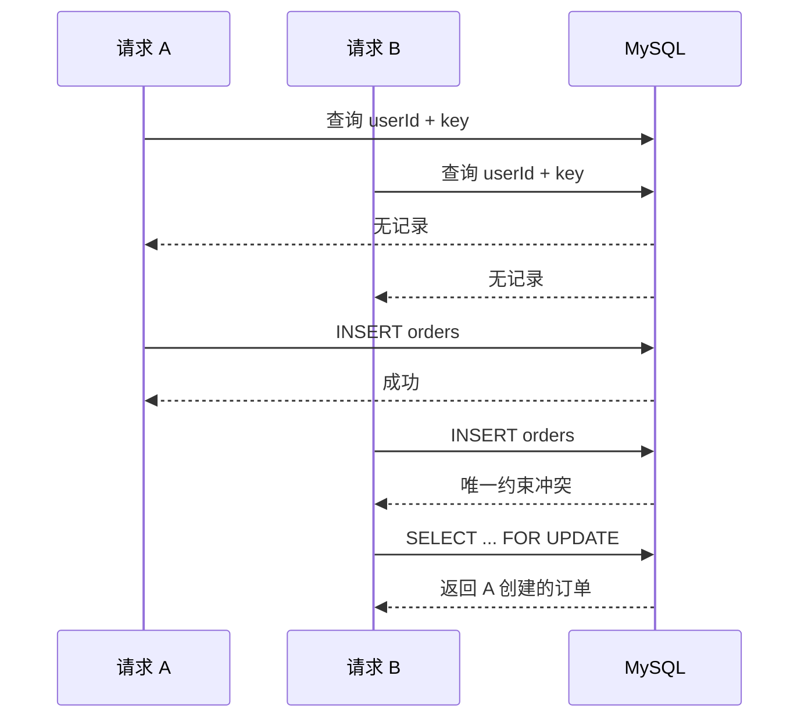

# 第三课：订单创建与幂等 V1.0

> 对应当前代码：2026-10-04，Flyway V12。
>
> 预计学习时间：175～205 分钟。分成 11 次，每次约 15～20 分钟。

前置内容：[第二课：商品查询与后端分层](20-第二课-商品查询与后端分层-V1.0.md)。

## 0. 本课目标

完成本课后，你应该能做到：

1. 从结账按钮追到 `POST /api/orders` 和两张订单表。
2. 解释为什么请求体只提交商品、套餐和幂等键，不提交价格。
3. 解释服务端核价、订单快照和整数金额各自解决的问题。
4. 看懂 `@Valid`、Java `record`、`enum`、`Optional` 和 `@Transactional` 在本链路中的用法。
5. 解释 `orders` 与 `order_items` 为什么分开保存。
6. 说明同一个幂等键的正常重试、参数冲突和并发竞争三条路径。
7. 解释前端按钮禁用、Service 查询和数据库唯一约束的职责差异。
8. 说明为什么订单查询必须同时带 `orderId` 和当前 `userId`。
9. 根据 7 项 Service 单元测试和 8 项 HTTP 契约测试判断各层已经证明了什么、还没有证明什么。
10. 用两分钟准确讲出当前下单实现，且不把本地测试支付说成真实支付。

建议分段：

| 第几次 | 阅读范围 | 预计时间 |
| --- | --- | --- |
| 1 | 第 1～2 节：请求链和页面动作 | 20 分钟 |
| 2 | 第 3 节：前端幂等键 | 15 分钟 |
| 3 | 第 4 节：HTTP、JSON 和 CSRF | 15 分钟 |
| 4 | 第 5～6 节：Controller、校验和当前用户 | 20 分钟 |
| 5 | 第 7～8 节：服务端核价、金额和快照 | 20 分钟 |
| 6 | 第 9～10 节：表结构、事务和迁移历史 | 20 分钟 |
| 7 | 第 11.1～11.3 节：首次、重放和参数冲突 | 15 分钟 |
| 8 | 第 11.4～13 节：并发竞争、归属和错误 | 20 分钟 |
| 9 | 第 14.1～14.8 节：Service 单元测试 | 20 分钟 |
| 10 | 第 14.9～16 节：HTTP 测试、调试和语法 | 20 分钟 |
| 11 | 第 17～20 节：面试表达、边界和检查清单 | 15 分钟 |

## 1. 一次下单经过哪些代码

用户在商品详情选择套餐，进入结账页，点击“确认购买”。当前链路如下：

```mermaid
flowchart LR
    A[结账页确认购买] --> B[completeDemoPurchase]
    B --> C[checkoutIdempotency]
    C --> D[createOrder]
    D --> E[POST /api/orders]
    E --> F[OrderController]
    F --> G[OrderService]
    G --> H[ProductMapper 重新读取商品和套餐]
    G --> I[OrderMapper]
    I --> J[(orders)]
    I --> K[(order_items)]
    G --> L[OrderResponse]
    L --> M[/checkout/result]
```

这条链路包含五个关键判断：

1. 用户是否已经登录。
2. 商品是否仍然公开可售。
3. 套餐是否仍属于该商品并处于可售状态。
4. 同一个用户是否已经用过这个幂等键。
5. `orders` 和 `order_items` 能否在同一个事务中完整写入。

当前按钮文字中的“购买”只创建待支付订单。返回状态是 `PENDING_PAYMENT`，不会在这一步扣款或发放权益。

## 2. 先看用户点击按钮时发生什么

文件：`frontend/src/pages/BuyerPages.vue`。

核心函数经过简化后如下：

```ts
async function completeDemoPurchase() {
  if (!packageOption.value) return
  if (checkoutAuthenticated.value === null) await loadCheckoutIdentity()
  if (checkoutRequiresSignIn.value) {
    void router.push({ path: '/login', query: { next: route.fullPath } })
    return
  }

  orderLoading.value = true
  orderError.value = ''
  try {
    if (!product.value) {
      throw new Error('当前无法连接交易后端，订单没有创建。请恢复服务后重试。')
    }
    const idempotency = checkoutIdempotency(product.value.id, packageOption.value.id)
    const order = await createOrder(product.value.id, packageOption.value.id, idempotency.key)
    sessionStorage.removeItem(idempotency.storageKey)
    void router.push({
      path: '/checkout/result',
      query: { orderId: String(order.id) },
    })
  } catch (error) {
    // 401 跳转登录，其他错误显示在页面中
  } finally {
    orderLoading.value = false
  }
}
```

### 2.1 `async` 和 `await`

`async` 表示函数内部会等待异步操作，调用结果是一个 `Promise`。`await` 会暂停当前函数，等请求完成后再继续执行；它不会冻结整个浏览器页面。

这里有两个连续等待：

```text
loadCheckoutIdentity：确认当前 Session 对应谁
createOrder：向后端创建订单
```

### 2.2 `try / catch / finally`

- `try` 放可能失败的网络请求。
- `catch` 接住 401、409、500 或网络断开等异常。
- `finally` 无论成功还是失败都会执行，所以适合恢复 `orderLoading`。

如果只在成功分支把 `orderLoading` 改回 `false`，失败后按钮会一直停在“正在确认购买…”。

### 2.3 按钮禁用解决什么

页面按钮有这两个条件：

```vue
:disabled="orderLoading || !product"
```

- 请求进行中，`orderLoading` 为 `true`，按钮无法再次点击。
- 商品后端数据没有成功取得时，`product` 为空，按钮不可用。

这属于交互层保护，可以减少普通用户的连续点击。用户仍可绕过页面直接发送 HTTP 请求，也可能在两个标签页同时下单，所以后端和数据库还要继续防守。

### 2.4 成功后为什么才删除幂等键

成功取得订单响应后执行：

```ts
sessionStorage.removeItem(idempotency.storageKey)
```

网络超时或请求失败时不会删除。用户再次点击会复用原来的键，后端可以返回已经创建的订单。成功以后删除，下一次明确发起的新购买会生成新键。

本节可以停在这里。恢复时先复述：登录检查、加载状态、创建订单、成功清键、跳转结果页。

## 3. 前端怎样生成和复用幂等键

文件：`frontend/src/pages/BuyerPages.vue`。

```ts
function checkoutIdempotency(productId: number, packageId: number) {
  const storageKey = `meteor.checkout.idempotency.${productId}.${packageId}`
  const prefix = `checkout-${productId}-${packageId}-`
  const existing = sessionStorage.getItem(storageKey)
  if (existing?.startsWith(prefix) && existing.length <= 100) {
    return { key: existing, storageKey }
  }

  const key = `${prefix}${crypto.randomUUID()}`
  sessionStorage.setItem(storageKey, key)
  return { key, storageKey }
}
```

例如商品 `1001`、套餐 `2002` 可能产生：

```text
checkout-1001-2002-3ad48827-b074-4ebf-b379-b654870fd612
```

### 3.1 两个 key 不要混淆

```text
storageKey：浏览器 sessionStorage 中的存储位置
key：真正发给后端并保存到 orders.idempotency_key 的值
```

`storageKey` 含商品和套餐，因此同一个标签页会为不同套餐保留不同的待重试键。

### 3.2 `sessionStorage` 的范围

`sessionStorage` 通常在当前浏览器标签页会话内保留；刷新页面仍可读取，关闭标签页后一般被清除。它适合覆盖“请求可能已经到达后端，但页面没有收到响应，用户随后刷新重试”的场景。

它无法单独解决以下情况：

- 两个标签页各自生成不同键。
- 脚本或 API 客户端直接构造请求。
- 多台设备同时操作。
- 攻击者故意重复或篡改参数。

最终约束位于数据库。

### 3.3 `crypto.randomUUID()`

它由浏览器生成 UUID，碰撞概率极低。前缀让开发者看日志时能快速识别商品和套餐；服务端仍会用请求中的 `productId`、`packageId` 与旧订单快照比较，不能依赖字符串前缀判断业务参数。

### 3.4 可选链 `?.`

```ts
existing?.startsWith(prefix)
```

当 `existing` 是 `null` 时，表达式直接得到 `undefined`，不会调用 `null.startsWith(...)` 导致异常。

### 3.5 100 字符限制为什么前后端都有

前端复用旧键时检查 `existing.length <= 100`；后端 DTO 使用 `@Size(max = 100)`；数据库列是 `VARCHAR(100)`。三层一致能提早发现问题。后端校验和数据库列限制仍是可信边界，前端检查只改善体验。

## 4. API Client、JSON 和 CSRF

文件：`frontend/src/api/orders.ts`。

```ts
export async function createOrder(
  productId: number,
  packageId: number,
  idempotencyKey: string,
) {
  return apiPost<OrderResponse>(
    '/api/orders',
    { productId, packageId, idempotencyKey },
    true,
  )
}
```

请求体只有三个字段：

```json
{
  "productId": 1001,
  "packageId": 2002,
  "idempotencyKey": "checkout-1001-2002-3ad48827-b074-4ebf-b379-b654870fd612"
}
```

没有这些字段：

```text
priceCents
currency
productTitle
shopName
packageName
orderStatus
userId
```

缺少它们是有意的：

- 价格、币种和展示快照由服务端读取当前可售数据。
- 初始状态由服务端固定为 `PENDING_PAYMENT`。
- 用户 id 来自已经认证的 Session。

如果客户端可以提交 `priceCents: 1`，修改浏览器请求即可把 39 元套餐按 1 分创建订单。

### 4.1 `apiPost<OrderResponse>` 中的尖括号

`OrderResponse` 是 TypeScript 泛型参数，告诉调用方成功响应应按什么结构使用。它提供编辑器补全和编译期检查，无法替代运行时服务端校验。

### 4.2 第三个参数 `true`

`apiPost` 的第三个参数是 `forceFreshCsrf`。传入 `true` 后，创建订单前会重新读取 CSRF token。请求还带：

```ts
credentials: 'include'
```

因此浏览器会附带 Session Cookie。CSRF token 证明这个修改数据的请求来自拿到当前页面令牌的客户端；Session Cookie 用来识别当前用户。

当请求收到 403 时，共享 HTTP Client 会刷新一次 CSRF token 并重试一次。这里的重试进一步说明创建订单必须支持幂等。

### 4.3 HTTP 语义

初次成功响应：

```http
HTTP/1.1 201 Created
Content-Type: application/json
```

当前 Controller 使用固定的 `@ResponseStatus(HttpStatus.CREATED)`，所以同键重放返回已有订单时也会得到 201。这是当前实现契约；若以后需要严格区分“新建”和“重放”，可以增加响应元数据或调整响应状态，不能在教程中假称现在已经区分。

## 5. Controller：接住 HTTP 请求

文件：`backend/src/main/java/dev/meteor/order/controller/OrderController.java`。

```java
@RestController
@RequestMapping("/api/orders")
public class OrderController {

    @PostMapping
    @ResponseStatus(HttpStatus.CREATED)
    public OrderResponse createOrder(
            @AuthenticationPrincipal MeteorUserPrincipal principal,
            @Valid @RequestBody CreateOrderRequest request
    ) {
        return orderService.createOrder(principal.id(), request);
    }
}
```

逐项解释：

| 语法 | 在这里的作用 |
| --- | --- |
| `@RestController` | 返回值序列化为 JSON |
| `@RequestMapping("/api/orders")` | 定义 Controller 的共同路径 |
| `@PostMapping` | 接收 `POST /api/orders` |
| `@ResponseStatus(CREATED)` | 成功响应状态为 201 |
| `@AuthenticationPrincipal` | 取得 Spring Security 已认证用户 |
| `@RequestBody` | 把 JSON 解析成 Java 对象 |
| `@Valid` | 执行 DTO 字段上的 Bean Validation 规则 |

Controller 没有写 SQL，也没有决定价格。它完成 HTTP 层转换后，把 `principal.id()` 和请求 DTO 交给 Service。

## 6. 请求校验和当前用户

文件：`backend/src/main/java/dev/meteor/order/dto/CreateOrderRequest.java`。

```java
public record CreateOrderRequest(
        @Positive long productId,
        @Positive long packageId,
        @NotBlank @Size(max = 100) String idempotencyKey
) {
    public CreateOrderRequest {
        idempotencyKey = idempotencyKey == null ? null : idempotencyKey.strip();
    }
}
```

### 6.1 Java `record`

`record` 适合表达只承载数据的对象。Java 自动提供构造器、字段访问方法、`equals`、`hashCode` 和 `toString`。读取字段时写：

```java
request.productId()
request.packageId()
request.idempotencyKey()
```

它与普通 JavaBean 的 `getProductId()` 命名不同。

### 6.2 三个校验注解

- `@Positive`：id 必须大于 0。
- `@NotBlank`：幂等键不能为 `null`、空串或只有空白。
- `@Size(max = 100)`：最多 100 个字符。

校验失败由共享异常处理器转换为 400。Service 不会开始查商品或写订单。

### 6.3 紧凑构造器

```java
public CreateOrderRequest {
    idempotencyKey = idempotencyKey == null ? null : idempotencyKey.strip();
}
```

这是 record 的 compact constructor。`strip()` 删除首尾 Unicode 空白。测试传入 `" checkout-001 "`，最终保存为 `"checkout-001"`。

先判空是因为校验发生在对象构造之后；直接调用 `idempotencyKey.strip()` 会在校验报告 `@NotBlank` 前触发空指针异常。

### 6.4 用户 id 为什么不在请求体

可信用户来自：

```java
@AuthenticationPrincipal MeteorUserPrincipal principal
```

随后传入：

```java
orderService.createOrder(principal.id(), request)
```

假设请求体允许 `userId: 2`，登录用户可以改成其他人的 id 下单或查询。当前接口从 Session 得到用户身份，前端没有选择目标用户的权限。

## 7. Service 第一部分：先查旧请求，再重新核价

文件：`backend/src/main/java/dev/meteor/order/service/OrderService.java`。

方法开头先查幂等记录：

```java
OrderSnapshotProjection existing = orderMapper
        .findByUserIdAndIdempotencyKey(userId, request.idempotencyKey())
        .orElse(null);
```

存在旧订单时比较原请求的商品和套餐：

```java
if (existing != null) {
    if (existing.productId() != request.productId()
            || existing.packageId() != request.packageId()) {
        throw new OrderIdempotencyConflictException(request.idempotencyKey());
    }
    return toResponse(existing);
}
```

没有旧订单时才读取当前商品和套餐：

```java
ProductSummaryProjection product = productMapper
        .findPublishedProduct(request.productId())
        .orElseThrow(() -> new ProductNotFoundException(request.productId()));

PackageOptionProjection packageOption = productMapper
        .findSalePackage(request.productId(), request.packageId())
        .orElseThrow(() -> new OrderPackageNotFoundException(
                request.productId(), request.packageId()
        ));
```

### 7.1 服务端重新读取什么

- 当前公开商品标题。
- 当前店铺名称。
- 该商品下当前可售套餐。
- 套餐当前价格。
- 套餐当前币种。

`findSalePackage(productId, packageId)` 同时带两个 id，阻止把 A 商品的套餐 id 拼到 B 商品请求里。

### 7.2 `Optional.orElseThrow`

Mapper 返回 `Optional<T>`，表达查询可能没有结果。`orElseThrow` 在没有记录时抛出明确业务异常：

```text
商品不可公开读取 → ProductNotFoundException → 404
套餐不属于商品或不再可售 → OrderPackageNotFoundException → 404
```

这里把不可售资源统一隐藏为 404，没有向调用者泄露更多内部状态。

### 7.3 为什么旧订单要先返回

第一次请求已成功创建订单后，商品可能下架或价格可能变化。相同幂等请求重放时应返回第一次的结果，不能按照新价格再创建一笔，也不能因商品后来下架而把已经成功的第一次请求改成失败。

## 8. 金额、状态和订单快照

### 8.1 当前项目怎样表示金额

当前代码使用最小货币单位“分”的整数：

```text
19.00 元 → 1900
39.00 元 → 3900
```

对应类型：

```text
TypeScript：number
Java：long
MySQL：BIGINT
```

字段名明确带 `_cents` 或 `Cents`：

```text
price_cents
total_amount_cents
unit_price_cents
priceCents
totalAmountCents
```

整数避免二进制浮点数计算 `0.1 + 0.2` 时出现精度尾差。当前业务只支持 CNY 和整数分，所以没有使用 `BigDecimal`。如果以后支持费率计算、更多小数位货币或复杂税额，需重新设计舍入规则和金额类型。

### 8.2 初始状态由谁决定

```java
new OrderInsert(
        userId,
        OrderStatus.PENDING_PAYMENT,
        packageOption.priceCents(),
        packageOption.currency(),
        request.idempotencyKey()
)
```

客户端无法指定 `PAID`。创建订单只会进入 `PENDING_PAYMENT`。

### 8.3 `enum` 把状态限制在四个值

文件：`backend/src/main/java/dev/meteor/order/model/OrderStatus.java`。

```java
public enum OrderStatus {
    PENDING_PAYMENT,
    PAID,
    CLOSED,
    REFUNDED;

    public boolean acceptsPayment() {
        return this == PENDING_PAYMENT;
    }

    public boolean hasPaid() {
        return this == PAID;
    }
}
```

相比任意字符串，enum 能让编译器发现拼写错误，也能把状态判断集中到类型上。数据库还有 `CHECK` 约束，防止绕开 Java 写入未知状态。

### 8.4 什么是订单快照

创建订单项时保存：

```java
new OrderItemInsert(
        order.getId(),
        product.id(),
        packageOption.id(),
        product.title(),
        product.shopName(),
        packageOption.name(),
        "ALL_RELEASES",
        packageOption.priceCents(),
        packageOption.currency(),
        1
)
```

其中 `productId`、`packageId` 保留与当前业务对象的关联；标题、店铺名、套餐名、访问策略、单价和币种保存成交时快照。

假设商家第二天把套餐从 39 元改为 49 元，并修改商品标题：

- 新访问商品详情应显示新标题和 49 元。
- 旧订单仍应显示成交时标题和 39 元。
- 支付旧订单时应核对订单中的 3900 分。

订单详情查询读取 `order_items` 的快照字段，不回查当前商品名称覆盖历史。

## 9. `orders` 和 `order_items` 为什么分开

当前一笔订单只有一个订单项，数据库仍分为两张表：

```text
orders
  id
  user_id
  status
  total_amount_cents
  currency
  idempotency_key

order_items
  id
  order_id
  product_id
  package_id
  product_title
  shop_name
  package_name
  access_policy
  unit_price_cents
  currency
  quantity
```

职责划分：

- `orders` 保存整笔交易的购买者、总额、状态和请求身份。
- `order_items` 保存这笔交易买了什么，以及成交时承诺。

当前 V4 约束 `uq_order_item_order UNIQUE (order_id)`，并要求 `quantity = 1`，所以每个订单只能有一个订单项。这与当前单商品立即购买流程一致。以后实现购物车和多商品订单时，需要新增迁移调整约束与金额汇总逻辑，不能只改前端数组。

## 10. 事务和迁移历史

### 10.1 `@Transactional` 的边界

```java
@Transactional
public OrderResponse createOrder(long userId, CreateOrderRequest request) {
    // 查旧请求、核价、插入 orders、插入 order_items
}
```

Spring 在方法外层开启数据库事务。正常返回时提交；未处理的运行时异常通常触发回滚。

如果 `orders` 插入成功，`order_items` 插入失败，整个事务应回滚，避免数据库留下没有商品明细的半张订单。

`@Transactional` 还让同一次下单中的多个 Mapper 操作共享事务上下文。它不代表“任何异常都一定按预期恢复”；数据库类型、异常转换、隔离级别和捕获方式仍需要集成测试验证。

### 10.2 V4：最初创建订单表

文件：`backend/src/main/resources/db/migration/V4__create_orders.sql`。

关键约束：

```sql
CONSTRAINT uq_order_user_idempotency
    UNIQUE (user_id, idempotency_key),
CONSTRAINT chk_order_total
    CHECK (total_amount_cents >= 0),
CONSTRAINT chk_order_currency
    CHECK (currency = 'CNY')
```

`UNIQUE (user_id, idempotency_key)` 表示：

- 同一用户不能重复使用同一个幂等键创建两笔订单。
- 不同用户可以各自使用相同字符串，不会互相冲突。

V4 最初的状态是 `PENDING／PAID／CANCELLED／REFUNDED`。已经执行过的迁移不能原地修改，否则已有数据库与新数据库可能得到不同历史。

### 10.3 V6：补齐快照字段和权益策略

文件：`backend/src/main/resources/db/migration/V6__create_entitlement_grants.sql`。

V6 给 `order_items` 增加：

```text
shop_name
access_policy
```

迁移先允许为空，回填已有订单，再改成 `NOT NULL` 并加入 `ALL_RELEASES` 检查约束。这种顺序避免已有数据使加列直接失败。

### 10.4 V11：统一当前状态语言

文件：`backend/src/main/resources/db/migration/V11__normalize_order_statuses.sql`。

V11 完成三件事：

1. 删除旧状态检查约束。
2. 把历史 `PENDING` 改成 `PENDING_PAYMENT`，把 `CANCELLED` 改成 `CLOSED`。
3. 设置新默认值并建立四状态检查约束。

所以当前数据库有效状态是：

```text
PENDING_PAYMENT / PAID / CLOSED / REFUNDED
```

只读 V4 会看到旧状态；判断当前结构必须按 V4 → V6 → V11 的迁移顺序叠加。

### 10.5 生成主键怎样回到 Java 对象

Mapper 使用：

```java
@Options(useGeneratedKeys = true, keyProperty = "id", keyColumn = "id")
int insertOrder(OrderInsert order);
```

MySQL 插入后产生自增 id，MyBatis 通过 `setId(...)` 写回传入的 `OrderInsert`：

```java
order.getId()
```

随后这个 id 被写入 `order_items.order_id`。

本节可以停在这里。恢复时画出两张表，并说明一次事务为什么要写两张表。

## 11. 幂等的三条路径

幂等在这里的含义：同一个用户用同一个键重试同一个下单意图，系统返回同一订单，不重复产生订单。

### 11.1 路径 A：第一次请求

```text
按 userId + idempotencyKey 查询 → 没有
读取当前商品和套餐 → 有效
插入 orders → 成功
插入 order_items → 成功
事务提交 → 返回新订单
```

### 11.2 路径 B：第一次已完成，客户端重试

```text
按 userId + idempotencyKey 查询 → 找到订单 7001
比较 productId 和 packageId → 与本次相同
不再 INSERT
返回订单 7001 的快照
```

这覆盖常见超时：服务端已经提交，响应在网络中丢失，浏览器不知道结果。重试得到原订单，用户无需猜测是否重复购买。

### 11.3 路径 C：同键被用于另一套餐

```text
按 userId + idempotencyKey 查询 → 找到订单 7001
旧 packageId = 2001
新 packageId = 2002
抛出 OrderIdempotencyConflictException
返回 409 IDEMPOTENCY_CONFLICT
```

同一个键代表一个确定请求意图。若允许同键参数改变，系统无法判断应该返回旧结果还是执行新请求。

### 11.4 路径 D：两个请求同时到达

两个请求可能几乎同时执行第一次查询，都看到“没有旧订单”：



Service 的恢复代码：

```java
try {
    orderMapper.insertOrder(order);
} catch (DuplicateKeyException duplicateKeyException) {
    OrderSnapshotProjection concurrentlyCreated = orderMapper
            .findByUserIdAndIdempotencyKeyForUpdate(
                    userId,
                    request.idempotencyKey()
            )
            .orElseThrow(() -> duplicateKeyException);

    if (concurrentlyCreated.productId() != request.productId()
            || concurrentlyCreated.packageId() != request.packageId()) {
        throw new OrderIdempotencyConflictException(request.idempotencyKey());
    }
    return toResponse(concurrentlyCreated);
}
```

### 11.5 为什么“先查询”还需要唯一约束

“先查再插”包含时间间隙。多个请求可以都在插入前完成查询。数据库唯一约束在最终写入点原子裁决，只允许一个成功。

### 11.6 `DuplicateKeyException`

这是 Spring 对数据库唯一键异常的统一抽象。Service 捕获后没有直接显示 500，而是读取竞争中胜出的订单，再比较业务参数。

当前 `orders` 还有主键等唯一约束；该分支默认本次重复异常对应用户级幂等键。若未来在同一次插入上增加其他唯一约束，应根据约束来源区分，避免把无关的数据错误误判为幂等重放。

### 11.7 为什么恢复查询带 `FOR UPDATE`

Mapper 查询末尾是：

```sql
FOR UPDATE
```

在当前 MySQL InnoDB 事务场景中，这是锁定当前读。它用于读取并锁住竞争请求已提交的记录，避免恢复逻辑只依赖事务早先的一致性快照。项目此前已经用真实 MySQL 并发 HTTP 请求验证了当前实现的重复请求恢复；单元测试只模拟异常和返回值，无法单独证明数据库隔离行为。

### 11.8 数据库约束是最后一道保证

三层职责可以这样记：

| 层 | 保护内容 | 能否单独保证不重复 |
| --- | --- | --- |
| 前端按钮禁用 | 减少一次页面中的连续点击 | 不能 |
| Service 预查询 | 快速返回已存在订单并检查参数 | 不能，存在并发窗口 |
| 数据库唯一约束 | 原子阻止同用户同键重复插入 | 能 |

幂等处理还包括冲突语义和结果重放，所以数据库唯一约束提供底线，Service 提供完整业务行为。

## 12. Mapper SQL 和资源归属

### 12.1 按幂等键查询时带用户 id

```sql
WHERE o.user_id = #{userId}
  AND o.idempotency_key = #{idempotencyKey}
```

幂等键只在一个用户范围内唯一。只按键查询可能把另一个用户碰巧相同的键当成本人的历史请求。

### 12.2 订单详情也带用户 id

```sql
WHERE o.id = #{orderId}
  AND o.user_id = #{userId}
```

`orderId` 来自 URL，用户可以修改。`userId` 来自 Session。把二者放在同一条 SQL 条件中，其他用户的订单和不存在的订单都返回空，Service 统一抛出 `OrderNotFoundException`。

这能减少资源枚举信息泄露，也能在数据库读取阶段阻止越权。

### 12.3 `@Param`

```java
Optional<OrderSnapshotProjection> findByIdAndUserId(
        @Param("orderId") long orderId,
        @Param("userId") long userId
);
```

`@Param` 为 SQL 中的 `#{orderId}` 和 `#{userId}` 提供明确名称。`#{...}` 使用预编译参数绑定，不把用户输入直接拼进 SQL。

### 12.4 Projection

查询结果映射为：

```java
public record OrderSnapshotProjection(
        long id,
        long userId,
        OrderStatus status,
        long totalAmountCents,
        String currency,
        String idempotencyKey,
        long productId,
        long packageId,
        String productTitle,
        String shopName,
        String packageName,
        String accessPolicy
) {}
```

Projection 服务于数据库查询结果。`OrderResponse` 服务于外部 API。Service 的 `toResponse` 明确转换两者，避免直接把持久层结构暴露为接口契约。

### 12.5 用 XML 公共片段消除重复 SQL（10 分钟）

接口文件 `backend/src/main/java/dev/meteor/order/mapper/OrderMapper.java` 只保留方法签名和 `@Param`。SQL 位于 `backend/src/main/resources/mapper/OrderMapper.xml`，namespace 必须与接口完整类名一致，`select`、`insert`、`update` 的 id 必须与方法名一致。

四个订单快照查询原先各写一次相同字段和 JOIN。当前实现把它们收拢为：

```xml
<sql id="orderSnapshotColumns">
    o.id,
    o.user_id,
    o.status,
    <!-- 其余订单和订单项快照字段 -->
</sql>

<sql id="orderSnapshotFrom">
    FROM orders o
    JOIN order_items oi ON oi.order_id = o.id
</sql>

<select id="findByIdAndUserIdForUpdate"
        resultType="dev.meteor.order.mapper.projection.OrderSnapshotProjection">
    SELECT <include refid="orderSnapshotColumns"/>
    <include refid="orderSnapshotFrom"/>
    WHERE o.id = #{orderId}
      AND o.user_id = #{userId}
    FOR UPDATE
</select>
```

`<sql>` 只定义可复用的 SQL 片段，不会单独执行；`<include>` 在 MyBatis 解析 Mapper 时展开片段。普通查询和加锁查询只复用字段与 JOIN，各自的 WHERE 和 `FOR UPDATE` 仍清楚可见，因此这次改动不改变接口、表结构或业务行为。

快速验证文件是 `backend/src/test/java/dev/meteor/order/mapper/OrderMapperXmlTest.java`。它不连接数据库，直接解析 XML，确认 9 个 Mapper 语句都存在、普通查询没有 `FOR UPDATE`、锁定查询以 `FOR UPDATE` 结尾、`insertOrder` 仍把生成主键写回 `id`。真实 SQL 能否被 MySQL 执行仍由 Testcontainers 集成测试负责；本机 Docker 不可用时，这部分证据仍是跳过状态。

面试可以说：“我把高频变化的查询列和 JOIN 收进 MyBatis XML 片段，并补了快速映射契约测试，降低字段演进漏改风险；数据库方言和事务行为仍由真实 MySQL 集成测试验证。”不能把 XML 解析测试说成数据库集成测试。

## 13. 错误怎样回到页面

共享异常处理文件：`backend/src/main/java/dev/meteor/web/error/GlobalExceptionHandler.java`。

与下单相关的主要结果：

| 情况 | HTTP 状态 | 错误码或行为 |
| --- | --- | --- |
| 未登录 | 401 | 前端跳登录页并保留 `next` |
| CSRF 无效 | 403 | HTTP Client 刷新令牌后重试一次 |
| id、键格式不合法 | 400 | `INVALID_ARGUMENT` |
| 商品不可公开读取 | 404 | `PRODUCT_NOT_FOUND` |
| 套餐不属于商品或不可售 | 404 | `ORDER_PACKAGE_NOT_FOUND` |
| 同键对应不同商品／套餐 | 409 | `IDEMPOTENCY_CONFLICT` |
| 成功创建或成功重放 | 201 | 返回 `OrderResponse` |

页面错误元素使用：

```vue
<p v-if="orderError" class="form-error" role="alert">
  {{ orderError }}
</p>
```

`role="alert"` 让辅助技术在错误出现时播报。按钮在加载中显示“正在确认购买…”，避免用户不知道点击是否生效。

## 14. 两层订单自动化测试分别证明什么

文件：`backend/src/test/java/dev/meteor/order/service/OrderServiceTest.java`。

### 14.1 服务端核价和快照

`pricesOrderFromCurrentSalePackageAndStoresImmutableSnapshot`

证明：

- 请求中的幂等键会先 `strip()`。
- 状态是 `PENDING_PAYMENT`。
- 总额来自当前套餐的 3900 分。
- 标题、店铺、套餐名、访问策略和单价写入订单项。

### 14.2 同键同参数直接返回旧订单

`returnsPreviousOrderForSameIdempotencyKeyWithoutWritingAgain`

证明 `insertOrderCalls` 和 `insertItemCalls` 都是 0，重放没有再次写库。

### 14.3 同键不同套餐冲突

`rejectsReuseOfIdempotencyKeyForDifferentPackage`

证明复用键并改变套餐会抛 `OrderIdempotencyConflictException`。

### 14.4 拒绝不可售套餐

`rejectsPackageThatIsNotCurrentlyForSale`

证明套餐查询无结果时抛异常，并且订单插入次数为 0。

### 14.5 并发唯一键冲突恢复

`returnsConcurrentlyCreatedOrderWhenUniqueIdempotencyKeyWinsTheRace`

Stub 在插入时主动抛 `DuplicateKeyException`，锁定查询返回订单 `7002`。测试证明 Service 会返回胜出的订单且不插入第二个订单项。

它没有启动两个真实线程，也没有连接 MySQL，所以只证明 Java 分支。真实数据库并发行为来自阶段性 MySQL HTTP 验收。

### 14.6 用户范围的列表和详情

`returnsOnlyUserScopedOrderDetailsWithEntitlementState`

证明 Service 能映射订单快照与权益状态。Stub 不会自己检查 SQL，真正的用户过滤条件还要查看 Mapper SQL或通过集成／HTTP 验收证明。

### 14.7 隐藏不存在或外部订单

`hidesMissingOrForeignOrderBehindNotFound`

证明查询为空时统一抛 `OrderNotFoundException`。

### 14.8 Stub 单元测试的边界

这些测试速度快，能精确验证 Service 分支。它们没有证明：

- MyBatis 列名能否全部正确映射。
- MySQL 检查约束是否生效。
- `FOR UPDATE` 在真实隔离级别下的行为。
- 两个并发 HTTP 请求的提交顺序。
- 前端从点击到结果页的完整浏览器行为。

项目已经做过真实 MySQL、重复请求、冲突请求和浏览器验收。现在已有一条 Testcontainers 下单／支付测试代码，但本机 Docker 启动失败使它尚未执行；并发请求和 CI 仍没有自动化覆盖。

### 14.9 八项 HTTP 契约测试（15 分钟）

文件：`backend/src/test/java/dev/meteor/order/controller/OrderControllerWebTest.java`。

`OrderServiceTest` 直接调用 Service，不会经过 Spring Security、CSRF 过滤器、JSON 反序列化、Bean Validation、HTTP 状态或全局异常映射。`OrderControllerWebTest` 使用 `@WebMvcTest` 和 `MockMvc` 补这一层：

| 测试行为 | HTTP 结果 | 证明内容 |
| --- | --- | --- |
| 匿名创建订单 | 401 `UNAUTHORIZED` | 写接口必须先建立 Session 身份 |
| 已登录但无 CSRF | 403 `FORBIDDEN` | 浏览器写请求必须携带 CSRF token |
| 非法商品、套餐和空幂等键 | 400 `INVALID_ARGUMENT` | `@Valid` 在进入 Service 前拦截请求 |
| 合法创建 | 201 + 订单快照 JSON | Controller 传入当前 Principal id，compact constructor 已去除幂等键空白 |
| 同键改参数 | 409 `IDEMPOTENCY_CONFLICT` | 业务冲突映射为稳定错误码 |
| 不可售套餐 | 404 `ORDER_PACKAGE_NOT_FOUND` | 资源不可用不会伪装成成功订单 |
| 查询订单列表 | 200 + 当前用户结果 | Controller 不接受前端 userId，只传 Principal id |
| 不存在或外部订单 | 404 `ORDER_NOT_FOUND` | 两种情况使用同一外部响应，避免泄露资源存在性 |

成功测试中的关键安排是：

```java
CreateOrderRequest normalizedRequest =
        new CreateOrderRequest(101L, 201L, "checkout-001");

verify(orderService).createOrder(USER_ID, normalizedRequest);
```

请求 JSON 实际传入的是 `" checkout-001 "`。Jackson 构造 record 时执行 compact constructor 的 `strip()`，因此 Mockito 验证 Service 收到的是规范化后的值。这个测试同时连接了 JSON、Java record 构造过程和 Controller 调用参数。

`@WebMvcTest` 没有启动 MySQL，也没有执行 `OrderService` 的核价、事务或并发恢复。它证明 HTTP 边界；7 项 Service 测试证明业务分支；真实 MySQL 验收和尚未跑通的 Testcontainers 负责数据库映射与事务证据。四类证据不能相互替代。

## 15. 从零开始调试这条链路

按下面顺序定位，能减少来回猜测。

### 15.1 页面没有发请求

检查：

1. 是否选中了套餐。
2. `product` 是否成功加载。
3. 按钮是否因 `orderLoading` 或 `!product` 被禁用。
4. 未登录时是否跳到 `/login?next=...`。
5. 浏览器 Console 是否有 JavaScript 错误。

### 15.2 请求是 400

查看 Network 中的 JSON：

```text
productId 是否为正数
packageId 是否为正数
idempotencyKey 是否为空或超过 100 字符
```

再对照 `CreateOrderRequest` 的校验注解。

### 15.3 请求是 401 或 403

- 401：确认 Session Cookie 是否存在，登录接口是否成功。
- 403：查看 `/api/auth/csrf` 是否成功，提交头是否使用响应提供的 headerName。
- 403 自动重试仍失败：检查 Session 是否已失效，不要无限重试。

### 15.4 请求是 404

分别检查：

```text
findPublishedProduct(productId)
findSalePackage(productId, packageId)
```

商品存在于数据库不代表当前公开可售；套餐存在也不代表它属于请求商品并仍在售。

### 15.5 请求是 409

按当前用户和幂等键查旧订单，比较旧 `product_id/package_id` 与本次请求。409 通常说明客户端错误复用了另一个购买意图的键。

### 15.6 数据库出现半张订单

检查 Service 是否仍由 Spring 代理调用、`@Transactional` 是否生效、异常是否被吞掉、表引擎是否为 InnoDB。当前正常路径应同时提交 `orders` 和 `order_items`。

### 15.7 页面超时但数据库已有订单

保留原 sessionStorage 幂等键重新请求。预期返回同一订单 id，数据库中同用户同键仍只有一行。

## 16. 高频语法速查

### 16.1 TypeScript 联合类型

```ts
status: 'PENDING_PAYMENT' | 'PAID' | 'CLOSED' | 'REFUNDED'
```

表示 `status` 只能取列出的字符串。后端增加状态后，前端类型和显示逻辑必须同步。

### 16.2 解构返回对象

当前代码保存整个 `idempotency` 对象：

```ts
const idempotency = checkoutIdempotency(...)
idempotency.key
idempotency.storageKey
```

等价的解构写法是：

```ts
const { key, storageKey } = checkoutIdempotency(...)
```

### 16.3 Java Lambda

```java
.orElseThrow(() -> new ProductNotFoundException(request.productId()))
```

`() -> ...` 是无参数 Lambda。只有 Optional 为空时才创建异常。

### 16.4 `final`

`OrderInsert` 中除生成 id 外的字段都是 `final`，构造完成后不能重新指向其他值。生成 id 由 MyBatis 写回，因此 `id` 保留 setter。

### 16.5 `static final`

```java
private static final String ACCESS_POLICY = "ALL_RELEASES";
```

这是类级常量，所有 `OrderService` 实例共享，创建后不能重新赋值。

### 16.6 SQL `JOIN`

```sql
FROM orders o
JOIN order_items oi ON oi.order_id = o.id
```

只有同时存在订单头和订单项时才返回快照。这与事务保证的完整写入相互配合。

### 16.7 `LEFT JOIN`

订单列表查询权益使用 `LEFT JOIN entitlement_grants`。待支付订单还没有 grant，也应出现在购买记录中，因此不能用普通 `JOIN` 把它过滤掉。

## 17. 面试追问与准确回答

### 问：为什么价格不能由前端传？

答：

> 浏览器请求可被修改。创建订单时我只接收商品 id、套餐 id 和幂等键，后端重新查询当前公开商品与可售套餐，用数据库中的 `priceCents` 和 `currency` 创建订单，再保存成交快照。前端价格只用于展示。

### 问：为什么金额用 long？

答：

> 当前只支持 CNY 和整数分，Java 用 long、MySQL 用 BIGINT，并通过字段名明确 cents，避免浮点精度问题。若以后支持多币种小数位、税费或费率计算，需要补充舍入规则并重新评估 BigDecimal 或 Money 值对象。

### 问：幂等怎样实现？

答：

> 前端为一次结账意图生成 UUID，并在 sessionStorage 中保留到成功响应。后端先按当前用户和幂等键查询，参数一致就返回旧订单，参数变化返回 409。并发请求可能同时查不到记录，所以数据库还有 `(user_id, idempotency_key)` 唯一约束；竞争失败方捕获 DuplicateKeyException，再用锁定当前读读取胜出订单。

### 问：为什么不能只禁用按钮？

答：

> 按钮禁用只能改善一个页面里的交互，无法阻止刷新、双标签页、网络自动重试和直接 API 调用。数据库唯一约束负责最终原子保证，Service 负责结果重放和参数冲突语义。

### 问：订单快照有什么用？

答：

> 商品标题、店铺名、套餐名和价格以后可能变化。订单项保存成交时的这些字段，历史订单和后续支付仍以当时承诺为准；同时保留 productId 和 packageId 供授权与追踪使用。

### 问：`@Transactional` 在这里保护什么？

答：

> 创建订单头和订单项属于一个业务动作。事务保证两次写入一起提交或一起回滚，避免只留下订单头。并发幂等还依赖数据库唯一约束和冲突恢复，事务本身不会消除所有竞争。

### 问：怎样防止用户读取别人的订单？

答：

> 用户 id 取自 Spring Security 的 AuthenticationPrincipal，不接受前端 userId。详情 SQL 同时限定 `o.id = orderId` 和 `o.user_id = currentUserId`，无记录时统一返回 404。

### 问：你做过真实并发测试吗？

答：

> Service 单元测试模拟了唯一键冲突恢复分支，阶段验收还在真实 MySQL 上发送过并发 HTTP 请求，确认重复请求收敛到同一订单。当前 Testcontainers 代码只覆盖顺序重放和支付事务回滚，而且尚因 Docker 问题跳过；并发集成测试、CI 和压力测试都没有完成。

## 18. 两分钟讲解稿与当前边界

理解后按自己的语言表达：

> 用户在 Vue 结账页选择套餐并确认购买。页面先检查 Session 登录状态，为本次商品和套餐生成 UUID 幂等键，并把键保存在 sessionStorage 直到收到成功响应。API 只提交 productId、packageId 和 idempotencyKey，同时携带 Session Cookie 和 CSRF token。OrderController 从 AuthenticationPrincipal 取得当前用户，校验 DTO 后交给 OrderService。Service 先按用户和幂等键查历史订单；新请求会重新读取当前公开商品和可售套餐，用数据库中的整数分价格创建 PENDING_PAYMENT 订单，并把成交时标题、店铺、套餐、价格和访问策略写进 order_items。两次写入处于同一事务。数据库用用户加幂等键的唯一约束处理并发竞争，失败方读取胜出订单；同键参数变化返回 409。订单查询也同时限定订单 id 和当前用户 id。对应 Service 有 7 项单元测试，HTTP 层有 8 项认证、CSRF、校验和错误契约测试；项目做过真实 MySQL 重复和并发请求验收。Testcontainers 测试代码已加入，但容器尚未跑通，也没有压力测试。

当前已经实现并验证：

- 单商品、单套餐的服务端核价下单。
- 订单头和订单项快照。
- 用户级幂等重放、参数冲突和并发唯一约束恢复。
- Session 用户范围内的订单列表和详情。
- 本地测试支付可把待支付订单推进到已支付并发放权益。

当前未实现：

- 购物车、多商品订单和数量大于 1。
- 优惠券、税费、库存预占、运费或多币种。
- 订单超时关闭任务和用户主动取消。
- 真实支付机构接入、退款和对账。
- 幂等键过期或归档策略；当前键随订单长期保留。
- Testcontainers 容器运行验证、CI 并发集成测试和性能压测。

## 19. 完成本课的检查标准

- [ ] 能从结账按钮依次找到 `createOrder`、Controller、Service、Mapper 和两张表。
- [ ] 能说出请求体为什么没有价格、用户 id 和订单状态。
- [ ] 能解释 `sessionStorage` 中 storageKey 与发给后端的 key。
- [ ] 能解释请求失败时为什么保留键、成功时为什么删除键。
- [ ] 能解释 `@AuthenticationPrincipal`、`@Valid` 和 Java record。
- [ ] 能把 39 元写成 3900 分，并说明当前为什么使用 long/BIGINT。
- [ ] 能区分订单头与订单项快照。
- [ ] 能说明 V4、V6、V11 分别改变了什么。
- [ ] 能画出首次请求、普通重放、参数冲突和并发竞争四条路径。
- [ ] 能解释“先查再插”为什么仍需要数据库唯一约束。
- [ ] 能说明 `FOR UPDATE` 在并发恢复查询中的作用。
- [ ] 能指出 7 项 Stub 单元测试没有覆盖真实数据库映射和隔离行为。
- [ ] 能解释 8 项 `@WebMvcTest` 为什么能证明 HTTP 契约，却不能证明 Service 事务。
- [ ] 能说明订单详情 SQL 为什么同时限定订单 id 和当前用户 id。
- [ ] 能准确说出当前没有真实支付、退款、购物车和生产下载。

## 20. 下一课

下一步阅读：[第四课：测试支付与事务内权益发放](22-第四课-测试支付与事务内权益发放-V1.0.md)。

第四课进入本地测试支付和权益发放：

```text
PENDING_PAYMENT 订单
  → POST 测试支付事件
  → 锁定当前用户订单
  → 校验金额、币种、事件键和交易键
  → 订单变为 PAID
  → 同一事务幂等创建 EntitlementGrant
  → 内容库可见
```

重点包括支付事实与业务状态的区别、订单行锁、事件幂等、事务内发放权益、重放处理，以及本地测试适配器与真实支付机构之间的边界。
