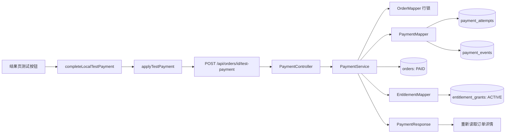

# 第四课：测试支付与事务内权益发放 V1.0

> 对应当前代码：2026-10-04，Flyway V12。
>
> 预计学习时间：160～190 分钟。分成 10 次，每次约 15～20 分钟。

前置内容：[第三课：订单创建与幂等](21-第三课-订单创建与幂等-V1.0.md)。

## 0. 本课目标

完成本课后，你应该能做到：

1. 从结果页的“完成本地测试购买”追到支付事件、订单状态和购买权益。
2. 说明为什么前端开发模式和后端配置要分别控制测试入口。
3. 区分订单 id、支付尝试 id、提供方事件 id、提供方交易 id 和权益 id。
4. 解释 `SELECT ... FOR UPDATE` 为什么放在支付方法开头。
5. 说明金额、币种、订单状态、事件关联和交易关联怎样校验。
6. 画出首次支付、同事件重放、同交易不同事件重放和冲突四类路径。
7. 解释支付尝试、支付事件、订单和权益为什么要在同一个本地事务中更新。
8. 说明 `INSERT ... SELECT ... ON DUPLICATE KEY UPDATE` 怎样幂等发放权益。
9. 根据 10 项 Service 测试和 7 项 Controller Web 测试判断已有证据和测试空白。
10. 准确说明本地测试适配器与真实支付回调的差距。

建议分段：

| 第几次 | 阅读范围 | 预计时间 |
| --- | --- | --- |
| 1 | 第 1～2 节：页面动作、开关和请求链 | 20 分钟 |
| 2 | 第 3～4 节：前端标识与 API 请求 | 15 分钟 |
| 3 | 第 5～6 节：Controller、DTO 和当前用户 | 15 分钟 |
| 4 | 第 7～8 节：订单行锁和首次支付校验 | 20 分钟 |
| 5 | 第 9～10 节：支付尝试、事件和状态转移 | 20 分钟 |
| 6 | 第 11～12 节：权益发放和事务回滚 | 20 分钟 |
| 7 | 第 13～14 节：两类重放与冲突矩阵 | 20 分钟 |
| 8 | 第 15～16 节：迁移、约束、Service 与 Web 测试 | 20 分钟 |
| 9 | 第 17～18 节：错误、调试和语法 | 20 分钟 |
| 10 | 第 19～21 节：面试表达、边界和检查清单 | 15 分钟 |

## 1. 用户在页面上做了什么

第三课结束时，数据库里已经有一笔 `PENDING_PAYMENT` 订单。结果页根据 URL 中的 `orderId` 请求真实订单详情：

```text
/checkout/result?orderId=7001
```

订单仍待支付时，Vite 开发模式会显示“完成本地测试购买”。用户点击后：

1. 页面读取当前订单的 id、金额和币种。
2. 页面为本次测试事件生成事件 id 和交易 id。
3. 前端发送 `POST /api/orders/7001/test-payment`。
4. 后端锁定当前用户的订单。
5. 后端校验事件、交易、金额、币种和状态。
6. 后端写支付尝试与支付事件。
7. 后端把订单改成 `PAID`。
8. 后端为订单项创建 `ACTIVE` 权益。
9. 前端重新读取订单详情，显示权益已生效。

完整链路：



当前页面生成的是本地测试事件，没有联系银行、支付宝、微信或其他支付机构，也没有真实资金流动。

## 2. 测试入口有两层独立开关

### 2.1 前端只在开发构建显示按钮

文件：`frontend/src/pages/BuyerPages.vue`。

```ts
const demoAccountsVisible = import.meta.env.DEV
```

按钮条件：

```vue
<button
  v-if="demoAccountsVisible && resultOrder?.status === 'PENDING_PAYMENT'"
  :disabled="paymentLoading"
  @click="completeLocalTestPayment"
>
  {{ paymentLoading ? '正在确认测试支付…' : '完成本地测试购买' }}
</button>
```

生产构建中 `import.meta.env.DEV` 为 `false`，按钮不会渲染。订单已支付后，状态条件也会隐藏按钮。

### 2.2 后端默认不注册测试 Controller

文件：`backend/src/main/java/dev/meteor/payment/controller/PaymentController.java`。

```java
@ConditionalOnProperty(
        name = "meteor.test-payment.enabled",
        havingValue = "true"
)
```

配置文件：`backend/src/main/resources/application.yml`。

```yaml
meteor:
  test-payment:
    enabled: ${METEOR_TEST_PAYMENT_ENABLED:false}
```

默认值是 `false`。本地学习时显式设置：

```powershell
$env:METEOR_TEST_PAYMENT_ENABLED='true'
```

### 2.3 两层开关为什么相互独立

| 前端环境 | 后端开关 | 结果 |
| --- | --- | --- |
| 开发模式 | true | 显示按钮，接口存在，可走测试闭环 |
| 开发模式 | false | 显示按钮，调用接口得到 404 |
| 生产构建 | true | 页面无按钮，但接口仍可被直接调用 |
| 生产构建 | false | 页面无按钮，Controller 也不存在 |

后端开关决定接口是否存在，前端条件只决定页面是否展示操作。部署时必须保持后端开关关闭，不能用“页面没有按钮”代替服务端控制。

这两层仍不构成真实支付安全方案。真实回调需要签名验证、密钥管理、原始事件持久化、重试、对账和退款处理。

本节可以停在这里。恢复时先说出四种前后端开关组合。

## 3. 前端怎样生成测试事件

文件：`frontend/src/pages/BuyerPages.vue`。

```ts
const testPaymentEventId = ref('')
const testPaymentTransactionId = ref('')
```

点击时生成标识：

```ts
testPaymentEventId.value ||= `evt-ui-${order.id}-${crypto.randomUUID()}`
testPaymentTransactionId.value ||= `txn-ui-${order.id}-${crypto.randomUUID()}`
```

### 3.1 `||=` 是什么

逻辑或赋值：左边是假值时才给它赋右边的值。

第一次点击：

```text
testPaymentEventId.value = ''
→ 生成 evt-ui-7001-...
```

请求失败后再次点击：

```text
testPaymentEventId.value 已有值
→ 继续使用同一个值
```

这样网络错误后的页面内重试会重放同一个测试事件。与订单幂等键不同，这两个值当前只保存在 Vue 组件内存中，没有写入 `sessionStorage`；刷新结果页后会生成新值。

### 3.2 五类 id 的含义

| 标识 | 示例 | 谁生成 | 用途 |
| --- | --- | --- | --- |
| 订单 id | `7001` | MySQL | 标识本地订单 |
| 支付尝试 id | `3001` | MySQL | 标识本地一次支付尝试记录 |
| 提供方事件 id | `evt-ui-7001-...` | 当前测试页面 | 标识一次外部事件投递 |
| 提供方交易 id | `txn-ui-7001-...` | 当前测试页面 | 标识提供方的一笔支付交易 |
| 权益 id | `5001` | MySQL | 标识购买后得到的访问资格 |

真实支付中，事件 id 和交易 id 应来自经过验签的支付机构数据。当前页面自己生成，适合本地模拟，不能作为生产可信来源。

### 3.3 事件 id 与交易 id为什么都需要

同一笔交易可能因网络重试多次投递事件；某些系统还会为同一交易生成不同事件记录。

当前 Service 同时处理：

- 同一个事件 id 重复到达。
- 同一个交易 id 搭配另一个事件 id 到达。
- 一个事件 id 被改绑到另一交易。
- 一个交易 id 被改绑到另一订单。

当前数据库限制一笔交易只能保存一个 `payment_events` 记录，因此这里只建模“成功事件的幂等落库”，还没有完整的支付事件生命周期。

## 4. API 请求包含什么

文件：`frontend/src/api/payments.ts`。

```ts
export async function applyTestPayment(
  orderId: number,
  providerEventId: string,
  providerTransactionId: string,
  amountCents: number,
  currency: string,
) {
  return apiPost<PaymentResponse>(
    `/api/orders/${orderId}/test-payment`,
    {
      providerEventId,
      providerTransactionId,
      amountCents,
      currency,
    },
    true,
  )
}
```

HTTP 示例：

```http
POST /api/orders/7001/test-payment
Content-Type: application/json
X-CSRF-TOKEN: ...
Cookie: JSESSIONID=...

{
  "providerEventId": "evt-ui-7001-...",
  "providerTransactionId": "txn-ui-7001-...",
  "amountCents": 1900,
  "currency": "CNY"
}
```

第三个参数 `true` 让共享 API Client 在请求前刷新 CSRF token。请求带 Session Cookie，后端据此取得当前用户。

### 4.1 前端传金额是否安全

这里传金额用于模拟“支付提供方声称收到了多少钱”。后端不会直接相信它，会与锁定订单的 `totalAmountCents` 和 `currency` 比较。

下单接口不接收金额；测试支付接口接收金额并进行匹配校验。两条接口的语义不同：

- 下单：服务端决定应付金额。
- 支付事件：外部事实携带实收金额，服务端验证它是否对应订单。

### 4.2 成功响应

Controller 没有设置 201，成功默认返回 200：

```json
{
  "eventId": 4001,
  "provider": "LOCAL_TEST",
  "providerEventId": "evt-ui-7001-...",
  "providerTransactionId": "txn-ui-7001-...",
  "processingStatus": "APPLIED",
  "orderId": 7001,
  "orderStatus": "PAID",
  "amountCents": 1900,
  "currency": "CNY",
  "entitlementGrantId": 5001,
  "entitlementStatus": "ACTIVE"
}
```

## 5. Controller 和角色限制

文件：`backend/src/main/java/dev/meteor/payment/controller/PaymentController.java`。

```java
@PostMapping("/{orderId}/test-payment")
public PaymentResponse applyTestPayment(
        @AuthenticationPrincipal MeteorUserPrincipal principal,
        @PathVariable long orderId,
        @Valid @RequestBody TestPaymentEventRequest request
) {
    return paymentService.applyTestPayment(principal.id(), orderId, request);
}
```

路径中的 `orderId` 可以被用户修改，Service 查询时必须同时检查当前 Session 用户。

`SecurityConfig` 还要求：

```java
.requestMatchers(
        HttpMethod.POST,
        "/api/orders",
        "/api/orders/*/test-payment"
)
.hasAnyRole("USER", "CREATOR")
```

因此匿名用户得到 401，不具备买家或创作者角色的已登录用户得到 403。角色限制负责接口类别授权，订单归属仍由数据库查询负责。

## 6. DTO 校验与规范化

文件：`backend/src/main/java/dev/meteor/payment/dto/TestPaymentEventRequest.java`。

```java
public record TestPaymentEventRequest(
        @NotBlank @Size(max = 100) String providerEventId,
        @NotBlank @Size(max = 100) String providerTransactionId,
        @Positive long amountCents,
        @NotBlank @Size(min = 3, max = 3) String currency
) {
    public TestPaymentEventRequest {
        providerEventId = providerEventId == null
                ? null : providerEventId.strip();
        providerTransactionId = providerTransactionId == null
                ? null : providerTransactionId.strip();
        currency = currency == null
                ? null : currency.strip().toUpperCase(Locale.ROOT);
    }
}
```

校验规则：

- 两个提供方标识不能空白，最多 100 字符。
- 金额必须大于 0。
- 币种清理空白后必须正好 3 个字符。
- `cny` 会规范成 `CNY`。

`Locale.ROOT` 提供与用户语言环境无关的大小写转换，避免某些语言环境下出现特殊字母转换规则。

DTO 只验证格式。`CNY` 是否与订单一致、事件 id 是否已用过、交易是否属于另一订单，都由 Service 和数据库判断。

## 7. 第一步先锁住当前用户的订单

`PaymentService.applyTestPayment` 以这段代码开始：

```java
OrderSnapshotProjection order = orderMapper
        .findByIdAndUserIdForUpdate(orderId, userId)
        .orElseThrow(() -> new PaymentOrderNotFoundException(orderId));
```

Mapper SQL：

```sql
SELECT ...
FROM orders o
JOIN order_items oi ON oi.order_id = o.id
WHERE o.id = #{orderId}
  AND o.user_id = #{userId}
FOR UPDATE
```

### 7.1 三个作用

1. 用 `orderId + userId` 检查资源归属。
2. 读取订单金额、币种、状态和订单项快照。
3. 对这行订单加排他锁，使同一订单的支付事务串行处理。

其他用户传入订单 `7001` 时查询为空，后端统一返回 404 `ORDER_NOT_FOUND`。响应不会确认该订单是否属于别人。

### 7.2 行锁解决什么竞争

假设两个全新的成功事件同时到达同一订单：

```text
事务 A 锁住订单 7001
事务 B 等待订单 7001 的锁
事务 A 校验、写事件、改 PAID、发权益并提交
事务 B 获得锁，读取到 PAID
事务 B 根据事件／交易是否已记录决定重放或冲突
```

没有行锁时，A 和 B 都可能读取 `PENDING_PAYMENT`，然后并发执行后续写入。唯一约束能拦住部分重复，但业务状态判断会更复杂。

### 7.3 锁的范围

- 它只锁目标订单记录，不锁整个订单表。
- 同一订单的支付会互相等待。
- 不同订单可以并行处理。
- 跨订单复用同一交易号由支付表唯一约束继续防守。

`FOR UPDATE` 必须位于事务中才能覆盖后续处理。`applyTestPayment` 使用 `@Transactional`。

## 8. 首次支付先校验金额和订单状态

排除已有事件和已有交易的重放路径后，Service 执行：

```java
validatePaymentAmount(
        order.totalAmountCents(),
        order.currency(),
        request
);

if (!order.status().acceptsPayment()) {
    throw new PaymentConflictException(
            "Order " + orderId + " is already " + order.status()
    );
}
```

金额校验：

```java
if (expectedAmountCents != request.amountCents()
        || !expectedCurrency.equals(request.currency())) {
    throw new PaymentConflictException(
            "Payment amount or currency does not match the order"
    );
}
```

### 8.1 为什么比较订单快照金额

商品套餐当前价格可能已经变化。支付的是订单创建时确定的 `orders.total_amount_cents`，不能重新读取套餐现价。

### 8.2 `acceptsPayment()`

`OrderStatus` 中：

```java
public boolean acceptsPayment() {
    return this == PENDING_PAYMENT;
}
```

只有 `PENDING_PAYMENT` 接受全新支付事件。`PAID`、`CLOSED`、`REFUNDED` 收到未记录的新事件都会返回冲突。

已处理事件的合法重放会在这段检查之前提前返回，所以 PAID 订单仍能重放原成功结果。

## 9. `payment_attempts` 保存什么

文件：`backend/src/main/resources/db/migration/V5__create_test_payments.sql`。

主要字段：

```text
id
order_id
provider
provider_transaction_id
status
amount_cents
currency
```

当前 Service 使用：

```text
provider = LOCAL_TEST
status = PENDING → SUCCEEDED
```

### 9.1 一张表一行表达什么

`payment_attempts` 表达“订单 7001 通过 LOCAL_TEST 的交易 txn-001 尝试支付 1900 CNY”。

关键约束：

```sql
UNIQUE (order_id)
UNIQUE (provider, provider_transaction_id)
```

- 当前一个订单最多一笔支付尝试。
- 同一提供方的一个交易号最多关联一个支付尝试。

当前模型无法记录一次订单先失败、用户换交易再次支付的多次尝试；状态虽然预留了 `FAILED` 和 `RECONCILING`，Service 还没有实现这些流程。

### 9.2 复用已有尝试时的检查

```java
PaymentAttemptProjection attempt = paymentMapper
        .findAttemptByOrderId(orderId)
        .orElse(null);

if (attempt != null) {
    if (!request.providerTransactionId()
            .equals(attempt.providerTransactionId())) {
        throw new PaymentConflictException(...);
    }
    if (!attempt.status().acceptsSuccess()) {
        throw new PaymentConflictException(...);
    }
}
```

已有尝试必须使用同一交易号，且还处于 `PENDING`，才能继续写成功事件。

### 9.3 新建尝试时的并发防御

插入若触发 `DuplicateKeyException`，Service 会按提供方和交易号查冲突记录：

```java
PaymentAttemptProjection conflictingAttempt = paymentMapper
        .findAttemptByProviderTransactionId(
                PROVIDER,
                request.providerTransactionId()
        )
        .orElse(null);
```

如果交易号已经属于另一订单，转换为 `PAYMENT_CONFLICT`。同一订单并发主要由订单行锁串行化。

## 10. `payment_events` 保存什么

主要字段：

```text
id
payment_attempt_id
provider
provider_event_id
provider_transaction_id
event_type
amount_cents
currency
processing_status
received_at
processed_at
```

当前 Service 只插入：

```text
event_type = PAYMENT_SUCCEEDED
processing_status = APPLIED
```

关键唯一约束：

```sql
UNIQUE (provider, provider_event_id)
UNIQUE (provider, provider_transaction_id)
```

事件键阻止同一事件重复落库；交易键让同一成功交易即使换了事件 id，也只保存一次。

### 10.1 写入和状态转移顺序

首次合法请求依次执行：

```text
INSERT payment_attempts，状态 PENDING
INSERT payment_events，处理状态 APPLIED
UPDATE payment_attempts，PENDING → SUCCEEDED
UPDATE orders，PENDING_PAYMENT → PAID
确保 entitlement_grants 存在
```

两个 UPDATE 都要求影响行数恰好为 1：

```java
if (paymentMapper.markAttemptSucceeded(attempt.id()) != 1) {
    throw new PaymentConflictException(...);
}

if (orderMapper.markPaid(orderId, userId) != 1) {
    throw new PaymentConflictException(...);
}
```

SQL 也带旧状态条件：

```sql
UPDATE payment_attempts
SET status = 'SUCCEEDED'
WHERE id = #{attemptId}
  AND status = 'PENDING';
```

```sql
UPDATE orders
SET status = 'PAID'
WHERE id = #{orderId}
  AND user_id = #{userId}
  AND status = 'PENDING_PAYMENT';
```

这类“带旧状态的条件更新”把允许的状态转移写进数据库操作。行数为 0 表示状态已经变化或资源不匹配，Service 不会继续假定成功。

### 10.2 Java enum、数据库 CHECK 和前端联合类型（15 分钟）

当前实现把三组有限状态分别集中到：

- `payment/model/PaymentAttemptStatus.java`：`PENDING`、`SUCCEEDED`、`FAILED`、`RECONCILING`。
- `payment/model/PaymentEventType.java`：当前只有 `PAYMENT_SUCCEEDED`。
- `payment/model/PaymentEventProcessingStatus.java`：`APPLIED`、`IGNORED`、`REJECTED`。

Projection 和 Insert 参数都直接使用这些 enum。MyBatis 默认按枚举的 `name()` 读写，所以数据库中仍保存原来的 `PENDING`、`SUCCEEDED`、`APPLIED` 等文本，不需要修改已经执行的 V5 迁移。数据库 `CHECK` 负责拒绝表中非法值，Java enum 负责让编译器拒绝不存在的状态，两层约束作用位置不同。

Service 不再写字符串比较：

```java
if (!attempt.status().acceptsSuccess()) {
    throw new PaymentConflictException(...);
}

if (event.eventType() != PaymentEventType.PAYMENT_SUCCEEDED
        || !event.processingStatus().wasApplied()
        || !attempt.status().hasSucceeded()) {
    throw new PaymentConflictException(...);
}
```

`acceptsSuccess()` 当前只允许 `PENDING → SUCCEEDED`；`hasSucceeded()` 和 `wasApplied()` 表达重放旧成功事件的条件。查询 `payment_events` 时也读取 `event_type`，为以后增加退款事件后避免类型混淆。

`PaymentResponse.processingStatus` 使用同一个 Java enum，Jackson 返回的 JSON 文本仍是 `"APPLIED"`。`frontend/src/api/payments.ts` 将字段限制为 `'APPLIED' | 'IGNORED' | 'REJECTED'`，因此后端数据库词汇、Java 类型和 TypeScript 契约保持一致。

这次类型收拢没有实现新的状态流程。`FAILED`、`RECONCILING`、`IGNORED` 和 `REJECTED` 仍是数据库允许但当前成功入口不会主动创建的状态；退款、失败重试和对账仍需新的业务设计与 Flyway 迁移。

## 11. 支付成功后怎样创建权益

文件：`backend/src/main/java/dev/meteor/payment/service/PaymentService.java`。

首次支付更新订单后执行：

```java
EntitlementGrantProjection grant = ensureEntitlement(
        orderId,
        userId,
        OrderStatus.PAID
);
```

内部方法：

```java
private EntitlementGrantProjection ensureEntitlement(
        long orderId,
        long userId,
        OrderStatus orderStatus
) {
    if (!orderStatus.hasPaid()) {
        return null;
    }

    entitlementMapper.ensureGrantForPaidOrder(orderId, userId);
    return entitlementMapper.findByOrderIdAndUserId(orderId, userId)
            .orElseThrow(() -> new IllegalStateException(
                    "Paid order " + orderId + " has no entitlement grant"
            ));
}
```

只有 `PAID` 状态会进入权益发放。插入后必须再次查到 Grant；找不到会抛异常，使整个事务失败。

### 11.1 条件插入

文件：`backend/src/main/java/dev/meteor/entitlement/mapper/EntitlementMapper.java`。

```sql
INSERT INTO entitlement_grants (
    user_id,
    order_item_id,
    product_id,
    package_id,
    access_policy,
    status
)
SELECT o.user_id,
       oi.id,
       oi.product_id,
       oi.package_id,
       oi.access_policy,
       'ACTIVE'
FROM orders o
JOIN order_items oi ON oi.order_id = o.id
WHERE o.id = #{orderId}
  AND o.user_id = #{userId}
  AND o.status = 'PAID'
ON DUPLICATE KEY UPDATE id = entitlement_grants.id;
```

这条 SQL 同时完成三层约束：

1. 订单必须属于当前用户。
2. 订单必须已经是 `PAID`。
3. Grant 字段从订单项快照读取，不接受前端提供套餐和访问策略。

### 11.2 `INSERT ... SELECT`

普通 INSERT 的值由参数直接提供。这里的值来自数据库查询，能把订单、订单项和用户条件放在同一条语句中。

### 11.3 `ON DUPLICATE KEY UPDATE`

`entitlement_grants` 有：

```sql
UNIQUE (order_item_id)
```

同一订单项再次确保权益时触发唯一键，`id = entitlement_grants.id` 保持原记录不变。它不会创建第二份权益，也不会把已撤销权益自动改回 ACTIVE。

### 11.4 权益记录表达什么

一条 Grant 表达：

```text
用户 2
因为订单项 8001
获得商品 1001 / 套餐 2001
按 ALL_RELEASES 策略访问
当前状态 ACTIVE
```

来源订单项很重要。以后退款或撤销时，可以精确处理某一笔购买带来的资格。

## 12. 为什么四类数据要在同一个事务中

`PaymentService.applyTestPayment` 使用：

```java
@Transactional
```

事务覆盖：

```text
payment_attempts
payment_events
orders
entitlement_grants
```

### 12.1 正常提交

全部操作成功后同时提交：

```text
尝试 = SUCCEEDED
事件 = APPLIED
订单 = PAID
权益 = ACTIVE
```

### 12.2 发权益失败

订单已经执行 `UPDATE ... PAID` 后，如果权益查询仍为空：

```java
throw new IllegalStateException(...)
```

运行时异常离开事务方法，Spring 回滚之前的支付尝试、事件和订单更新。最终不会留下“本地订单已支付，但购买权益没有创建”的部分提交。

### 12.3 外部支付事实与本地事务

当前 `LOCAL_TEST` 事件由同一个应用请求产生，所以支付记录和业务状态能放在一个 MySQL 事务中。

真实支付机构的扣款发生在外部系统，本地事务无法回滚外部资金事实。生产设计通常需要：

```text
接收并验签原始事件
→ 可靠保存 Inbox
→ 异步或可重试地应用业务状态
→ 失败后继续重试／人工对账
```

因此“同一事务保证一致”只描述当前本地数据库内的四类写入，不能扩展为跨支付机构的分布式事务保证。

### 12.4 单元测试没有启动 Spring 事务

`PaymentServiceTest` 直接 `new PaymentService(...)` 并使用 Stub Mapper。它能证明发权益为空时抛出异常，但没有 Spring 代理和真实数据库，无法单独证明回滚。

项目阶段验收已通过真实 MySQL HTTP 链路验证订单、支付和 Grant 一起产生。后续仍应补 Testcontainers 集成测试，把提交与回滚自动化。

本节可以停在这里。恢复时画出四张表，并说明任意一步失败后的预期结果。

## 13. 两类合法重放

### 13.1 同一个提供方事件再次到达

Service 先查：

```java
findEventByProviderEventId(PROVIDER, request.providerEventId())
```

找到后继续校验：

1. 事件关联的交易必须存在支付尝试。
2. 支付尝试必须属于当前订单。
3. 旧事件的交易 id 必须等于本次请求交易 id。
4. 旧事件金额和币种必须等于本次请求。
5. 旧事件必须为 `APPLIED`。
6. 旧尝试必须为 `SUCCEEDED`。

都满足后不再插入、不再更新订单，确保 Grant 存在，然后返回旧事件结果。

### 13.2 同一交易换了另一个事件 id

事件 id 查不到后，Service 继续查：

```java
findEventByProviderTransactionId(
        PROVIDER,
        request.providerTransactionId()
)
```

找到成功事件时，校验金额、币种、尝试状态和订单关联，然后返回已经保存的原事件。响应中的 `providerEventId` 是原事件 id，不是本次新传入的 id。

### 13.3 重放为什么还调用 `ensureEntitlement`

合法成功事件重放会执行：

```java
ensureEntitlement(orderId, userId, order.status())
```

用途是修复“历史 PAID 订单已有成功支付事实，但 Grant 尚未建立”的本地数据缺口。插入由订单项唯一约束保持幂等。

限制条件：

- 订单必须已是 PAID。
- 事件必须 APPLIED。
- 尝试必须 SUCCEEDED。
- 失败或 REJECTED 事件不能借重放创建权益。
- 已撤销 Grant 不会被重新激活。

## 14. 冲突路径矩阵

| 输入或已有状态 | Service 处理 | 结果 |
| --- | --- | --- |
| 金额或币种与订单不同 | 首次写入前拒绝 | 409 `PAYMENT_CONFLICT` |
| 已支付订单收到全新事件和交易 | 状态不接受新支付 | 409 |
| 同事件 id 换了交易 id | 检测事件键改绑 | 409 |
| 同事件已关联另一订单 | 检查支付尝试的 orderId | 409 |
| 同交易 id 已关联另一订单 | 检查交易尝试关联 | 409 |
| 同订单已有另一交易尝试 | 拒绝更换交易 | 409 |
| 已有事件是 REJECTED | 不允许重放为成功 | 409 |
| 已有尝试不是 SUCCEEDED | 不允许当作成功结果 | 409 |
| 事件存在但找不到支付尝试 | 数据不完整 | 409 |
| 支付尝试状态更新影响 0 行 | 状态竞争或不一致 | 409 并回滚 |
| 订单更新影响 0 行 | 状态竞争或归属不一致 | 409 并回滚 |
| 订单不存在或属于他人 | 锁定查询为空 | 404 `ORDER_NOT_FOUND` |
| 请求字段格式无效 | Bean Validation 拒绝 | 400 `INVALID_ARGUMENT` |

数据库唯一约束仍会处理应用层预查询之后发生的竞争：

- `(provider, provider_transaction_id)` 在尝试表唯一。
- `(provider, provider_event_id)` 在事件表唯一。
- `(provider, provider_transaction_id)` 在事件表也唯一。
- `order_item_id` 在权益表唯一。

## 15. V5、V6、V7 怎样组成数据演进

### 15.1 V5 创建本地支付记录

`V5__create_test_payments.sql` 创建：

```text
payment_attempts
payment_events
```

它建立金额非负、币种 CNY、状态范围、订单外键、事件和交易唯一约束。

### 15.2 V6 增加权益表

`V6__create_entitlement_grants.sql` 先补齐订单项的店铺和访问策略快照，再创建 `entitlement_grants`。

权益状态约束：

```sql
CHECK (
    (status = 'ACTIVE' AND revoked_at IS NULL)
    OR
    (status = 'REVOKED' AND revoked_at IS NOT NULL)
)
```

它保证 ACTIVE 权益没有撤销时间，REVOKED 权益必须记录撤销时间。

### 15.3 V7 回填历史已支付订单

V6 上线前可能已有 `PAID` 订单。`V7__backfill_paid_order_entitlements.sql` 从订单和订单项生成缺失 Grant：

```sql
WHERE o.status = 'PAID'
ON DUPLICATE KEY UPDATE id = entitlement_grants.id;
```

`granted_at` 优先使用成功事件处理时间，没有时退回订单更新时间或创建时间。

迁移用于一次性修复历史数据；运行时的 `ensureGrantForPaidOrder` 负责新支付和合法重放。两者都依赖订单项唯一约束保持幂等。

## 16. 支付自动化测试证据

文件：`backend/src/test/java/dev/meteor/payment/service/PaymentServiceTest.java`。

### 16.1 首次合法支付

`appliesMatchingTestPaymentAndMovesOrderToPaid`

证明：插入一次 attempt、一次 event，更新一次订单，返回 `PAID`，并确保一次 ACTIVE Grant。输入 `cny` 会规范成 `CNY`。

### 16.2 同事件重放

`replaysSameProviderEventWithoutApplyingItTwice`

证明：已有 APPLIED 事件和 SUCCEEDED 尝试时，不重复插入、不重复改订单，同时再次确保 Grant。

### 16.3 事件 id 改绑交易

`rejectsReusingEventIdForAnotherTransaction`

证明：同一事件 id 搭配不同交易 id 会冲突。

### 16.4 失败事件不能修复权益

`rejectedEventCannotSelfHealAnEntitlement`

证明：REJECTED 事件和 FAILED 尝试无法通过重放进入 `ensureEntitlement`。

### 16.5 同交易不同事件重放

`replaysSameTransactionEvenWhenProviderUsesAnotherEventId`

证明：交易 id 已有成功事件时返回原事件，不插入第二条事件。

### 16.6 错金额先于写入被拒绝

`rejectsWrongAmountBeforeWritingPaymentFacts`

证明：金额不符时 attempt 和 event 插入次数都是 0。

### 16.7 一个订单不能更换交易号

`rejectsDifferentTransactionForAnExistingAttempt`

证明：已有 PENDING 尝试关联 `txn-existing` 后，`txn-other` 不能继续。

### 16.8 已支付订单拒绝全新支付

`rejectsPaymentForAlreadyPaidOrderWhenEventIsNew`

证明：PAID 订单收到没有历史记录的新事件会冲突。

### 16.9 已成功尝试不能接收全新事件

`rejectsNewEventWhenExistingAttemptAlreadySucceeded`

证明：同一交易的 Attempt 已是 `SUCCEEDED`、却没有可重放旧 Event 时，Service 不会再次插入事件或更新订单。这个分支直接验证 `PaymentAttemptStatus.acceptsSuccess()` 的状态边界。

### 16.10 没有 Grant 时失败

`failsThePaymentTransactionWhenPaidOrderHasNoGrant`

证明：Service 执行权益确保后仍查不到 Grant 会抛 `IllegalStateException`，不会返回伪成功响应。

### 16.11 这些测试没有证明什么

Stub 单元测试没有证明：

- `FOR UPDATE` 的真实等待顺序。
- MyBatis 字段映射和生成主键。
- 四张表在异常时确实整体回滚。
- 数据库 CHECK 与 UNIQUE 约束实际生效。
- 两个线程或两台应用实例的并发行为。
- Controller 默认关闭与角色限制的完整 Web 行为。

阶段验收已在真实 MySQL 和浏览器中验证首次成功、重复事件、错金额、订单转 PAID 和 Grant 创建。Testcontainers 代码已经存在，但当前机器仍缺 `Skipped: 0` 的成功运行证据；并发集成测试和 CI 也未完成。

### 16.12 七项 Controller Web 契约测试（15 分钟）

文件：

- `backend/src/test/java/dev/meteor/payment/controller/PaymentControllerWebTest.java`
- `backend/src/test/java/dev/meteor/payment/controller/PaymentControllerDisabledWebTest.java`

Service 测试直接调用 Java 方法，无法证明 HTTP 路径、Spring Security、CSRF、Bean 条件注册、JSON 校验和异常映射。两组 `@WebMvcTest` 补上这一层：

| 场景 | 预期结果 | 证明什么 |
| --- | --- | --- |
| `meteor.test-payment.enabled=false` | 404 | Controller 没有注册，本地入口默认不可访问 |
| 匿名请求并带 CSRF | 401 `UNAUTHORIZED` | 仅有令牌不能替代登录身份 |
| 已登录但没有 CSRF | 403 `FORBIDDEN` | Session 写请求仍必须防 CSRF |
| 空事件 id、金额 0、两位币种 | 400 `INVALID_ARGUMENT` | Bean Validation 在 Service 前拒绝非法请求 |
| 合法请求 | 200，返回 `APPLIED`／`PAID` | 当前 Principal 的 userId、规范化 DTO 和枚举 JSON 契约正确 |
| Service 抛支付冲突 | 409 `PAYMENT_CONFLICT` | 业务冲突被统一映射为稳定错误码 |
| 当前用户查不到订单 | 404 `ORDER_NOT_FOUND` | 不存在和不属于当前用户使用同一隐藏结果 |

成功测试传入带空格的小写值，Controller 收到的 DTO 已变成 `evt-001`、`txn-001` 和 `CNY`。Mockito 的 `verify` 再确认 Service 使用当前登录用户的 `USER_ID`，而不是从请求 JSON 接收 userId。

关闭开关的测试单独启动一个属性为 false 的 Web 上下文；如果只测试开启状态，就无法证明 `@ConditionalOnProperty` 的默认隔离确实生效。

## 17. HTTP 错误和页面反馈

共享异常处理器把主要异常转换为：

| 异常 | HTTP | code |
| --- | --- | --- |
| DTO 校验失败 | 400 | `INVALID_ARGUMENT` |
| 未登录 | 401 | `UNAUTHORIZED` |
| 角色不允许 | 403 | `FORBIDDEN` |
| 订单不存在或属于他人 | 404 | `ORDER_NOT_FOUND` |
| 支付金额、状态或关联冲突 | 409 | `PAYMENT_CONFLICT` |

后端开关关闭时 Controller 不存在，请求通常得到 404；这与“订单不存在”的 404 响应来源不同，调试时应先检查环境变量和响应体。

页面状态：

```vue
<p v-if="paymentError" class="form-error" role="alert">
  {{ paymentError }}
</p>
<p v-if="paymentNotice" class="inline-note" role="status">
  {{ paymentNotice }}
</p>
```

- 失败使用 `role="alert"` 及时播报。
- 成功使用 `role="status"` 提供较温和的状态通知。
- 加载时按钮禁用并显示“正在确认测试支付…”。

成功后页面执行：

```ts
await loadResultOrder()
```

它重新读取服务端订单详情，不只依赖刚才的 PaymentResponse 更新页面。

## 18. 调试顺序和本课语法

### 18.1 页面没有按钮

依次检查：

1. 当前是否为 Vite 开发模式。
2. `resultOrder` 是否读取成功。
3. 订单状态是否为 `PENDING_PAYMENT`。
4. 生产构建隐藏测试按钮属于预期行为。

### 18.2 点击后得到 404

先看响应体：

- 没有匹配 Controller：检查 `METEOR_TEST_PAYMENT_ENABLED=true` 是否在启动后端的同一进程环境生效，修改环境变量后需要重启应用。
- `code = ORDER_NOT_FOUND`：检查 URL 订单 id、登录用户和订单归属。

### 18.3 得到 409

按顺序查：

```text
orders.status / total_amount_cents / currency
payment_attempts.order_id / provider_transaction_id / status
payment_events.provider_event_id / provider_transaction_id / processing_status
```

响应 message 会指出金额币种、事件复用、交易关联或状态冲突。

### 18.4 订单 PAID 但内容库为空

检查：

1. `entitlement_grants` 是否有对应 `order_item_id`。
2. Grant 状态是否为 `ACTIVE`。
3. Grant 的 `user_id` 是否与当前 Session 用户一致。
4. 支付 Service 是否通过 Spring 代理进入事务。
5. 该数据是否是 V6 之前的历史订单，V7 是否成功执行。

当前正常事务不应提交“PAID 但无 Grant”。手工改库、旧数据或绕过 Service 仍可能破坏不变量。

### 18.5 `??` 空值合并

前端成功提示：

```ts
payment.entitlementGrantId ?? ''
```

只有左边是 `null` 或 `undefined` 时才使用空串。数字 `0` 不会被当作空值，不过正常数据库 id 从 1 开始。

### 18.6 字符串模板

```ts
`/api/orders/${orderId}/test-payment`
```

反引号允许 `${...}` 插入变量。路径参数最终仍由 Controller 的 `@PathVariable long orderId` 解析。

### 18.7 提前返回

PaymentService 对合法重放使用提前 `return`，让重放分支结束后不再执行首次写入逻辑。

### 18.8 `!= 1`

Mapper 更新方法返回受影响行数。`!= 1` 同时拦截 0 行和意外多行；按主键或唯一订单条件更新时，正确结果应恰好为 1。

### 18.9 三元表达式

```java
grant == null ? null : grant.id()
```

条件为真返回前一个值，条件为假返回后一个值。未支付重放不会发 Grant 时，响应允许相关字段为 null；当前成功支付路径应返回具体 Grant。

## 19. 面试追问与准确回答

### 问：为什么支付前要锁订单？

答：

> 同一订单可能同时收到多个事件。PaymentService 在事务开头按订单 id 和当前用户 id 执行 SELECT FOR UPDATE，使同一订单的状态判断和更新串行化。支付事件与交易的唯一约束继续处理重复标识和跨订单冲突。

### 问：事件 id 和交易 id 有什么区别？

答：

> 交易 id 标识提供方的一笔支付交易，事件 id 标识一次事件投递。相同事件重试要返回旧结果；同一交易换事件 id 到达时也不能重复应用。当前 V5 在 provider 范围内分别对事件和交易建立唯一约束。

### 问：如何防止少付钱？

答：

> 下单时价格来自服务端套餐数据并写入订单快照。支付事件携带实收金额和币种，PaymentService 会与锁定订单的 totalAmountCents 和 currency 精确比较，不匹配时在写支付记录前返回 409。

### 问：支付成功后为什么立即创建 Grant？

答：

> 当前本地适配器把成功事件、订单 PAID 和购买权益作为一个数据库事务处理。Grant 通过 PAID 订单和订单项条件插入，并以 orderItemId 唯一。创建或读取 Grant 失败会抛异常，使支付相关本地写入整体回滚。

### 问：相同事件重放会怎样？

答：

> Service 查到旧事件后验证订单关联、交易 id、金额币种、事件 APPLIED 和尝试 SUCCEEDED，然后返回旧事件，不重复 INSERT 或更新订单。它会幂等确保 Grant 存在，用于修复历史已支付数据缺口。

### 问：这能直接接真实支付吗？

答：

> 当前接口是默认关闭的 LOCAL_TEST 适配器，事件和交易 id 由本地页面生成，没有签名、支付机构密钥、原始事件 Inbox、异步重试、对账、退款或异常恢复任务。它验证了本地状态机、幂等和事务模型，不能当作生产支付接入。

### 问：当前模型有什么限制？

答：

> 一个订单只允许一条 payment_attempts，一笔交易只允许一条 payment_events，Service 只实现 PAYMENT_SUCCEEDED。支付状态已经集中为 Java enum，并保持数据库 CHECK 和前端联合类型词汇一致；失败重试、换渠道、退款和完整事件生命周期仍需扩展数据模型并新增 Flyway 迁移。

### 问：测试覆盖到事务了吗？

答：

> 10 项 Service 单元测试覆盖首次成功、两类重放、金额和关联冲突、失败事件、已成功 Attempt 的异常新事件以及缺失 Grant；7 项 Web 测试覆盖开关、认证、CSRF、参数校验、响应和异常映射。两类测试都不证明真实 MySQL 事务，当前 2 项 Testcontainers 测试仍因 Docker 不可用而跳过。

## 20. 两分钟讲解稿与当前边界

理解后按自己的语言表达：

> 待支付订单的结果页在开发模式提供本地测试按钮，后端接口还要显式设置 METEOR_TEST_PAYMENT_ENABLED 才注册。前端生成测试事件 id 和交易 id，提交订单快照金额与币种，并携带 Session 和 CSRF。PaymentController 从当前 Principal 取得用户，PaymentService 在事务开头按订单和用户执行 SELECT FOR UPDATE。首次事件会校验金额、币种和 PENDING_PAYMENT 状态，创建 PENDING 支付尝试与 APPLIED 成功事件，再用条件更新把尝试改为 SUCCEEDED、订单改为 PAID。随后通过 INSERT SELECT 从 PAID 订单项幂等创建 ACTIVE EntitlementGrant，orderItemId 唯一约束防止重复授权。相同事件或相同交易重放会验证旧记录后返回既有结果，不重复记账；标识改绑、错金额或新事件支付已付款订单返回 409。四类本地数据处于同一 MySQL 事务，Grant 缺失会触发回滚。当前是默认关闭的 LOCAL_TEST 适配器，缺少真实支付验签、Inbox、对账、退款和恢复任务。

当前已经实现并验证：

- 测试支付入口默认关闭，显式开启后可在本地使用。
- 当前用户订单行锁和资源归属校验。
- 金额、币种、订单状态、事件和交易关联校验。
- 同事件重放与同交易不同事件重放。
- 本地事务内更新支付、订单并幂等创建购买权益。
- V7 对历史 PAID 订单的 Grant 回填。
- 支付尝试状态、事件类型和处理状态 enum 化，并与数据库 CHECK、前端联合类型保持同名值。
- 10 项支付 Service 单元测试、7 项 Controller Web 契约测试和阶段性真实 MySQL／浏览器成功链验收。

当前未实现：

- 真实支付机构 SDK、回调签名和密钥轮换。
- 原始事件 Inbox、异步消费、失败重试和死信处理。
- 多次支付尝试、换支付渠道和支付超时关闭。
- 退款、撤权联动、对账和异常补偿任务。
- 完整支付状态机；当前只有 `PENDING → SUCCEEDED` 成功路径，尚无失败重试、对账或退款转移。
- Testcontainers 回滚测试代码已加入但尚因 Docker 问题跳过；CI 和并发集成测试仍未完成。
- 生产对象存储与大文件下载；V12 只完成 Classpath 小文件的一次性受控下载。

## 21. 完成本课的检查标准

- [ ] 能画出页面、Controller、Service、四张表和响应链路。
- [ ] 能说明前端开发模式与后端环境变量两层开关的区别。
- [ ] 能区分五类 id，并说明事件 id 与交易 id 的关系。
- [ ] 能解释为什么支付请求包含金额，但后端仍要用订单快照复核。
- [ ] 能说明 `orderId + userId + FOR UPDATE` 的三个作用。
- [ ] 能说出首次支付的五个数据库动作顺序。
- [ ] 能解释带旧状态条件的 UPDATE 和影响行数检查。
- [ ] 能解释 attempt 与 event 两张表的职责和唯一约束。
- [ ] 能画出同事件重放和同交易不同事件重放。
- [ ] 能列出至少四种 409 冲突情况。
- [ ] 能逐句解释 Grant 的 `INSERT ... SELECT ... ON DUPLICATE KEY UPDATE`。
- [ ] 能说明为什么已撤销 Grant 不会因支付重放自动恢复。
- [ ] 能解释 V5、V6、V7 的迁移顺序。
- [ ] 能说出 9 项 Stub 测试没有证明真实事务回滚和行锁。
- [ ] 能准确说明当前没有真实验签、退款、对账和生产下载。

## 22. 下一课

下一步阅读：[第五课：内容库与逐层资源授权](23-第五课-内容库与逐层资源授权-V1.0.md)。

第五课进入“当前用户怎样看到自己买到的内容”：

```text
ACTIVE EntitlementGrant
  → GET /api/library
  → 内容库只展示当前有效访问
  → 展开 Package Release
  → 再次校验 Grant 与套餐归属
  → 展开冻结 DeliveryManifest
  → 返回文件元数据，不泄露 storage_key
```

重点包括 Grant 与订单历史的显示边界、逐层资源归属、`LEFT JOIN`／`JOIN` 的选择、Vue 组件拆分、按键异步加载、取消与迟到响应保护，以及当前缺失的受控下载授权。
