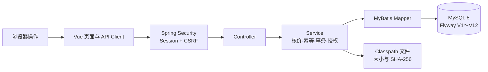

# Meteor 阶段审查与文档治理报告

日期：2026-10-04。

## 1. 审查范围

本次检查覆盖当前工作树中的后端、前端、Flyway 迁移、自动化测试、根 README、学习主路线和版本文档。

审查基准是本机 `HEAD 96cabf3` 加当前未提交修改。当前工作并非来自一个单独 Issue 或一组已提交 Commit，因此不能把它包装成正式 PR 的“需求逐条验收”；本报告以仓库现行 V0.4.0、ADR 和 AGENTS.md 作为实现边界。没有访问远程 Git 或公司 GitLab。

## 2. 阶段结论

当前项目已经形成一条能运行、能测试、能按代码解释的本地交易与文件交付链：



实现范围覆盖公开商品、数据库登录、服务端核价下单、本地测试支付、权益发放、内容库、Release、Manifest 和一次性下载。创作者发布、后台管理写接口、真实支付、退款和生产对象存储仍未打通，相关页面只能描述为演示或本地草稿。

## 3. 发现与风险

### P1：真实 MySQL 容器测试仍缺最终证据

- `PurchaseFlowMySqlIntegrationTest` 已编译并进入测试发现。
- 当前普通门禁报告 55 项测试、2 项跳过；这两项没有连接临时 MySQL。
- 严格门禁会正确失败并报告 `tests=2, skipped=2`。
- 在 Docker 恢复并得到 `skipped=0` 前，简历只能写“接入 Testcontainers 测试代码”，不能写“已使用 Testcontainers 验证事务回滚”。

### P1：工作树规模已经需要交付检查点

审查时 `git status` 有 126 个状态条目，其中 63 个已跟踪修改、63 个未跟踪条目。它们包含多轮业务实现、测试、文档和本次归档，不适合继续无限叠加。

下一阶段在 Docker 问题之外，应该做一次人工差异确认并形成清晰的本地 Commit；是否提交、怎样拆分 Commit 需要单独执行，当前没有自动提交或访问远程仓库。

### P2：托管 CI 尚未落地

`scripts/verify.ps1` 已提供可重复的本地入口，但没有 GitHub Actions、GitLab CI 或其他平台配置。当前可以说“一键本地质量门禁”，不能说“每次提交自动验证”。

### P2：下载仍是小文件实现

下载会用 `readAllBytes()` 把完整 Classpath 文件读入 JVM 内存，审计语义是 `FILE_RESPONSE_PREPARED`。生产化仍需要私有对象存储、流式响应或签名 URL、Range、限流、中断处理和失败审计。

### P2：部分前端路由仍是演示能力

创作者发布和后台管理页面存在交互与本地状态，但没有对应后端写接口。`CreatorPages.vue` 已直接提示文件尚未上传、订单接口尚未接入。文档必须继续使用“演示页面”或“本地草稿”，不能描述为发布系统已经完成。

### 已在本轮修复：学习文档状态滞后

综合手册、语法问答、权益手册、Release 手册和第四／第五课仍有“短时下载尚未实现”的旧句子。本轮已统一为：V12 完成 Classpath 小文件的一次性受控下载；生产对象存储和大文件能力未完成。

## 4. 代码、数据和文档对照

| 用户动作 | 前端入口 | 后端模块 | 主要数据 | 当前证据 |
| --- | --- | --- | --- | --- |
| 登录 | `api/auth.ts`、登录路由 | `auth` | `users`、`user_roles`、Session | Web 与账号加载测试 |
| 浏览商品 | `api/products.ts` | `product` | Product、Revision、Package、Taxonomy | Mapper／Service 测试和页面 |
| 创建订单 | `api/orders.ts` | `order` | `orders`、`order_items` | 7 项 Service 测试、真实 MySQL 阶段验收 |
| 本地测试支付 | `api/payments.ts` | `payment` | `payment_attempts`、`payment_events` | 9 项 Service 测试 |
| 查看权益 | `api/library.ts` | `entitlement` | `entitlement_grants` | 2 项 Service 测试、跨账号隐藏 |
| 展开版本和清单 | 内容库组件 | `delivery` | `package_releases`、Manifest、FileObject | 7 项 Service 测试 |
| 下载文件 | `DeliveryManifestPanel.vue` | `download` | Ticket、Audit、Classpath 文件 | 12 项下载相关自动化、浏览器一次性消费验收 |

这张表可以直接作为学习时的查找顺序：先找到页面动作，再沿前端 API、Controller、Service、Mapper 和表向下走。

## 5. 文档治理结果

### 主目录保留

- 当前设计：V0.4.0 需求、核心设计、版本取舍。
- 当前数据库说明：更名为 V1.0，对应已经实现的 Flyway V12。
- 唯一学习主路线：17 文档。
- 七节实战课：19～25。
- 专题查阅：11、12、14～16。
- 证据：08 学习日志、13 阶段报告、18 无障碍报告和本报告。
- 长期取舍：ADR-0001、ADR-0002。

### 移入归档

14 份被替代文件已移动到 `docs/archive/`：V0.1～V0.3.x 设计、早期决策、项目评估、旧知识地图、一月计划和早期视觉稿。归档索引逐项说明替代文档，旧文件没有删除。

### 图示优化

- 文档首页加入“从哪里开始”的导航图和当前业务闭环图。
- 零基础学习路线把长文本箭头改为可渲染的 Mermaid 流程图。
- 本报告加入浏览器到 MySQL／文件的分层图。

Mermaid 图由文本生成，修改业务路径时可以和文档一起评审；图中节点同时保留文字，不依赖颜色传达含义。

## 6. 本轮验证

完成文档移动和状态修订后需要重新执行：

```powershell
.\scripts\verify.ps1
```

交付条件：后端非容器测试通过、前端格式和生产构建通过、全部 Markdown 相对链接为 0 个损坏、`git diff --check` 通过。容器测试的限制继续单独报告。

本轮没有启动业务服务、连接本地业务 MySQL 或创建订单、支付、权益、票据数据，因此没有业务测试数据需要清理。

## 7. 下一阶段优先级

1. 修复或升级 Docker Desktop，运行 `scripts/verify.ps1 -RequireContainers`，取得 2 项 Testcontainers 执行、0 跳过证据。
2. 人工检查当前大工作树的差异边界，准备可解释的本地提交；不把后续新功能继续叠在未确认修改上。
3. 确认代码托管平台后接入 CI，直接复用同一组门禁语义。
4. 开始学习时只打开文档首页、17 主路线和当前一节课；专题手册按需查，不从 20 多份文件顺序通读。
