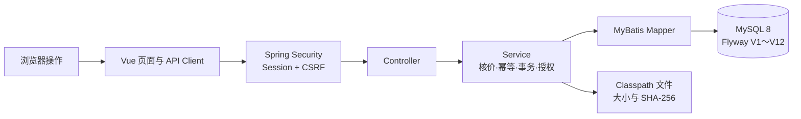

# Meteor 阶段审查与文档治理报告

日期：2026-10-04。

## 1. 审查范围

本次检查覆盖当前工作树中的后端、前端、Flyway 迁移、自动化测试、根 README、学习主路线和版本文档。

审查基准是本机 `HEAD 96cabf3` 加当前未提交修改。当前工作并非来自一个单独 Issue 或一组已提交 Commit，因此不能把它包装成正式 PR 的“需求逐条验收”；本报告以仓库现行 V0.4.0、ADR 和 AGENTS.md 作为实现边界。没有访问远程 Git 或公司 GitLab。

## 2. 阶段结论

当前项目已经形成一条能运行、能测试、能按代码解释的本地交易与文件交付链：



实现范围覆盖公开商品、数据库登录、服务端核价下单、本地测试支付、权益发放、内容库、Release、Manifest 和一次性下载。创作者发布、后台管理写接口、真实支付、退款和生产对象存储仍未打通，相关页面只能描述为演示或本地草稿。

## 3. 发现与风险

### P1：真实 MySQL 容器测试仍缺最终证据

- `PurchaseFlowMySqlIntegrationTest` 已编译并进入测试发现。
- 当前普通门禁报告 88 项测试、2 项跳过；86 项非容器测试通过，这两项没有连接临时 MySQL。
- 严格门禁会正确失败并报告 `tests=2, skipped=2`。
- 在 Docker 恢复并得到 `skipped=0` 前，简历只能写“接入 Testcontainers 测试代码”，不能写“已使用 Testcontainers 验证事务回滚”。

### 已在后续修复：工作树规模和交付检查点

审查时 `git status` 有 126 个状态条目，其中 63 个已跟踪修改、63 个未跟踪条目。它们包含多轮业务实现、测试、文档和本次归档，不适合继续无限叠加。

后续已经按功能拆分为本地 Commit，并在每个小阶段结束后恢复干净工作树。没有访问远程仓库；今后继续保持“一项可验证改动对应一个本地提交”。

### P2：托管 CI 尚未落地

`scripts/verify.ps1` 已提供可重复的本地入口，但没有 GitHub Actions、GitLab CI 或其他平台配置。当前可以说“一键本地质量门禁”，不能说“每次提交自动验证”。

### P2：下载仍是小文件实现

下载会用 `readAllBytes()` 把完整 Classpath 文件读入 JVM 内存，审计语义是 `FILE_RESPONSE_PREPARED`。生产化仍需要私有对象存储、流式响应或签名 URL、Range、限流、中断处理和失败审计。

### P2：部分前端路由仍是演示能力

创作者发布和后台管理页面存在交互与本地状态，但没有对应后端写接口。`CreatorPages.vue` 已直接提示文件尚未上传、订单接口尚未接入。文档必须继续使用“演示页面”或“本地草稿”，不能描述为发布系统已经完成。

### 已在本轮修复：学习文档状态滞后

综合手册、语法问答、权益手册、Release 手册和第四／第五课仍有“短时下载尚未实现”的旧句子。本轮已统一为：V12 完成 Classpath 小文件的一次性受控下载；生产对象存储和大文件能力未完成。

### 已在后续小步修复：订单 Mapper 重复 SQL

`OrderMapper` 的 4 组订单快照查询和 2 组详情查询已迁入 `OrderMapper.xml`，使用公共 `<sql>`／`<include>` 片段复用字段与 JOIN。Java 接口只保留方法契约。新增的 `OrderMapperXmlTest` 会解析 XML 并检查 9 个语句、普通／锁定查询差异和生成主键配置；它不替代真实 MySQL 测试。

### 已在后续小步修复：支付状态裸字符串

支付尝试状态、支付事件类型和事件处理状态已分别集中为 `PaymentAttemptStatus`、`PaymentEventType` 和 `PaymentEventProcessingStatus`。Mapper 参数、Projection、Service 判断和 API 响应使用同一组 enum；前端响应类型使用对应字符串联合类型。旧数据库值和接口 JSON 未改变，因此没有修改 Flyway。新增的第 10 项支付 Service 测试覆盖“Attempt 已成功但没有旧 Event 可重放”的异常分支。

### 已在后续小步补齐：支付 HTTP 契约

新增 7 项 Payment Controller Web 测试，分别证明测试支付开关关闭时接口为 404，以及开启后的匿名 401、缺 CSRF 403、非法 DTO 400、成功响应、业务冲突 409 和当前用户资源隐藏 404。测试会核对当前 Principal userId、输入规范化和枚举 JSON；它们不连接 MySQL，因此不替代 Testcontainers。

## 4. 代码、数据和文档对照

| 用户动作 | 前端入口 | 后端模块 | 主要数据 | 当前证据 |
| --- | --- | --- | --- | --- |
| 登录 | `api/auth.ts`、登录路由 | `auth` | `users`、`user_roles`、Session | Web 与账号加载测试 |
| 浏览商品 | `api/products.ts` | `product` | Product、Revision、Package、Taxonomy | 7 项 Service 测试、6 项公开 HTTP 契约测试和页面 |
| 创建订单 | `api/orders.ts` | `order` | `orders`、`order_items` | 7 项 Service 测试、9 项 HTTP 契约测试、真实 MySQL 阶段验收 |
| 本地测试支付 | `api/payments.ts` | `payment` | `payment_attempts`、`payment_events` | 10 项 Service 测试、7 项 Web 契约测试 |
| 查看权益 | `api/library.ts` | `entitlement` | `entitlement_grants` | 2 项 Service 测试、内容库 HTTP 当前用户契约 |
| 展开版本和清单 | 内容库组件 | `delivery` | `package_releases`、Manifest、FileObject | 7 项 Service 测试、Release／Manifest HTTP 资源隐藏契约 |
| 下载文件 | `DeliveryManifestPanel.vue` | `download` | Ticket、Audit、Classpath 文件 | 12 项下载相关自动化、浏览器一次性消费验收 |

这张表可以直接作为学习时的查找顺序：先找到页面动作，再沿前端 API、Controller、Service、Mapper 和表向下走。

## 5. 文档治理结果

### 主目录保留

- 当前设计：V0.4.0 需求、核心设计、版本取舍。
- 当前数据库说明：更名为 V1.0，对应已经实现的 Flyway V12。
- 唯一学习主路线：17 文档。
- 七节实战课：19～25。
- 按需查阅：12 语法手册、27 简历证据清单和领域词汇表。
- 证据：08 学习日志、18 无障碍报告和本报告。
- 长期取舍：ADR-0001、ADR-0002。

### 移入归档

19 份被替代文件已移动到 `docs/archive/`：V0.1～V0.3.x 设计、早期决策、项目评估、旧知识地图、一月计划、早期视觉稿，以及被当前分课教程替代的 5 份学习／审查材料。归档索引逐项说明替代文档，旧文件没有删除。

17 主学习路线已删去逐课重复讲解，只保留 90 分钟启动、七天顺序、14 天安排、查阅入口、调试顺序和过关标准。具体业务内容只在 19～25 课程维护，语法和简历证据分别只在 12、27 维护。

### 图示优化

- 文档首页加入“从哪里开始”的导航图和当前业务闭环图。
- 零基础学习路线把长文本箭头改为可渲染的 Mermaid 流程图。
- 本报告加入浏览器到 MySQL／文件的分层图。

Mermaid 图由文本生成，修改业务路径时可以和文档一起评审；图中节点同时保留文字，不依赖颜色传达含义。

## 6. 本轮验证

完成文档移动、Mapper 重构和状态修订后已重新执行：

```powershell
.\scripts\verify.ps1
```

最新结果为后端 88 项被发现、86 项非容器测试通过、2 项 Testcontainers 跳过；前端格式和生产构建通过；51 份 Markdown 相对链接为 0 个损坏；Git 空白检查通过。401／403 与业务异常共用 `{code, message, timestamp}`，残缺 JSON 和错误路径类型也返回稳定的 `INVALID_ARGUMENT`。容器测试的限制继续单独报告。

本轮没有启动业务服务、连接本地业务 MySQL 或创建订单、支付、权益、票据数据，因此没有业务测试数据需要清理。

## 7. 下一阶段优先级

1. 修复或升级 Docker Desktop，运行 `scripts/verify.ps1 -RequireContainers`，取得 2 项 Testcontainers 执行、0 跳过证据。
2. 到校后只打开文档首页和 17 主路线第 0 节，按 14 天安排完成操作、定位、口述和独立小修改。
3. 使用 27 简历证据清单逐条验收，未达到掌握门槛的能力不写进正式简历。
4. 确认实际代码托管平台后接入 CI，直接复用现有本地门禁语义。
