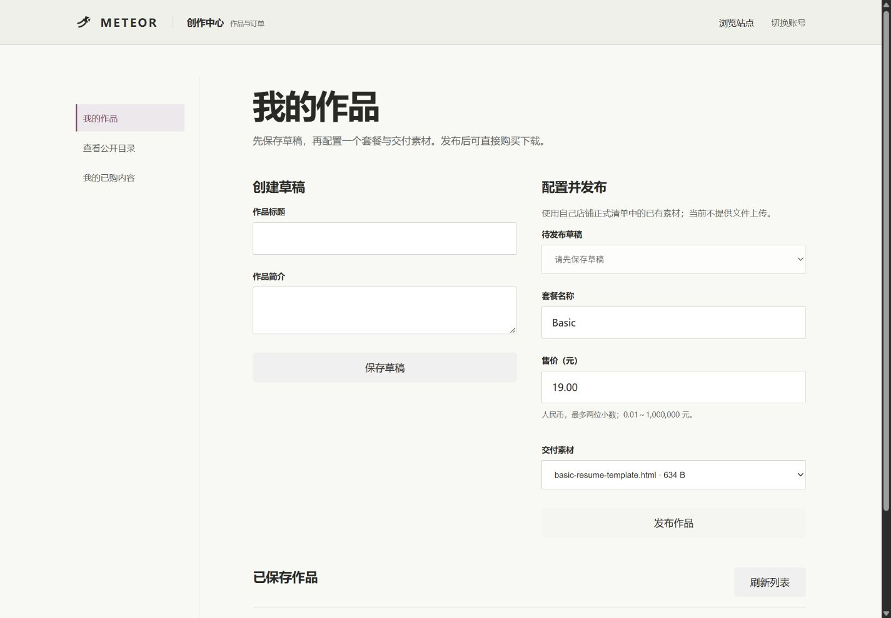
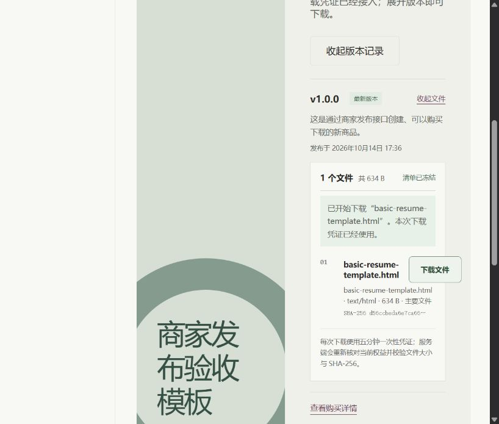

# MVP 演示与关键注释阅读

## 2026-10-15：素材商品验收

可以从“冬日静谧”图集进入 productId=9102 的真实商品并演示购买下载；四个图片 ZIP 商品共享既有服务端权限链。旧截图中的 productId=1002 属于上一轮临时验收，不能当成当前数据库的固定记录。详见[素材接入说明](31-已有展示素材接入真实商品.md)。

更新时间：2026-10-14。主目录为 `E:\VibeCoding\Meteor`。这里把演示动作连接到业务注释；详细发布链见 [发布专题](28-创作者商品草稿与发布任务-V1.0.md)，当前验收证据见 [执行日志](08-学习执行日志.md)。

## 1. 五到十分钟的演示顺序

1. 商家登录 `creator@meteor.local`，打开 `/creator/works`。
2. 填标题和简介保存草稿；刷新确认仍是草稿，公开目录此时不应出现它。
3. 配置一个套餐与价格，选择一份可复用素材，点击发布；刷新确认已发布。
4. 切换买家 `buyer@meteor.local`，打开新商品的详情，选择它的新套餐。
5. 创建订单，展示真实订单 ID 与等待支付状态；完成本地测试支付。
6. 进入内容库，展开新商品版本与冻结清单，下载真实文件。
7. 解释重复发布、越权或重复消费票据中的一个失败路径；用测试证明它不是只靠按钮禁用。

本地演示账号密码均为 password，需要显式启用演示账号与测试支付。它们是本地测试入口，不能宣传成真实收款。功能验收要记录新 productId／packageId／orderId，不能使用旧种子商品代替“商家新商品已打通”。

## 2. 重点注释读哪些

每行用 10～15 分钟，先读注释指出的业务约束，再读紧接着的代码与 SQL。注释讲的是为什么采取这个顺序，不要求逐行背语法。

| 顺序 | 文件与定位点 | 需要解释 |
| --- | --- | --- |
| 1 | [ProductQueryService](../backend/src/main/java/dev/meteor/product/service/ProductQueryService.java)，LIKE 转义 | 参数绑定防止 SQL 结构被改变；转义让 %／_ 按字面搜索，是不同职责 |
| 2 | [AuthController](../backend/src/main/java/dev/meteor/auth/controller/AuthController.java)，Session 策略和 saveContext | 登录更换会话标识；线程上下文与跨请求持久化不同 |
| 3 | [ProductDraftService](../backend/src/main/java/dev/meteor/product/service/ProductDraftService.java)，店铺锁与双表写入 | 当前用户、店铺归属、生成主键、草稿不会变可售 |
| 4 | [ProductPublicationService](../backend/src/main/java/dev/meteor/product/service/ProductPublicationService.java)，publish | 单次发布事务、同配置重放、素材资格与完整性、最后上架 |
| 5 | [OrderService](../backend/src/main/java/dev/meteor/order/service/OrderService.java)，查幂等键、唯一键异常 | 返回原成交快照；并发失败后用当前读读取胜出订单 |
| 6 | [PaymentService](../backend/src/main/java/dev/meteor/payment/service/PaymentService.java)，行锁、重放、Grant | 金额复核；成功事件、订单和权益共同回滚 |
| 7 | [EntitlementMapper](../backend/src/main/java/dev/meteor/entitlement/mapper/EntitlementMapper.java)，重复键原样保留 id | 重放不重复发放，也不能恢复已经撤销的访问 |
| 8 | [ReleaseService](../backend/src/main/java/dev/meteor/delivery/service/ReleaseService.java) 与 [DeliveryManifestService](../backend/src/main/java/dev/meteor/delivery/service/DeliveryManifestService.java) | packageId 来自已验证 Grant，不能由浏览器随意指定 |
| 9 | [DownloadService](../backend/src/main/java/dev/meteor/download/service/DownloadService.java)，取得锁后读 Clock | 等锁可能跨过到期时刻；再次授权、校验文件后才消费，审计失败也回滚 |

如果仍在第二课，先读第 1 行，接着完成本课异常与测试。剩余按主学习路线逐步进入，不把这张表变成一天内必须读完的新课程。

## 3. 下载边界修正的证据

本轮发现 `consume` 先取当前时间再等数据库锁。新测试先在旧代码失败，表明等待期间到期的票据仍被接受；修复为锁查询返回后再采样时钟。

[回归测试](../backend/src/test/java/dev/meteor/download/service/DownloadServiceTest.java) 的 `rejectsTicketThatExpiresWhileWaitingForRowLock` 使用随锁查询时序变化的 Clock，模拟恰好到期，并断言不读文件、不消费、不写审计。它避免 sleep，测试结果可重复；真实数据库竞争与回滚由集成测试覆盖，不能把这个模拟 Clock 测试说成真实锁等待实验。

## 4. 投递材料使用方法

从 [简历证据清单](27-简历与面试证据清单-V1.0.md) 选择已能解释的能力，不要求每个功能都写一条。新增发布闭环可以合入项目介绍，让商家供给到买家交付的业务起点完整。

用户的源码定位、口述与独立小修改仍需由实际学习证明；助手把代码写完并验收，不代表学习者已经掌握。
## 5. 本轮演示截图

商家真实作品列表、草稿与发布表单：

新商品的独立权益、冻结清单与下载反馈：

