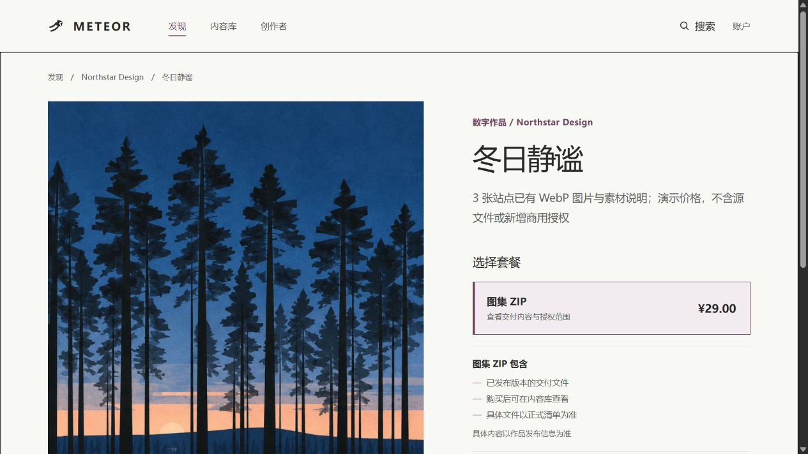
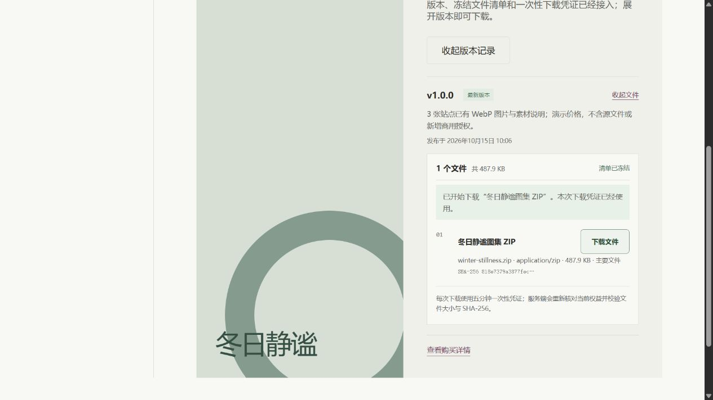

# 已有展示素材接入真实商品

更新时间：2026-10-15。主目录 `E:\VibeCoding\Meteor`，新增 V13 数据迁移；没有新增表或修改 V1～V12。

## 1. 10 分钟：看清本次交付

首页图片、发现页分类和 `/collections/:slug` 图集原来只有前端展示配置。本次保留图集，并让“查看套餐与购买”链接进入对应 `/products/:id`。商品信息和价格从 API 读取，购买继续走已有 Session、订单、测试支付、权益和一次性下载接口。

| 图集 | 商品／套餐／版本／文件／清单／条目 ID | 分类 | 演示价格 | ZIP 内图片 |
| --- | --- | --- | --- | --- |
| 光与空间 | 各表 9101 | photography | ¥19 | 3 张项目生成的场景图 |
| 冬日静谧 | 各表 9102 | illustration | ¥29 | 3 张已有冬日插画 |
| 静谧建筑 | 各表 9103 | illustration | ¥19 | 1 张已有建筑插画 |
| 风景叙事 | 各表 9104 | illustration | ¥29 | 2 张已有风景插画 |

每个 ZIP 另有 `README.txt`，说明素材来源、演示价格、公开预览与交付范围。没有新增 PSD、原始高清图、商用许可或真人摄影师署名。所有图片沿用站点现有 WebP 字节；公开预览仍可直接访问，授权控制的是 ZIP 下载。

36 个没有实际文件的设计／字体／音频／3D 等占位卡片已从发现页正式列表移除；首页其他分类的设计预览仍存在，本轮不声称全站所有设计页面都已经接通。

## 2. 10 分钟：沿代码查一遍

1. [showcase.ts](../frontend/src/data/showcase.ts) 的 `ArtworkCollection.productId` 只关联这四个预置演示商品；价格、状态和套餐仍从后端读取。一般商家新商品没有自动生成图片映射，本轮没有做封面上传。
2. [V13 迁移](../backend/src/main/resources/db/migration/V13__import_showcase_delivery_products.sql) 在原有 Product、Revision、Taxonomy、Package、Release、FileObject、Manifest 与 ManifestItem 表写入四组数据，最后打开可售状态。商品统一归演示店铺 101，不据此声明原作者身份。
3. `INSERT ... SELECT` 用已存在的分类 slug 找 taxonomy_terms.id；主键范围 9101～9104 专用于本次预置配置。不使用 `IGNORE` 或 upsert；如果主键已被真实数据占用，迁移会报错，应先检查冲突，不能覆盖用户记录。
4. [BuyerPages.vue](../frontend/src/pages/BuyerPages.vue) 让所有数据库分类结果进入正式列表，按显式图集关系过滤主题，展示对应预览；旧版只显示 all/templates 的 API 结果已修正。
5. 买家下单仍进入 OrderService → OrderMapper → orders/order_items。下载仍进入 DownloadService，校验当前用户、Grant、Release、ManifestItem、票据期限和文件摘要；没有新增绕过权限的静态 ZIP 下载路由。
6. 商家的素材列表通过自己店铺正式清单找到这四个 ZIP，因此可将它们用于既有单文件首次发布流程。空店铺或别的用户仍不能引用这些文件。

## 3. 验证与停下的位置

在仓库根目录执行 `python scripts/check-showcase-delivery.py`：逐张比较 ZIP 条目和前端预览字节，并核对 catalog.json 与 V13 的 ZIP 长度、SHA-256。不自动重新生成已经冻结的交付包或迁移；未来改文件须新增版本和迁移。

真实 MySQL 集成测试 `purchasesAllImportedShowcasePacksAndVerifiesTheirRealImages` 对四个商品分别查询分类、核价下单、测试支付、拒绝其他用户下载、消费票据、读取 ZIP、验证摘要和 WebP 条目，最后拒绝重复消费。2026-10-15 严格门禁已通过 125 项、0 跳过，其中 5 项容器测试；实际运行结果见[执行日志](08-学习执行日志.md)。

前端格式、类型和生产构建均通过；浏览器已用 Enter 从图集进入商品、结账、登录、测试支付、内容库和下载清单，确认 SPA 主内容焦点、弹窗 Escape 与焦点恢复。320px／390px 的图集、商品与分类抽查没有横向溢出。图集、商品、插画与摄影目录的 axe A/AA 扫描均为 0 条违规；不代表已覆盖其他设备、浏览器或全站所有页面。本轮验证数据只放在临时数据库；主目录现有数据库未被脚本直接修改。正常启动最新版后端时，Flyway 会向配置的数据库应用 V13，重启前先确认连接的是自己的开发库。

面试可以说“已有素材通过正式商品、分类、版本和冻结交付清单接入同一交易链路，下载验证实际 ZIP 摘要与一次性票据”。不能说已实现任意素材上传、商用版权审核或全站运营平台。

你现在仍按第二课学习。读完订单、支付、下载后，再用本节定位一份 ZIP 的整条链路；无需先学 Python 或图库样式。

## 4. 2026-10-15 验收证据

浏览器购买冬日静谧产生临时订单 1、Grant 1；图集 ZIP 清单显示 487.9 KB。页面触发下载只证明客户端发起了下载，不把状态文字当作文件保存证据。另一次 HTTP 下载收到了 499,632 字节，SHA-256 与迁移元数据一致；同一 token 重复请求 404。四个包的实际资源字节由真实 MySQL 测试逐一核对。

截图来自已清理的独立验收库；本机现有业务数据库未直接修改。保留忽略目录中的 HTTP 回执和 Surefire 报告。
