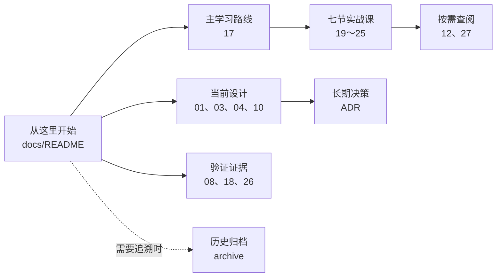

# Meteor 文档导航

## 2026-10-15：素材商品验收

四个真实素材商品已接入既有购买下载链；严格门禁 125 项全部通过、含 5 项真实 MySQL、0 跳过。素材专题在完成买家七课后选读；第二课的异常处理和分层示例不需要改学习顺序。详见[素材接入说明](31-已有展示素材接入真实商品.md)。

最近文档更新：2026-10-15；代码增量验证：2026-10-15；上一轮全量审查：2026-10-04。

这里是项目文档的唯一入口。主目录只保留当前设计、学习主线和有效证据；被替代的旧版本已经移动到 [archive](archive/README.md)，日常学习不需要打开。

## 从第二课继续：后端优先

1. 按 [后端学习主路线](17-零基础项目学习路线-V1.0.md) 继续第二课第 8～9 节，不重做初始化。
2. 下单前补第一课的认证后端；第一到第六课的前端长段落已经压缩成请求约定。
3. 当前先收尾 [简历投递版 MVP](29-简历投递版MVP范围与验收.md)：验收、演示、简历与口述。已补最小商家发布；上传、审核与运营不在本轮范围。
4. 源码与课程以主目录 `E:\VibeCoding\Meteor` 为准；其他工作树的支付 Inbox／恢复成果没有并入这里。

## 当前实现到了哪里

2026-10-14 已接通最小商家发布与页面：保存草稿、配置一个套餐、选择自己店铺正式清单中的已有素材，事务内生成正式版本和冻结清单，再使新商品可售。买家可按新商品实际购买下载。

发布源码与失败路径见 [发布专题](28-创作者商品草稿与发布任务-V1.0.md)，演示与关键代码注释见 [阅读指南](30-MVP演示与关键注释阅读.md)。范围以 [MVP 清单](29-简历投递版MVP范围与验收.md) 为准。

当前严格门禁：后端 125 项全部通过、0 跳过，含 5 项 MySQL 8.0.36 容器测试；前端格式、类型与生产构建通过，56 份 Markdown 链接无损坏。页面与 HTTP 证据见 [执行日志](08-学习执行日志.md)。数据库为 V13，本次只增数据迁移，没有改写旧迁移。

| 范围 | 当前结论 | 已有证据 |
| --- | --- | --- |
| 商品目录 | 已完成只读列表、搜索与详情 | 7 项 Service 测试、6 项公开 HTTP 契约测试、真实前端页面 |
| 商家草稿与首次发布 | 已接通真实页面与接口；单套餐、已有素材、冻结清单、商品可售 | 13 项草稿与 13 项发布非容器检查；真实 MySQL 草稿回滚、双线程发布、发布回滚、新商品购买下载 |
| 身份认证 | 已完成数据库账号、BCrypt、Session、CSRF | Web 测试、本机登录；注册／找回密码未做 |
| 订单 | 已完成服务端核价、快照、用户级幂等与并发冲突恢复 | Service 单元测试、HTTP 契约测试、Testcontainers 同键双线程实跑 |
| 支付 | 已完成默认关闭的本地测试适配器 | 10 项 Service 测试、7 项 Web 契约测试；不是真实支付 |
| 权益 | 已完成事务内幂等 Grant、历史回填、内容库与订单查询 | 重放不重复授权、跨账号隐藏资源 |
| 版本交付 | 已完成 Release、冻结 Manifest 和 Classpath 文件元数据 | 9 项 Service 测试、9 项 HTTP 授权契约、Flyway V9～V10 |
| 下载 | 已完成本地 Classpath 文件最小闭环 | 五分钟一次性票据、取得锁后判断到期、二次授权、流式校验与 Resource 响应、重复消费 404、V12 |
| 无障碍 | 核心路由完成一轮自动扫描和关键人工检查 | 11 路由 axe 0 违规、键盘、320px、减少动画 |
| 数据库集成测试 | 本轮 4 项 MySQL 8.0.36 完整门禁实跑通过 | V1～V12、草稿写入、订单与发布双线程竞争、购买下载以及草稿、发布、权益、下载审计写入失败回滚 |
| 可重复验证 | 本地一键门禁已完成，托管 CI 未做 | Maven Wrapper、前端格式／构建、链接和空白检查 |
| 请求追踪 | 已完成单服务请求编号、错误关联和完成日志 | `X-Request-Id`、MDC、错误 JSON；未接集中日志或分布式追踪 |

上一轮（2026-10-05）自动化结果是：后端 95 项全部通过、0 跳过，其中 2 项 Testcontainers 已连接临时 MySQL 8.0.36；同键双线程订单场景连续运行 3 轮均通过。前端 Prettier、TypeScript 和生产构建通过。401／403、业务异常、残缺 JSON 和错误路径参数均使用稳定的错误 JSON 契约，并与响应头、完成日志共享 `requestId`。`scripts/verify.ps1 -RequireContainers` 已在本机通过，并继续把容器测试跳过判为失败。本轮增量不沿用该历史结论，见执行日志。

## 后端学习主线

编号保留，学习顺序以 [主路线](17-零基础项目学习路线-V1.0.md) 为准；前端部分选读。

| 顺序 | 后端核心问题 | 教程 |
| ---: | --- | --- |
| 1 | Controller／Service／Mapper、SQL 与错误响应 | [第二课：商品查询](20-第二课-商品查询与后端分层-V1.0.md) |
| 2 | Session、CSRF、BCrypt 与当前用户 | [第一课：认证后端](19-第一课-从登录页面看懂一次全栈请求-V1.0.md) |
| 3 | 核价、快照、幂等与并发冲突 | [第三课：订单](21-第三课-订单创建与幂等-V1.0.md) |
| 4 | 行锁、事件去重、事务内权益发放 | [第四课：支付](22-第四课-测试支付与事务内权益发放-V1.0.md) |
| 5 | Grant、Release、Manifest 逐层授权 | [第五课：内容库](23-第五课-内容库与逐层资源授权-V1.0.md) |
| 6 | 票据、二次授权、文件校验与审计 | [第六课：下载](24-第六课-一次性下载票据与受控文件响应-V1.0.md) |
| 7 | 真实 MySQL、并发与事务回滚证据 | [第七课：集成测试](25-第七课-Testcontainers真实MySQL集成测试-V1.0.md) |

## 当前设计基线

这些文件定义当前业务规则；代码与文档冲突时，应先确认代码是否遗漏，再通过新版本或 ADR 修改规则。

- [项目需求与总体设计 V0.4.0](01-项目需求与总体设计-V0.4.0.md)：产品范围、角色、页面和接口边界。
- [核心业务设计 V0.4.0](03-核心业务设计-V0.4.0.md)：订单、支付、权益、版本和下载不变量。
- [评价取舍与版本记录 V0.4.0](04-评价取舍与版本记录-V0.4.0.md)：V0.4.0 为什么这样取舍。
- [数据库设计 V1.0](10-数据库设计-V1.0.md)：当前 Flyway V12 的表关系、约束和后续迁移边界。
- [ADR-0001](adr/0001-content-library-shows-active-access-only.md)：内容库只展示当前有效访问。
- [ADR-0002](adr/0002-one-time-download-tickets.md)：五分钟一次性下载票据。

## 按需查阅

第一次不要从查阅文档开始。学习七节主线时遇到具体问题，只打开对应入口。

- [项目代码语法与面试问答](12-项目代码语法与面试问答-V1.0.md)：用本项目代码解释 Java、Spring、SQL、Vue 和 TypeScript。
- [领域词汇表](../GLOSSARY.md)：统一 Product、Package、Grant、Release 等术语。
- [简历与面试证据清单](27-简历与面试证据清单-V1.0.md)：把四条候选简历表述逐项连接到真实代码、测试、掌握门槛和禁止夸大的边界；完成主线后使用。

早期综合手册和权益／Release／Manifest 专题已被第 1、3、4、5 课覆盖，现移入[历史归档](archive/README.md)，避免同一条链维护两套解释。

## 日志与审查证据

- [学习执行日志](08-学习执行日志.md)：每一阶段做了什么、怎样验证、是否清理数据。
- [无障碍审查与修复报告（2026-10-03）](18-无障碍审查与修复报告-2026-10-03.md)：键盘、焦点、对比度、窄屏和 axe 证据。
- [阶段审查与文档治理报告（2026-10-04）](26-阶段审查与文档治理报告-2026-10-04.md)：当前质量门禁、实现边界、版本整理和下一阶段优先级。

2026-10-02 的阶段报告属于历史快照，已归档；当前状态以本页、学习日志和 2026-10-04 报告为准。

## 版本和归档规则

| 类型 | 当前版本 | 什么时候新建版本 | 旧版本放哪里 |
| --- | --- | --- | --- |
| 产品／核心设计 | V0.4.0 | 产品范围、状态或核心不变量发生实质变化 | `archive/` |
| 数据库说明 | V1.0，对应 Flyway V12 | 新增迁移后同步更新当前文档；重大结构重写再升文档版本 | Git 历史或 `archive/` |
| 学习教程 | V1.0 | 代码路径或教学结构大幅变化 | `archive/` |
| ADR | 递增编号 | 产生需要长期保留的技术取舍 | 不覆盖旧 ADR；新增编号 |
| 审查报告 | 日期 | 完成一次阶段验收 | 保留原日期，不当作当前设计 |

归档文件用于追溯决策，不能作为当前实现依据。详细映射见 [历史归档索引](archive/README.md)。

## 当前技术债

1. 已有本地质量门禁，仍缺根据实际代码托管平台运行的 CI。
2. 支付数据库当前只允许一次尝试和一种成功事件；接入真实支付、退款或换渠道前需要扩展事件 Inbox、重试、对账和状态转移规则。
3. 下载已使用 `DigestInputStream` 做固定内存校验，并以 Spring `Resource` 写响应；当前校验和响应会读取 Classpath 文件两遍，生产对象存储仍需不可变版本或 ETag、短时签名 URL、Range、限流和传输失败审计。
4. 无障碍仍缺 NVDA／VoiceOver、Safari／Firefox、真机、200%／400% 缩放和强制颜色模式审计。
5. 当前请求编号只覆盖单个后端进程；仍缺集中日志、指标、告警和跨服务 trace context，不能描述为生产可观测性平台。

`OrderMapper` 的重复订单快照 SQL 已迁入 XML 公共片段，并由 `OrderMapperXmlTest` 检查 9 个映射语句、行锁差异和生成主键配置。

支付尝试状态、事件类型和事件处理状态已分别集中为 Java enum，MyBatis 按枚举名称读写原有数据库值，API 与前端联合类型沿用相同词汇。

业务承诺以 V0.4.0 和已接受 ADR 为准；实现证据以本页矩阵、学习执行日志和最新阶段审查报告为准。
