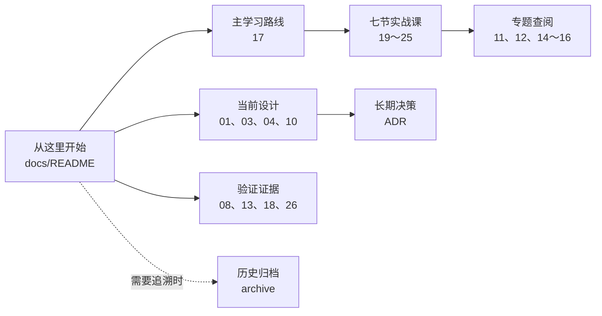

# Meteor 文档导航

最后审查：2026-10-04。

这里是项目文档的唯一入口。主目录只保留当前设计、学习主线和有效证据；被替代的旧版本已经移动到 [archive](archive/README.md)，日常学习不需要打开。

## 9 号到校后从这里开始

1. 只打开 [零基础项目学习路线](17-零基础项目学习路线-V1.0.md) 第 0 节，完成到校当天的 90 分钟启动流程。
2. 第二次学习再从该文档第 1～5 节进入七天主线，不要顺序打开全部专题手册。
3. 每学完一节，用 [学习执行日志](08-学习执行日志.md) 核对哪些结果真的验证过、哪些仍是计划。

## 当前实现到了哪里

```mermaid
flowchart LR
    UI[Vue 页面] --> AUTH[Session 登录]
    AUTH --> ORDER[服务端核价下单]
    ORDER --> PAY[本地测试支付]
    PAY --> GRANT[事务内发放权益]
    GRANT --> LIB[内容库]
    LIB --> RELEASE[Package Release]
    RELEASE --> MANIFEST[冻结交付清单]
    MANIFEST --> TICKET[一次性下载票据]
    TICKET --> FILE[完整性校验与文件响应]
    FILE --> AUDIT[响应准备审计]
```

| 范围 | 当前结论 | 已有证据 |
| --- | --- | --- |
| 商品目录 | 已完成只读列表、搜索与详情 | 7 项 Service 测试、6 项公开 HTTP 契约测试、真实前端页面 |
| 身份认证 | 已完成数据库账号、BCrypt、Session、CSRF | Web 测试、本机登录；注册／找回密码未做 |
| 订单 | 已完成服务端核价、快照、用户级幂等与并发冲突恢复 | Service 单元测试、HTTP 契约测试、真实 MySQL 阶段验收 |
| 支付 | 已完成默认关闭的本地测试适配器 | 10 项 Service 测试、7 项 Web 契约测试；不是真实支付 |
| 权益 | 已完成事务内幂等 Grant、历史回填、内容库与订单查询 | 重放不重复授权、跨账号隐藏资源 |
| 版本交付 | 已完成 Release、冻结 Manifest 和 Classpath 文件元数据 | 9 项 Service 测试、9 项 HTTP 授权契约、Flyway V9～V10 |
| 下载 | 已完成本地小文件最小闭环 | 五分钟一次性票据、二次授权、重复消费 404、V12 |
| 无障碍 | 核心路由完成一轮自动扫描和关键人工检查 | 11 路由 axe 0 违规、键盘、320px、减少动画 |
| 数据库集成测试 | 代码已接入，真实容器运行待完成 | 2 项被 Maven 发现；Docker 不可用时跳过 |
| 可重复验证 | 本地一键门禁已完成，托管 CI 未做 | Maven Wrapper、前端格式／构建、链接和空白检查 |

当前自动化结果是：后端 88 项被发现，86 项非容器测试执行通过，2 项 Testcontainers 因 Docker 不可用而跳过；前端 Prettier、TypeScript 和生产构建通过。401／403、业务异常、残缺 JSON 和错误路径参数均使用稳定的错误 JSON 契约。`scripts/verify.ps1 -RequireContainers` 会把容器测试跳过判为失败，因此当前不能在简历中写“Testcontainers 已跑通”。

## 七节学习主线

| 顺序 | 页面动作和核心问题 | 教程 |
| ---: | --- | --- |
| 1 | 登录：浏览器如何拿到 Session，CSRF 为什么存在 | [从登录页面看懂一次全栈请求](19-第一课-从登录页面看懂一次全栈请求-V1.0.md) |
| 2 | 商品查询：请求怎样经过 Controller、Service、Mapper、SQL | [商品查询与后端分层](20-第二课-商品查询与后端分层-V1.0.md) |
| 3 | 创建订单：服务端核价、成交快照和幂等怎样配合 | [订单创建与幂等](21-第三课-订单创建与幂等-V1.0.md) |
| 4 | 测试支付：事务、行锁、事件去重和权益发放 | [测试支付与事务内权益发放](22-第四课-测试支付与事务内权益发放-V1.0.md) |
| 5 | 内容库：Grant、Release、Manifest 怎样逐层授权 | [内容库与逐层资源授权](23-第五课-内容库与逐层资源授权-V1.0.md) |
| 6 | 下载：短时 token、消费时复核、完整性和审计 | [一次性下载票据与受控文件响应](24-第六课-一次性下载票据与受控文件响应-V1.0.md) |
| 7 | 集成测试：真实 MySQL、Flyway、幂等和事务回滚 | [Testcontainers 真实 MySQL 集成测试](25-第七课-Testcontainers真实MySQL集成测试-V1.0.md) |

## 当前设计基线

这些文件定义当前业务规则；代码与文档冲突时，应先确认代码是否遗漏，再通过新版本或 ADR 修改规则。

- [项目需求与总体设计 V0.4.0](01-项目需求与总体设计-V0.4.0.md)：产品范围、角色、页面和接口边界。
- [核心业务设计 V0.4.0](03-核心业务设计-V0.4.0.md)：订单、支付、权益、版本和下载不变量。
- [评价取舍与版本记录 V0.4.0](04-评价取舍与版本记录-V0.4.0.md)：V0.4.0 为什么这样取舍。
- [数据库设计 V1.0](10-数据库设计-V1.0.md)：当前 Flyway V12 的表关系、约束和后续迁移边界。
- [ADR-0001](adr/0001-content-library-shows-active-access-only.md)：内容库只展示当前有效访问。
- [ADR-0002](adr/0002-one-time-download-tickets.md)：五分钟一次性下载票据。

## 专题查阅

第一次不要从这些长文开始。学习七节主线时遇到术语或语法，再按需打开。

- [零基础学习与面试实战手册](11-零基础学习与面试实战手册-V1.0.md)：登录、下单和测试支付的早期综合讲解。
- [项目代码语法与面试问答](12-项目代码语法与面试问答-V1.0.md)：用本项目代码解释 Java、Spring、SQL、Vue 和 TypeScript。
- [购买权益闭环](14-购买权益闭环与面试学习手册-V1.0.md)：支付后发放 Grant 的完整专题。
- [Package Release](15-发布版本Release学习手册-V1.0.md)：套餐版本与历史权益。
- [交付清单与文件对象](16-交付清单与文件对象学习手册-V1.0.md)：Manifest、ManifestItem 和 FileObject。
- [领域词汇表](../GLOSSARY.md)：统一 Product、Package、Grant、Release 等术语。
- [简历与面试证据清单](27-简历与面试证据清单-V1.0.md)：把四条候选简历表述逐项连接到真实代码、测试、掌握门槛和禁止夸大的边界；完成主线后使用。

## 日志与审查证据

- [学习执行日志](08-学习执行日志.md)：每一阶段做了什么、怎样验证、是否清理数据。
- [阶段审查报告（2026-10-02）](13-阶段审查报告-2026-10-02.md)：早期代码、数据库和浏览器验收。
- [无障碍审查与修复报告（2026-10-03）](18-无障碍审查与修复报告-2026-10-03.md)：键盘、焦点、对比度、窄屏和 axe 证据。
- [阶段审查与文档治理报告（2026-10-04）](26-阶段审查与文档治理报告-2026-10-04.md)：当前质量门禁、实现边界、版本整理和下一阶段优先级。

## 版本和归档规则

| 类型 | 当前版本 | 什么时候新建版本 | 旧版本放哪里 |
| --- | --- | --- | --- |
| 产品／核心设计 | V0.4.0 | 产品范围、状态或核心不变量发生实质变化 | `archive/` |
| 数据库说明 | V1.0，对应 Flyway V12 | 新增迁移后同步更新当前文档；重大结构重写再升文档版本 | Git 历史或 `archive/` |
| 学习教程 | V1.0 | 代码路径或教学结构大幅变化 | `archive/` |
| ADR | 递增编号 | 产生需要长期保留的技术取舍 | 不覆盖旧 ADR；新增编号 |
| 审查报告 | 日期 | 完成一次阶段验收 | 保留原日期，不当作当前设计 |

归档文件用于追溯决策，不能作为当前实现依据。详细映射见 [历史归档索引](archive/README.md)。

## 当前技术债

1. Docker Desktop 仍不可用，2 项 Testcontainers 测试没有取得 `Skipped: 0` 证据。
2. 已有本地质量门禁，仍缺根据实际代码托管平台运行的 CI。
3. 支付数据库当前只允许一次尝试和一种成功事件；接入真实支付、退款或换渠道前需要扩展事件 Inbox、重试、对账和状态转移规则。
4. 下载使用 `readAllBytes()` 读取 Classpath 小文件；生产对象存储还需要流式传输或短时签名 URL、Range、限流和失败审计。
5. 无障碍仍缺 NVDA／VoiceOver、Safari／Firefox、真机、200%／400% 缩放和强制颜色模式审计。

`OrderMapper` 的重复订单快照 SQL 已迁入 XML 公共片段，并由 `OrderMapperXmlTest` 检查 9 个映射语句、行锁差异和生成主键配置。

支付尝试状态、事件类型和事件处理状态已分别集中为 Java enum，MyBatis 按枚举名称读写原有数据库值，API 与前端联合类型沿用相同词汇。

业务承诺以 V0.4.0 和已接受 ADR 为准；实现证据以本页矩阵、学习执行日志和最新阶段审查报告为准。
